# Emberfall — Architecture du module C++

> **Statut :** v1.3 (27/10/2026), mise à jour après le codage de la **mort / réapparition / réanimation**, de la **survie**, des **boss 1 et 2** et de la **sauvegarde v2**, à partir d'une relecture des en-têtes (et des `.cpp` pour les séquences) du module `Emberfall` (`Source/Emberfall/Public` et `Private` : 55 en-têtes, 47 `.cpp`, environ 26 700 lignes) et du référentiel v1.3 (§ 8 à 11). **Le code n'a jamais été compilé** : ce document décrit ce qui est écrit, pas un comportement mesuré.
> **Changements v1.2 → v1.3 :** mort et réapparition (`IEMBInteractable`, `AEMBDeathBag`, `UEMBRespawnSubsystem`, `AEMBGameMode::RespawnPlayer`, attente de réapparition et réanimation dans `AEMBPlayerCharacter`, `ReviveWithFraction` / `SetSurvivalModifiers` dans les jauges, `ResetFromDeath` / `GrantSpawnProtection` / `SetExtraFireResistance` dans le combat, `FEMBHitData::CorruptionAmount`, pièces « point de réapparition », lit « Dormir ») ; survie (`UEMBSurvivalComponent`, `UEMBEnvironmentSubsystem`, `AEMBEnvironmentVolume`, `EMBSurvivalTypes.h`, `Data/DT_Consumables.csv`, sources de chaleur et purificateurs sur les pièces) ; boss (`AEMBBossBase`, `AEMBBossAIController`, `EMBBossTags`, dragon refactoré en classe fille, `AEMBColossusBoss` + `AEMBColossusArena` / `AEMBObelisk` + `BTTask_EMBColossusCharge`, `AEMBSeraphBoss` + `AEMBSeraphShadow` + `AEMBSeraphArena` / `AEMBSeraphBell` + `AEMBProjectile` poolé + `BTTask_EMBSeraphDash` / `Plunge` / `Reposition`, abandon de rencontre après 30 s de wipe) ; sauvegarde **format 2** (survie, liaison de réapparition, sacs, itération sur `AEMBBossBase`, report plafonné à 300 s, résultat de migration à trois valeurs) ; canal de collision `EMBProjectile`. Sections réécrites ou ajoutées : 0, 1, 2.1, 2.2, 2.9, 2.10, 2.11 à 2.15 (nouvelles), 3, 4 (4.4 à 4.6 nouvelles), 5.3, 6, 7, 8 (8.4 nouvelle), 9 (9.5 nouvelle), 10.
> **Changements v1.1 → v1.2 :** classes `AEMBGameMode`, `AEMBPlayerState`, `UEMBProgressionComponent`, `UEMBProgressionSubsystem`, `UEMBProgressionSettings`, `AEMBDiscoveryVolume`, `UEMBSaveSubsystem`, `UEMBSaveGame` et types `EMBSaveTypes.h` ; ajouts dans le combat (`SetPassiveModifiers`), les jauges (`RestoreFromSave`), la construction (multiplicateur de coût, colonne `RequiredGlyph`, `IsPieceUnlocked` branché), l'inventaire (bonus de charge, export/import), la structure (`BeginBulkLoad` / `EndBulkLoad`), le dragon (`NotifyWorldEvent`, `IsEncounterActive`, `ApplyDefeatedFromSave`, `OnEncounterEnded`) et l'arène (état final calme). Données : `Data/DT_SkillNodes.csv`, colonne `RequiredGlyph` de `DT_BuildPieces.csv`, réglages dans `Config/DefaultGame.ini`. Décision utilisateur : **un acteur répliqué par pièce pour la v1** (le Fast Array reste une évolution). Sections réécrites : 0, 1, 2.1, 2.7 à 2.10 (nouvelles), 3, 5, 6, 7, 8, 9, 10.
> **Changements v1 → v1.1 :** mouvement dédié `UEMBCharacterMovementComponent` (sprint par « saved moves »), retour de coup `Client_ConfirmHit` / `OnHitConfirmed`, montages fiables `Multicast_PlayMontageReliable`, riposte ×3, i-frames par timer, parade routée par `IEMBHitReceiver`, pièces de construction qui reçoivent les coups, `PlacerPlayerId` et `GetBaseId`, recalcul limité au sous-graphe dépendant et cascade par niveaux, inventaire pondéré, foudre de phase 3, VFX des zones de feu, fichiers projet et CSV de données. Le détail de chaque écart corrigé ou encore ouvert est en section 9.
> **Règle de lecture :** tout ce qui n'existe pas dans le code est marqué **« prévu, non codé »**. Les noms de classes, de membres, de délégués et de RPC cités sans cette mention existent tels quels dans les en-têtes.
> **Références :** constantes et contrats dans `00_Constantes_et_Contrats.md` (le « référentiel ») ; budgets et décisions de performance dans `03_Scalabilite.md`.
> **Moteur :** Unreal Engine 5.4+, coop 1 à 4 joueurs, serveur autoritaire (listen ou dédié).

---

## 0. Synthèse

| # | Constat ou décision | Statut |
|---|---|---|
| A1 | Le jeu repose sur **des composants d'acteur** (`UEMBStatsComponent`, `UEMBCombatComponent`, `UEMBInventoryComponent`, `UEMBBuildingComponent`) portés par `AEMBPlayerCharacter`, et non sur le Gameplay Ability System. | Codé |
| A2 | Un seul point d'entrée pour tous les dégâts : `UEMBCombatComponent::ApplyHitToActor` (routage interface → FSM → jauges). | Codé |
| A3 | Les trois boss dérivent de **`AEMBBossBase`** (`ACharacter`, `IEMBHitReceiver`, abstraite) qui factorise stats, phases, résistances, points faibles, attaques chronométrées, rencontre et défaite ; ils sont pilotés par `AEMBBossAIController` et un Behavior Tree (sélection, service et décorateur communs ; tâches propres : souffle et piqué du dragon, charge du Colosse, dash, plongeons et repositionnement de Nyxariel). Les arènes se mettent à jour **sans réplication** à partir de la phase répliquée du boss ; seuls leurs éléments interactifs (obélisques, cloches) sont répliqués. | Codé (assets BT/BB, Blueprints et DataTables à créer dans l'éditeur) |
| A4 | La construction utilise **un acteur répliqué dormant par pièce** (`AEMBBuildablePiece`, qui reçoit aussi les coups via `IEMBHitReceiver`) et un graphe d'intégrité dans un `UWorldSubsystem` (recalcul limité au sous-graphe dépendant, destructions regroupées par frame, cascade par niveaux, chargement en masse). **Décision utilisateur : acteur par pièce pour la v1** ; l'acteur « Base » à **Fast Array** (`03_Scalabilite.md` D5, Q4) reste une évolution. | Codé (acteur par pièce, retenu v1) / Fast Array : évolution |
| A5 | Gameplay Framework : `AEMBGameMode` (cycle de vie de la sauvegarde **et réapparition** : `RespawnPlayer`) et `AEMBPlayerState` (progression) sont codés. **GameState et PlayerController propres n'existent pas.** | Partiel |
| A6 | Progression : `UEMBProgressionComponent` sur `AEMBPlayerState` (état répliqué), `UEMBProgressionSubsystem` (`UWorldSubsystem`, règles et événements monde), `UEMBProgressionSettings` (`UDeveloperSettings`, barèmes dans `DefaultGame.ini`), `AEMBDiscoveryVolume` (lieux découverts). XP, niveaux, points, glyphes, rangs et passifs de combat, construction, charge et **survie** (faim/soif, confort, Corruption, résistance au feu) sont appliqués (section 5). `HarvestYield` et compétences actives : **non appliqués**. Les trois boss émettent leur événement de défaite. | Codé (réserves section 9) |
| A7 | Sauvegarde : `UEMBSaveSubsystem` (`UGameInstanceSubsystem`, serveur uniquement), `UEMBSaveGame` **format 2**, structures `EMBSaveTypes.h` ; 3 mondes × 2 fichiers A/B, autosave 300 s / boss vaincu / déconnexion, report pendant une rencontre de boss **plafonné à 300 s**, chargement en masse des constructions ; v2 : survie, liaison de réapparition, sacs de mort, tous les boss (section 6). | Codé (réserves section 9) |
| A8 | Interface utilisateur (UMG) : aucun widget n'est codé ; les délégués nécessaires au HUD (jauges, survie, mort, interaction), à l'arbre de glyphes et aux sauvegardes existent. | Prévu, non codé |
| A9 | Mort et réapparition (référentiel § 9) : à la mort, le joueur passe en **attente de réapparition** (répliquée) ; réapparition demandable après 3 s, automatique à 30 s, au point lié (lit, feu de camp) ou au `PlayerStart`, avec **sac de mort** (`AEMBDeathBag`) contenant tout l'inventaire ; un allié peut **réanimer** (maintien d'*Interagir* 4 s, interface `IEMBInteractable`). | Codé (réserves section 9.5) |
| A10 | Survie (référentiel § 10) : `UEMBSurvivalComponent` sur le personnage (timer serveur 1 Hz) pousse ses effets vers les jauges et le combat ; `UEMBEnvironmentSubsystem` (température, nuit, Corruption, chaleur, purification) alimenté par `AEMBEnvironmentVolume` et par les pièces construites. **Météo et cycle jour/nuit non codés** : seuls leurs points d'entrée existent (`SetTimeOfDay`, `SetWeatherTemperatureOffset`). | Codé (points d'entrée seulement pour météo et jour/nuit) |

---

## 1. Vue d'ensemble : les couches

```
┌──────────────────────────────────────────────────────────────────────────────────────────────┐
│ UI (UMG)                    prévu, non codé — s'abonne aux délégués (jauges, survie, mort,    │
│                             interaction, état de combat, inventaire, placement, phase du boss)│
├──────────────────────────────────────────────────────────────────────────────────────────────┤
│ Gameplay Framework          AEMBGameMode (sauvegarde + RespawnPlayer) · AEMBPlayerState       │
│                             (progression). GameState / PlayerController : classes moteur.     │
│                             Pawns codés : AEMBPlayerCharacter (IEMBInteractable : réanimation)│
│                             AEMBBossBase (abstraite) ◄ AEMBDragonBoss, AEMBColossusBoss,      │
│                             AEMBSeraphBoss                                                    │
├──────────────────────────────────────────────────────────────────────────────────────────────┤
│ Composants de jeu           UEMBStatsComponent (joueur ET boss) · UEMBCombatComponent (FSM)   │
│                             UEMBInventoryComponent (poids) · UEMBBuildingComponent            │
│                             UEMBSurvivalComponent (faim, soif, température, Corruption)       │
│                             UEMBCharacterMovementComponent (sprint prédit, saved moves)       │
│                             UEMBProgressionComponent (sur le PlayerState)                     │
├──────────────────────────────────────────────────────────────────────────────────────────────┤
│ Acteurs de monde            AEMBBuildablePiece (pièce posée, IEMBHitReceiver, IEMBInteractable│
│                             si point de réapparition, chaleur / purification) · AEMBDeathBag  │
│                             AEMBDragonArena · AEMBColossusArena + AEMBObelisk ·               │
│                             AEMBSeraphArena + AEMBSeraphBell · AEMBSeraphShadow (clones) ·    │
│                             AEMBProjectile (poolé) · AEMBDiscoveryVolume ·                    │
│                             AEMBEnvironmentVolume (biome, sans collision)                     │
├──────────────────────────────────────────────────────────────────────────────────────────────┤
│ Subsystems                  UEMBStructureSubsystem (graphe, intégrité, effondrement) ·        │
│                             UEMBProgressionSubsystem (tables, événements monde) ·             │
│                             UEMBRespawnSubsystem (liaisons, sacs ; serveur) ·                 │
│                             UEMBEnvironmentSubsystem (température, Corruption ; local) :      │
│                             tous UWorldSubsystem · UEMBSaveSubsystem (UGameInstanceSubsystem :│
│                             fichiers A/B, autosave, serveur seul)                             │
│ Réglages                    UEMBProgressionSettings (UDeveloperSettings, DefaultGame.ini)     │
├──────────────────────────────────────────────────────────────────────────────────────────────┤
│ IA (serveur uniquement)     AEMBBossAIController ◄ AEMBDragonAIController (nom historique)    │
│                             Communs : BTTask_EMBSelectAttack · BTService_EMBUpdateCombatContext│
│                             · BTDecorator_EMBDragonPhase. Dragon : BTTask_EMBDragonBreath,    │
│                             BTTask_EMBDragonDiveAttack. Colosse : BTTask_EMBColossusCharge.   │
│                             Nyxariel : BTTask_EMBSeraphDash / _SeraphPlunge / _SeraphReposition│
├──────────────────────────────────────────────────────────────────────────────────────────────┤
│ Animation                   EMBAnimNotifyState_HitWindow / _ComboWindow / _IFrames            │
├──────────────────────────────────────────────────────────────────────────────────────────────┤
│ Données                     CSV Data/ : DT_BuildPieces (+ RequiredGlyph, + bIsRespawnPoint,   │
│                             Heat*, Purify*), DT_DragonAttacks, DT_ColossusAttacks,            │
│                             DT_SeraphAttacks (même ligne FEMBBossAttackRow = FEMBDragonAttack │
│                             Row), DT_Glyphs, DT_SkillNodes, DT_Consumables (FEMBConsumableRow)│
│                             Sauvegarde v2 : UEMBSaveGame + FEMBPlayer/Piece/World/DeathBag    │
│                             SaveData + FEMBSurvivalSaveData                                   │
│                             Constantes C++ : EMBCombatDefaults, EMBBuildingDefaults,          │
│                             EMBDragonDefaults, EMBBossDefaults, EMBColossusDefaults,          │
│                             EMBSeraphDefaults, EMBSurvivalDefaults, EMBProjectileDefaults     │
│                             Gameplay Tags natifs : EMBTags, EMBBossTags                       │
│                             Config : canaux EMBMeleeHit / EMBBuilding / EMBProjectile,        │
│                             tags Glyph.* et Skill.*                                           │
└──────────────────────────────────────────────────────────────────────────────────────────────┘
```

| Couche | Ce qui existe | Ce qui manque |
|---|---|---|
| **GameMode** | `AEMBGameMode` (`AGameModeBase`) : déclare `AEMBPlayerState` et `AEMBPlayerCharacter` ; `InitGame` → `BindToWorld` + `SetActiveSlot` (option d'URL `?Slot=N`), `StartPlay` → `LoadActiveSlot`, `PostLogin` → `RestorePlayer`, `HandleSeamlessTravelPlayer`, `Logout` → `CapturePlayer`, `EndPlay` (arrêt ou fin de PIE) → `SaveNowBlocking` ; **v1.3** : `RespawnPlayer` (sac, point lié ou `PlayerStart`, nouveau pawn, valeurs de réapparition, 3 s d'invulnérabilité) | — (la réinitialisation du boss après un wipe est portée par `AEMBBossBase`, voir § 2.11) |
| **GameState** | — (classe moteur) | état de monde **répliqué** : les événements monde (`WorldEvents`) vivent dans `UEMBProgressionSubsystem`, **serveur seul** ; horloge jour/nuit et météo non codées (l'heure vit, non répliquée, dans `UEMBEnvironmentSubsystem`) |
| **PlayerController** | — (`APlayerController` moteur) | `AEMBPlayerController` : HUD, menus, ouverture de l'arbre de glyphes (prévu). Les entrées sont liées dans le **pawn** (`AEMBPlayerCharacter::SetupPlayerInputComponent`). |
| **PlayerState** | `AEMBPlayerState` : porte `UEMBProgressionComponent`, `NetUpdateFrequency` 10 Hz, `CopyProperties` / `OverrideWith` (voyage transparent, reconnexion d'un joueur inactif) par export/import de la progression | — |
| **Character** | `AEMBPlayerCharacter` (`PossessedBy` réapplique les passifs ; mort, réanimation, interaction), `AEMBBossBase` et ses 3 classes filles | — |
| **Composants** | 5 composants de jeu (dont `UEMBSurvivalComponent`) + `UEMBCharacterMovementComponent` + `UEMBProgressionComponent` (voir § 2) | — |
| **Subsystems** | `UEMBStructureSubsystem`, `UEMBProgressionSubsystem`, `UEMBRespawnSubsystem`, `UEMBEnvironmentSubsystem` (monde), `UEMBSaveSubsystem` (GameInstance) | système météo / jour-nuit qui appellerait les setters de l'environnement |
| **IA** | contrôleur générique `AEMBBossAIController` (+ `AEMBDragonAIController`, classe fine) + 9 nœuds BT (3 communs, 6 propres aux boss) | assets `BT_` / `BB_` des trois boss à créer dans l'éditeur (schémas en § 4) |
| **Données** | structures de lignes + CSV `Data/DT_BuildPieces.csv` (32 lignes, colonnes v1.3 `bIsRespawnPoint`, `HeatRadius`, `HeatBonus`, `PurifyRadius`, `PurifyRate` ; nouvelle ligne `PurifyingBrazier`), `DT_DragonAttacks.csv` (11), `DT_ColossusAttacks.csv` (9), `DT_SeraphAttacks.csv` (9), `DT_Consumables.csv` (9), `DT_Glyphs.csv` (36), `DT_SkillNodes.csv` (20) | import en DataTables dans l'éditeur (`/Game/Data/`, chemins attendus par `DefaultGame.ini`) ; affectation des tables d'attaques sur les Blueprints de boss |
| **Projet** | `Emberfall.uproject` (UE 5.4, plugins EnhancedInput et Niagara), `Emberfall.Target.cs`, `EmberfallEditor.Target.cs`, `EmberfallServer.Target.cs`, `Config/DefaultEngine.ini` (Enhanced Input, canaux de collision `EMBMeleeHit`, `EMBBuilding`, `EMBProjectile`, `GlobalDefaultGameMode=/Script/Emberfall.EMBGameMode`), `DefaultGame.ini` (progression, sauvegarde, classe du sac, table des consommables, cuisson de `/Game/Data`), `Config/Tags/EmberfallGlyphs.ini` | réglages réseau (débits, Push Model), cartes par défaut ; actions Enhanced Input `IA_Interact`, `IA_Respawn` (optionnelle), consommation rapide (optionnelle) à créer |
| **UI (UMG)** | dépendance `UMG` déclarée dans `Emberfall.Build.cs` | aucun widget (prévu) |

**Principes visibles dans le code**
- **Aucun Tick de gameplay permanent.** Le personnage, le combat, les boss, les pièces, la progression, la survie et la sauvegarde n'ont pas de Tick (la sauvegarde utilise trois timers : autosave 300 s, relevé du point sûr 10 s, nouvelle tentative de restauration de pawn 0,25 s ; la survie un timer serveur de 1 Hz par joueur ; chaque boss un contrôle de wipe à 1 Hz). Seuls tournent : la régénération de `UEMBStatsComponent` (Tick réveillé à la demande, 20 Hz, serveur), l'aperçu de `UEMBBuildingComponent` (30 Hz, client local), les tâches latentes du BT (`bNotifyTick`), le **Tick du contrôleur IA des boss**, volontairement réactivé (`UpdateControlRotation` applique le focus à la rotation du boss, serveur seul), le Tick d'un clone de Nyxariel **pendant son dash seulement**, et le `UProjectileMovementComponent` des projectiles **actifs** (sous-pas à 60 Hz ; un projectile rendu au pool est désactivé). Le reste passe par des RPC, des notifies, des timers (sprint, brûlure, zones de feu, lave, foudre, anneaux runiques, vagues d'effondrement, réapparition automatique, maintien d'interaction, balayage de la cible d'interaction côté client) et des délégués.
- **Serveur seul juge.** Toute modification de jauge, d'inventaire, d'état de combat, de pièce ou de boss est gardée par `HasAuthority()`.
- **Constantes centralisées.** Les valeurs du référentiel sont recopiées dans `EMBCombatDefaults`, `EMBBuildingDefaults`, `EMBDragonDefaults`, `EMBBossDefaults`, `EMBColossusDefaults`, `EMBSeraphDefaults`, `EMBSurvivalDefaults` ; les valeurs qui ne viennent pas du référentiel y sont marquées **(\*)** (choix d'implémentation à équilibrer) ; les composants les exposent en `UPROPERTY(EditDefaultsOnly)` quand elles doivent être réglables en Blueprint.

---

## 2. Diagrammes

### 2.1 Diagramme de classes principal

Légende : `*--` composition (sous-objet créé dans le constructeur) ; `<|--` héritage ; `<|..` implémentation d'interface ; `..>` dépendance (appel) ; `o--` agrégation (référence sans possession). `<<prévu>>` = non codé.

```mermaid
classDiagram
    direction TB

    class ACharacter
    class AAIController
    class UActorComponent
    class UWorldSubsystem
    class UAnimNotifyState
    class UBTTaskNode
    class UBTService
    class UBTDecorator_BlackboardBase

    class IEMBHitReceiver {
        <<interface>>
        +ReceiveEMBHit(FEMBHitData) EEMBHitResult
    }
    class IGameplayTagAssetInterface {
        <<interface>>
        +GetOwnedGameplayTags(FGameplayTagContainer)
    }

    class AEMBPlayerController {
        <<prévu>>
    }
    class AEMBPlayerState {
        +GetProgressionComponent() UEMBProgressionComponent
    }
    class UEMBProgressionComponent {
        +ApplyModifiersToPawn(APawn)
        +HasGlyph(FName) bool
    }
    class UEMBProgressionSubsystem {
        +NotifyWorldEvent(FGameplayTag, AActor, int64, float)
        +IsWorldEventRecorded(FGameplayTag) bool
    }

    class AEMBPlayerCharacter {
        -USpringArmComponent SpringArm
        -UCameraComponent Camera
        -FTimerHandle SprintDrainTimerHandle
        +GetStatsComponent() UEMBStatsComponent
        +GetCombatComponent() UEMBCombatComponent
        +IsSprinting() bool
        +NotifySprintRequested(bool)
        +PossessedBy(AController)
        -SendCombatInput(EEMBCombatInput)
        -HandleCombatStateChanged(EEMBCombatState, EEMBCombatState)
        -HandleInventoryChanged(FName, int32)
        -UpdateEncumbrance()
        -ForceStopSprint()
        -Client_StopSprint()
    }

    class UCharacterMovementComponent
    class UEMBCharacterMovementComponent {
        +float WalkSpeed
        +float SprintSpeed
        +uint8 bWantsToSprint
        -uint8 bSprintForbidden
        +SetWantsToSprint(bool)
        +IsSprintActive() bool
        +ForbidSprint()
        +GetMaxSpeed() float
        +UpdateFromCompressedFlags(uint8)
    }
    class FEMBSavedMove {
        +uint8 bSavedWantsToSprint
        +GetCompressedFlags() uint8
    }

    class UEMBStatsComponent {
        -float Health
        -float Stamina
        -float Poise
        -float RepPoise
        +float MaxHealth
        +ConsumeStamina(float) bool
        +ApplyDamage(float, AActor) float
        +ApplyPoiseDamage(float, AActor) bool
        +SetMaxHealth(float, bool)
        +RestoreFromSave(float, float)
        +OnAttributeChanged
        +OnDeath
        +OnPoiseBroken
    }

    class UEMBCombatComponent {
        -EEMBCombatState CurrentState
        -uint8 ComboIndex
        -EEMBCombatInput BufferedInput
        +HandleInput(EEMBCombatInput)
        +ReceiveHit(FEMBHitData) EEMBHitResult
        +ApplyHitToActor(AActor, FEMBHitData)$
        +CanTransitionTo(EEMBCombatState) bool
        +IsRiposteWindowOpen() bool
        +SetEncumbranceRatio(float)
        +SetPassiveModifiers(FEMBPassiveModifiers)
        +BeginHitWindow(FEMBHitWindowParams)
        +SetComboWindowOpen(bool)
        -Server_HandleInput(EEMBCombatInput)
        -Multicast_PlayMontage(UAnimMontage, float, FName)
        -Multicast_PlayMontageReliable(UAnimMontage, float, FName)
        -Multicast_StopMontage(UAnimMontage, float)
        -Client_ConfirmHit(AActor, EEMBHitResult, FVector)
        -Client_RejectPrediction()
        -ApplyParryPosture(AActor)
        +OnCombatStateChanged
        +OnParrySuccess
        +OnHitReceived
        +OnHitConfirmed
    }

    class UEMBInventoryComponent {
        -TArray~FEMBResourceEntry~ Resources
        +float MaxCarryWeight
        +GetResourceCount(FName) int32
        +HasResources(TMap) bool
        +ConsumeResources(TMap) bool
        +AddResource(FName, int32)
        +GetCurrentWeight() float
        +GetUnitWeight(FName)$
        -float CarryWeightBonus
        +SetCarryWeightBonus(float)
        +ExportResources(TArray)
        +ImportResources(TArray)
        +OnInventoryChanged
    }

    class UEMBBuildingComponent {
        -bool bBuildMode
        -FName SelectedRowName
        -FEMBPlacementEvaluation LastEvaluation
        +ToggleBuildMode()
        +SetSelectedPiece(FName)
        +ConfirmPlacement()
        -float BuildCostMultiplier
        +IsPieceUnlocked(FName) bool
        +SetBuildCostMultiplier(float)
        +GetEffectiveCost(Row) TMap
        -EvaluatePlacement(Row, CDO, FTransform, bool) FEMBPlacementEvaluation
        #Server_PlacePiece(FName, FTransform)
        #Client_PlacementResult(EEMBPlacementResult, float)
        +OnBuildModeChanged
        +OnPlacementResult
    }

    class AEMBBuildablePiece {
        #FName PieceRowName
        #EEMBBuildMaterial Material
        #float CurrentHealth
        #float Integrity
        #bool bCollapsed
        #int32 PlacerPlayerId
        -FString PlacerStableId
        +InitializePiece(FName, EEMBBuildMaterial, EEMBPieceCategory, bool, int32)
        +GetPlacerPlayerId() int32
        +GetPlacerStableId() FString
        +RestoreFromSave(float, FString)
        +ReceiveEMBHit(FEMBHitData) EEMBHitResult
        +ApplyStructuralDamage(float, AActor) float
        +TakeDamage(...) float
        +Collapse()
        +SetIntegrityServer(float)
        +ExecuteCollapse(bool)
        #Multicast_PlayCollapseEffects(bool)
    }

    class UEMBStructureSubsystem {
        -TArray~FNode~ Nodes
        -TMap Cells
        -TArray CollapseQueue
        -TArray DirectCollapseRequests
        +RegisterPiece(AEMBBuildablePiece)
        +UnregisterPiece(AEMBBuildablePiece, bool)
        +RequestCollapse(AEMBBuildablePiece)
        +CollapsePiecesNow(TArray)
        +PredictIntegrity(FEMBStructureProbe, int32) float
        +CountPiecesInTouchedBases(FEMBStructureProbe, int32) int32
        +GetBaseId(AEMBBuildablePiece) int32
        +BeginBulkLoad()
        +EndBulkLoad() int32
        +GetAllPieces(TArray)
        -CollectDependentNodes(TArray, TArray) uint32
        -RecomputeAffected(TArray, uint32, FVector)
    }

    class AEMBBossBase {
        <<abstract>>
        -int32 CurrentPhase
        -bool bIsTransitioning
        -bool bIsStunned
        -bool bIsDead
        -bool bIsFlying
        -bool bIsVulnerable
        #UEMBStatsComponent StatsComponent
        +ReceiveEMBHit(FEMBHitData) EEMBHitResult
        +BeginTimedAttack(FEMBBossAttackRow) float
        +ApplyAreaDamage(...) TArray
        +ApplyConeDamage(...) TArray
        +BeginEncounter()
        +AddFireZone(FVector, float, float, float)
        +Multicast_SpawnFireZoneVFX(UNiagaraSystem, TArray)
        +Multicast_ShowGroundMarker(FVector, float, float, bool)
        +IsEncounterActive() bool
        +ApplyDefeatedFromSave()
        +GetDefeatedEventTag() FGameplayTag*
        +OnPhaseChanged
        +OnPhaseTransitionStarted
        +OnStunChanged
        +OnBossDefeated
        +OnEncounterEnded
    }
    class AEMBDragonBoss {
        +IsCataclysmDue() bool
        +NotifyCataclysmFired()
    }

    class AEMBBossAIController {
        +FName BBKey_TargetActor$
        +SyncBlackboardState()
        +SetCombatTarget(AActor)
        +SetFacingLocked(bool)
        #HandleTargetPerceptionUpdated(AActor, FAIStimulus)
    }
    class AEMBDragonAIController

    class AEMBDragonArena {
        #TArray~FEMBArenaPhaseConfig~ PhaseConfigs
        #float LavaDamagePerSecond
        +BindToBoss(AEMBDragonBoss)
        #HandleBossPhaseChanged(int32, int32)
        #OnAshStormChanged(bool)
        -StartLightning()
        -StrikeLightning()
        -ResolveLightningImpact(FVector)
        -EnterFinalCalmState()
        #OnArenaFinalCalmState()
    }

    class BTTask_EMBSelectAttack
    class BTTask_EMBDragonBreath
    class BTTask_EMBDragonDiveAttack
    class BTService_EMBUpdateCombatContext
    class BTDecorator_EMBDragonPhase

    class EMBAnimNotifyState_HitWindow
    class EMBAnimNotifyState_ComboWindow
    class EMBAnimNotifyState_IFrames

    class FEMBGlyphRow {
        <<DataTable row>>
    }
    class FEMBSkillNodeRow {
        <<DataTable row>>
    }

    ACharacter <|-- AEMBPlayerCharacter
    ACharacter <|-- AEMBBossBase
    AEMBBossBase <|-- AEMBDragonBoss
    AAIController <|-- AEMBBossAIController
    AEMBBossAIController <|-- AEMBDragonAIController
    UActorComponent <|-- UEMBStatsComponent
    UActorComponent <|-- UEMBCombatComponent
    UActorComponent <|-- UEMBInventoryComponent
    UActorComponent <|-- UEMBBuildingComponent
    UWorldSubsystem <|-- UEMBStructureSubsystem
    UBTTaskNode <|-- BTTask_EMBSelectAttack
    UBTTaskNode <|-- BTTask_EMBDragonBreath
    UBTTaskNode <|-- BTTask_EMBDragonDiveAttack
    UBTService <|-- BTService_EMBUpdateCombatContext
    UBTDecorator_BlackboardBase <|-- BTDecorator_EMBDragonPhase
    UAnimNotifyState <|-- EMBAnimNotifyState_HitWindow
    UAnimNotifyState <|-- EMBAnimNotifyState_ComboWindow
    UAnimNotifyState <|-- EMBAnimNotifyState_IFrames
    UCharacterMovementComponent <|-- UEMBCharacterMovementComponent
    IEMBHitReceiver <|.. AEMBBossBase
    IEMBHitReceiver <|.. AEMBBuildablePiece
    IGameplayTagAssetInterface <|.. AEMBBossBase
    IGameplayTagAssetInterface <|.. AEMBPlayerCharacter

    AEMBPlayerCharacter *-- UEMBStatsComponent
    AEMBPlayerCharacter *-- UEMBCombatComponent
    AEMBPlayerCharacter *-- UEMBInventoryComponent
    AEMBPlayerCharacter *-- UEMBBuildingComponent
    AEMBPlayerCharacter *-- UEMBCharacterMovementComponent : SetDefaultSubobjectClass
    UEMBCharacterMovementComponent ..> FEMBSavedMove : rejeu réseau
    UEMBCharacterMovementComponent ..> AEMBPlayerCharacter : NotifySprintRequested (serveur)
    AEMBBossBase *-- UEMBStatsComponent
    AEMBPlayerState *-- UEMBProgressionComponent
    AEMBPlayerController ..> AEMBPlayerCharacter : possède (prévu)
    UEMBProgressionComponent ..> UEMBCombatComponent : SetPassiveModifiers (serveur)
    UEMBProgressionComponent ..> UEMBBuildingComponent : SetBuildCostMultiplier (serveur)
    UEMBProgressionComponent ..> UEMBInventoryComponent : SetCarryWeightBonus (serveur)
    UEMBBuildingComponent ..> UEMBProgressionComponent : IsPieceUnlocked lit HasGlyph
    AEMBPlayerCharacter ..> UEMBProgressionComponent : PossessedBy, ApplyModifiersToPawn
    AEMBDragonArena ..> AEMBDragonBoss : OnEncounterEnded (état final calme)

    UEMBCombatComponent ..> UEMBStatsComponent : FindComponentByClass
    UEMBCombatComponent ..> IEMBHitReceiver : ApplyHitToActor, ApplyParryPosture
    AEMBPlayerCharacter ..> UEMBInventoryComponent : OnInventoryChanged
    AEMBPlayerCharacter ..> UEMBCombatComponent : SetEncumbranceRatio
    UEMBBuildingComponent ..> UEMBInventoryComponent : ConsumeResources
    UEMBBuildingComponent ..> AEMBBuildablePiece : SpawnActorDeferred
    UEMBBuildingComponent ..> UEMBStructureSubsystem : PredictIntegrity, CountPiecesInTouchedBases
    UEMBStructureSubsystem o-- AEMBBuildablePiece : graphe FNode
    AEMBBuildablePiece ..> UEMBStructureSubsystem : Register et RequestCollapse

    AEMBBossAIController o-- AEMBBossBase : OnPossess
    AEMBBossBase ..> AEMBBossAIController : PushStateToBlackboard
    AEMBBossBase ..> UEMBCombatComponent : ApplyHitToActor
    AEMBDragonArena ..> AEMBDragonBoss : OnPhaseChanged
    AEMBDragonArena ..> UEMBCombatComponent : ApplyHitToActor lave et foudre
    AEMBDragonArena ..> AEMBDragonBoss : Multicast_ShowGroundMarker (foudre)
    BTTask_EMBSelectAttack ..> AEMBBossBase
    BTTask_EMBDragonBreath ..> AEMBDragonBoss
    BTTask_EMBDragonDiveAttack ..> AEMBDragonBoss
    BTService_EMBUpdateCombatContext ..> AEMBBossAIController
    EMBAnimNotifyState_HitWindow ..> UEMBCombatComponent : FindFromMesh
    EMBAnimNotifyState_ComboWindow ..> UEMBCombatComponent : FindFromMesh
    EMBAnimNotifyState_IFrames ..> UEMBCombatComponent : FindFromMesh

    UEMBProgressionSubsystem ..> FEMBGlyphRow : lit
    UEMBProgressionSubsystem ..> FEMBSkillNodeRow : lit
    UEMBProgressionSubsystem ..> UEMBProgressionComponent : GrantTrigger, AddXP (serveur)
    AEMBBossBase ..> UEMBProgressionSubsystem : NotifyWorldEvent à la mort (serveur)
    AEMBBossBase ..> UEMBProgressionSubsystem : IsWorldEventRecorded (BeginPlay)
```

Le détail de la progression et de la sauvegarde est dans le diagramme du § 2.7 ; la hiérarchie complète des boss (Colosse, Nyxariel, arènes, projectiles) au § 2.11 ; la survie, la mort et l'interaction au § 2.12. Celui-ci reste centré sur le combat, la construction et le dragon.

**Remarques sur le diagramme**
- Le personnage **n'implémente pas** `IEMBHitReceiver` (commentaire explicite de `EMBPlayerCharacter.h`) : les coups qui le visent passent par son `UEMBCombatComponent`.
- `AEMBBuildablePiece` implémente désormais `IEMBHitReceiver` : `ReceiveEMBHit` applique un multiplicateur par type (physique ×1,0 ; feu ×1,5 sur le bois, ×0,5 sinon ; autres ×0,5) puis `ApplyStructuralDamage`. `TakeDamage` (dégâts moteur) est aussi relié à `ApplyStructuralDamage`.
- Le personnage substitue `UEMBCharacterMovementComponent` au mouvement par défaut (constructeur `FObjectInitializer`) ; le souhait de sprint voyage dans les drapeaux compressés de chaque mouvement (`FLAG_Custom_0`).
- Les notifies d'animation sont des assets partagés : ils ne mémorisent pas le composant et le retrouvent à chaque appel via `UEMBCombatComponent::FindFromMesh` (`FindComponentByClass` sur le propriétaire du mesh).

### 2.2 Machine à états du combat (`UEMBCombatComponent::CanTransitionTo`)

Transcription fidèle de la table de transitions du code (`EMBCombatComponent.cpp`, `CanTransitionTo`) et des déclencheurs (`TransitionTo`, `EnterState`, `OnActionFinished`, `EndHitWindow`, `ReleaseCharge`). La FSM ne tourne que sur le serveur.

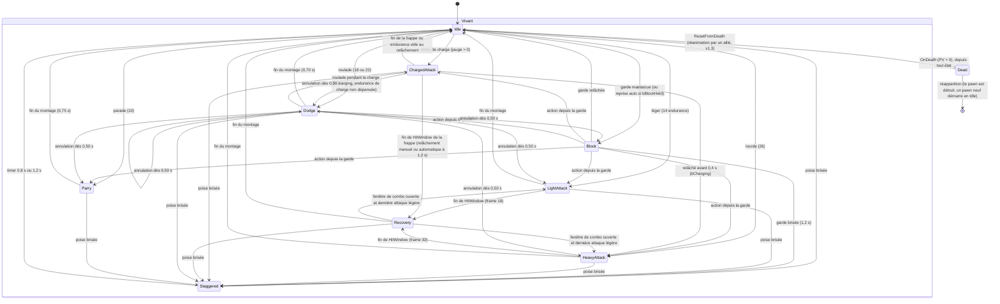

Règles transversales codées :
- `Dead` : une seule sortie, `ResetFromDeath` (serveur, **v1.3**) appelée par la réanimation : retour en `Idle`, montage de mort arrêté. La réapparition ne fait pas sortir la FSM de `Dead` : `AEMBGameMode::RespawnPlayer` détruit le pawn et en crée un neuf (§ 2.13). On entre en `Dead` depuis n'importe quel état ; le combat mémorise si la mort vient de dégâts continus (`WasKilledByDamageOverTime`), ce qui décide de l'emplacement du sac.
- `Staggered` : accessible depuis tout état sauf `Staggered` lui-même (« pas de stun-lock ») et `Dead`. Durée pilotée par un timer (0,8 s poise brisée, 1,2 s garde brisée), pas par le montage.
- `Dodge --> Dodge` : autorisé par la table (une action de départ depuis `Dodge` quand `bDodgeCancelOpen`), donc une roulade peut en enchaîner une autre après 0,50 s.
- `ChargedAttack --> Dodge` : seule annulation possible **pendant la charge** (`bCharging` vrai) ; l'endurance de la charge (38) n'étant facturée qu'au relâchement, rien n'est dépensé. Une fois la frappe lancée, plus d'annulation. Cette roulade n'est **pas prédite** côté client (la prédiction n'agit que depuis `Idle`, `Block` ou la fenêtre de combo) : elle part au retour du serveur.
- **Relâchement automatique** : un timer de 1,2 s (`ChargedMaxChargeTime`) armé à l'entrée en `ChargedAttack` appelle `ReleaseCharge` si le joueur maintient encore le bouton.
- Roulade **interdite** si la charge portée dépasse 100 % (`EncumbranceRatio > LoadHeavyMax`) ; coût 22 au-delà de 70 % (18 sinon).
- `Recovery` n'autorise **ni roulade ni parade** : un input de ce type est mémorisé (buffer 0,2 s) et exécuté au retour en `Idle`.
- Le combo exige `LastAttackState == LightAttack` : la `Recovery` d'une attaque lourde ou chargée ne s'enchaîne pas.
- Au retour en `Idle`, le serveur consomme l'input mémorisé puis relève la garde si `bBlockHeld` est encore vrai.
- **Protection de réapparition / réanimation** (v1.3) : `GrantSpawnProtection(3 s)` pose `bSpawnProtected` (répliqué), compté comme `State.Combat.Invulnerable`, **y compris contre les dégâts continus** ; annulée à la première attaque du joueur.
- Tags d'état : `State.Combat.Invulnerable` (compteur `InvulnerableCount` ; pour la roulade, **timer serveur** de la frame 3 à la frame 16, 14 ou 12 selon la charge portée — 13, 11 ou 9 frames d'i-frames —, indépendant du montage et de l'évaluation d'animation ; le notify `IFrames` reste possible mais optionnel et cumulatif), `State.Combat.HyperArmor` (lourde : timer frames 6-31 ; chargée : dès la charge jusqu'à la fin de la fenêtre active), `State.Combat.Staggered` et `State.Dead` (déduits de `CurrentState`). Les compteurs sont remis à zéro à chaque transition (`ResetTransientFlags`).
- La fenêtre de parade parfaite (frames 4-13) et la fenêtre de riposte (1,5 s après une parade parfaite, `IsRiposteWindowOpen`) sont aussi des timers / horodatages serveur.

### 2.3 Séquence « le joueur attaque le dragon »

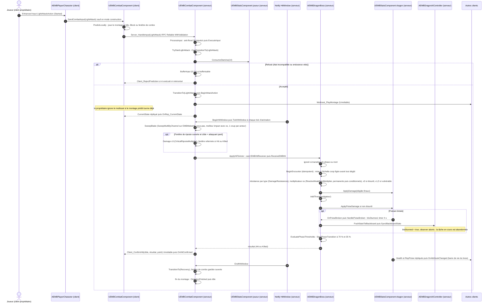

### 2.4 Séquence « le joueur pose une pièce »

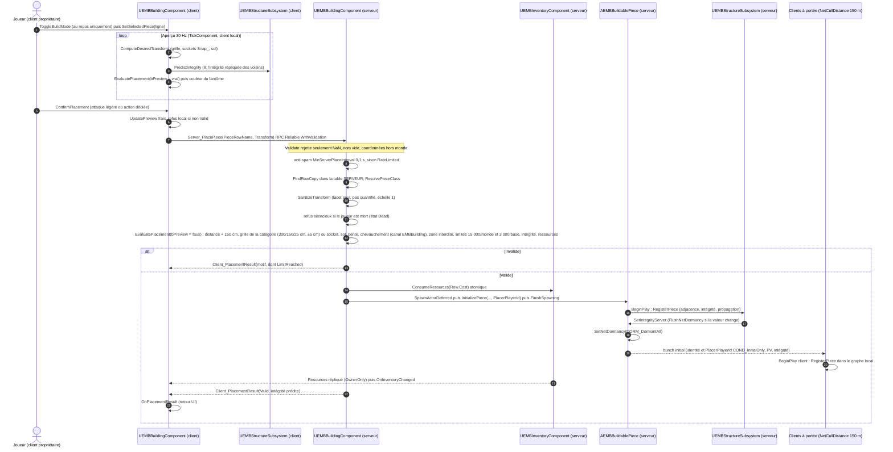

### 2.5 Séquence « une pièce est détruite » (dégâts puis effondrement en cascade)

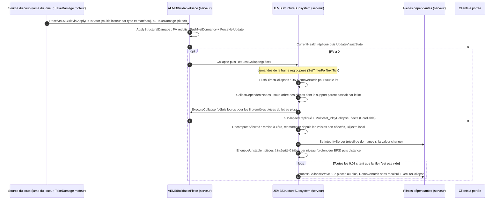

Une pièce mise en file mais « sauvée » entre-temps (support posé pendant la cascade, intégrité > 0) est ignorée par la vague. Les vagues ne refont **aucun** recalcul : une pièce non soutenue ne soutient personne.

### 2.6 Séquence « le joueur sprinte »

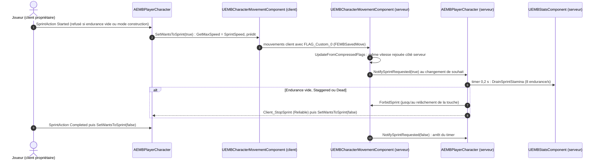

### 2.7 Diagramme de classes « progression et sauvegarde »

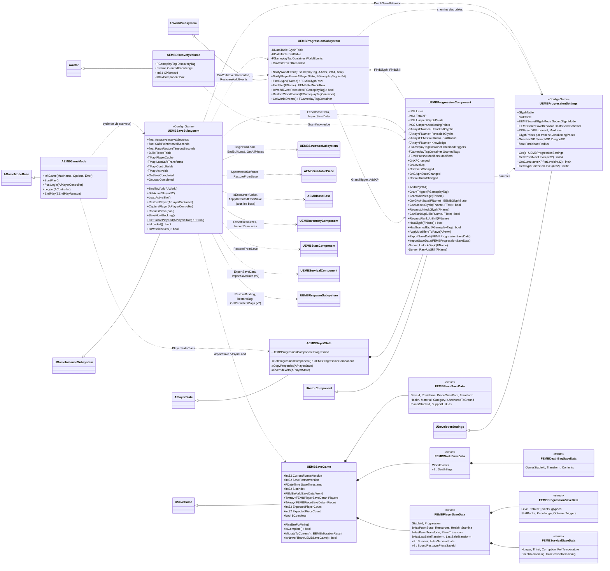

**Remarques**
- Le **sous-système de sauvegarde vit dans le GameInstance** (il survit aux changements de niveau) mais n'agit que sur le **serveur** et sur le monde auquel il est lié (`BindToWorld`) : chaque minuterie et chaque callback asynchrone vérifient `IsServer()` et un jeton de génération (`LoadGeneration`) qui invalide les réponses d'un monde précédent.
- Le **sous-système de progression est créé sur toutes les machines** (`ShouldCreateSubsystem` : mondes de jeu, serveur et clients), car l'UI et `IsPieceUnlocked` y lisent les tables ; la distribution (XP, déclencheurs) et `WorldEvents` n'existent que sur le serveur. Écart mineur avec le référentiel § 7.1 (« actif sur le serveur ») : seul le comportement est serveur.
- Les tables sont chargées **de façon synchrone** à l'initialisation du monde (`LoadTables`), avec contrôle de la structure de ligne.
- `FEMBResourceStack` est un alias (`using`) de `FEMBResourceEntry` : la sauvegarde réutilise la paire de l'inventaire, dont les champs sont marqués `SaveGame`.

### 2.8 Séquence « achat d'un glyphe »

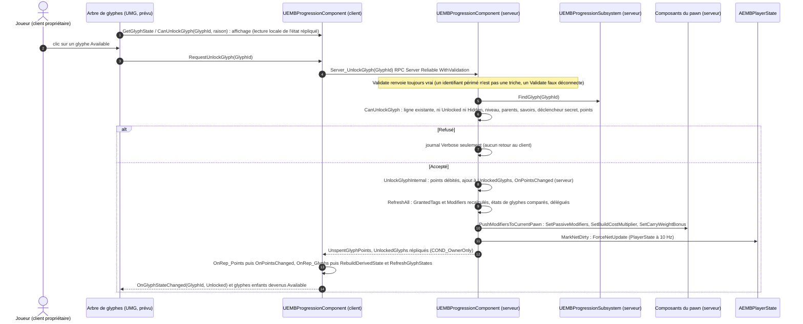

Le rang de compétence suit exactement le même chemin (`RequestRankUpSkill` → `Server_RankUpSkill` → `CanRankUpSkill` : ligne, rang maximal, niveau, parents au rang ≥ 1, savoirs, points d'Éveil) ; un rang de passif modifie `Modifiers` et part immédiatement vers le pawn. Une pièce dont la ligne porte un `RequiredGlyph` devient constructible dès que `HasGlyph` est vrai, côté aperçu (client) comme côté validation (serveur).

### 2.9 Séquence « mort d'un boss → XP, déclencheur, autosave » (exemple : le dragon)

La séquence est portée par `AEMBBossBase::HandleStatsDeath` et vaut pour les trois boss : seuls changent le tag (`GetDefeatedEventTag` : `.Guardian`, `.Seraph`, `.Dragon`), l'XP (`GetDefeatXP` lit `GuardianXP` 6 000, `SeraphXP` 15 000 ou `DragonXP` 60 000) et le nettoyage propre à la classe fille (`OnDefeatedServer` : Résonance interrompue, clones dissipés et pool de projectiles libéré...).

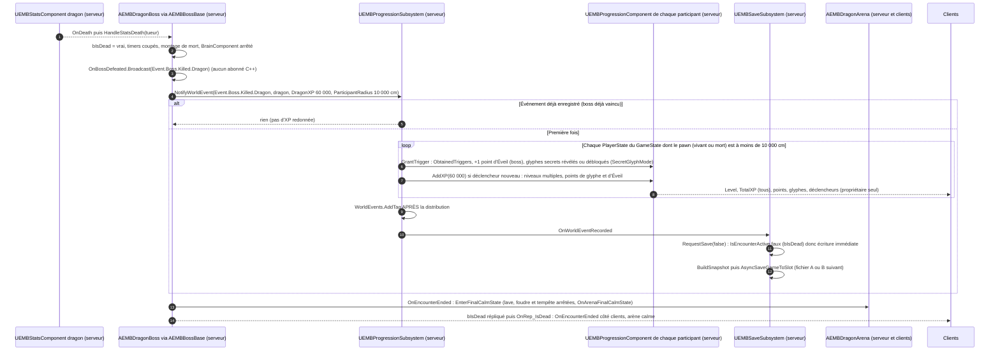

L'ordre « distribution puis enregistrement » est voulu : l'autosave déclenchée par `OnWorldEventRecorded` capture des progressions déjà à jour. Un joueur mort **en attente de réapparition** dans le rayon est participant (son pawn existe encore) ; un joueur qui a déjà réapparu loin de l'arène (au lit, au `PlayerStart`) ne l'est plus.

### 2.10 Séquence « chargement d'un monde »

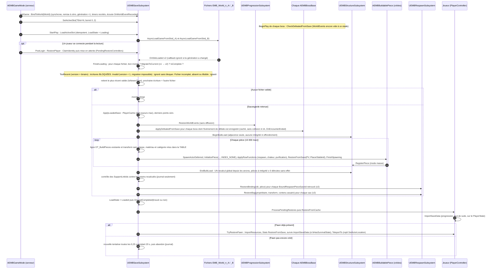

Garde-fou central : **aucune écriture n'est possible avant `LoadState = Loaded`** (`RequestSave` et `SaveNowBlocking` l'ignorent), sinon un monde encore vide écraserait la vraie sauvegarde. Tant qu'une restauration de pawn est en attente, la capture du joueur ne lit pas le pawn neuf (`IsRestorePending`), pour ne pas écraser l'inventaire et les PV sauvegardés.

### 2.11 Diagramme de classes « boss » (v1.3)

```mermaid
classDiagram
    direction TB

    class ACharacter
    class AActor
    class AAIController
    class UBTTaskNode
    class IEMBHitReceiver {
        <<interface>>
    }

    class AEMBBossBase {
        <<abstract>>
        #TObjectPtr~UDataTable~ AttackTable
        #float BaseMaxHealth
        #float ArenaRadius
        #TArray~float~ PhaseHealthThresholds
        #int32 EnrageFromPhase
        #TMap DamageResistances
        #TMap WeakPointMultipliers
        #TMap ConditionalWeakPointMultipliers
        +GetDefeatedEventTag() FGameplayTag*
        +GetDefeatXP() int64
        +IsAttackAllowed(Row) bool
        +GetAttackWeightModifier(Row) float
        +IsScriptedAttackDue() bool
        +BeginTimedAttack(Row) float
        +BeginStun(float)
        +SetFlying(bool)
        +StepFlightToward(...) bool
        +StepGroundCharge(...) bool
        +BeginVulnerableWindow(float)
        +SetConditionalWeakPointsActive(bool, float)
        +IsEncounterActive() bool
        +ApplyDefeatedFromSave()
        #OnPhaseEnteredServer(int32, int32)
        #OnPoiseDamageTaken(float, AActor)
        #ScheduleCustomEvents(Row, float, float) bool
        #OnTimedHitExecuted(Row, int32, TArray)
        #GetChainedAttackTag(Row) FGameplayTag
        #OnAttackCancelled()
        #OnDefeatedServer()
        #OnEncounterBegun()
        #OnEncounterReset()
        -TickWipeCheck()
        -ResetEncounter()
    }
    class AEMBDragonBoss {
        +IsCataclysmDue() bool
        +NotifyCataclysmFired()
        #OnEncounterBegun()
    }
    class AEMBColossusBoss {
        +SetArena(AEMBColossusArena)
        +GetIntactObeliskCount() int32
        +IsValidChargeObstacle(AActor) bool
        +ExposeCore(float)
        +ResolveChargeImpact(FHitResult, Row)
        #Multicast_RuneRing(...)
        #Multicast_ResonanceFinished(bool, float)
    }
    class AEMBSeraphBoss {
        +ShouldFly() bool
        +RollFeintDelay() float
        +PredictTargetGroundPoint(AActor, float) FVector
        +MakeSeraphHitData(Row, float) FEMBHitData
        +ResolveDashContact(...) bool
        +LaunchFeatherFan(...)
        +LaunchLance(...)
        +BroadcastShadowEcho(FEMBSeraphEcho)
        +Multicast_TipFlash(FGameplayTag, float)
        -TArray~AEMBProjectile~ ProjectilePool
    }
    class AEMBBossAIController {
        +FName BBKey_TargetActor$
        +SyncBlackboardState()
        +SetCombatTarget(AActor)
        +SetFacingLocked(bool)
    }
    class AEMBDragonAIController
    class AEMBColossusArena {
        +BindToBoss(AEMBColossusBoss)
        +GetIntactObeliskCount() int32
        +IsChargeObstacle(AActor) bool
    }
    class AEMBObelisk {
        -float Health
        -bool bLit
        +ReceiveEMBHit(FEMBHitData)
        +SetLit(bool)
        +OnObeliskDestroyed
    }
    class AEMBSeraphArena
    class AEMBSeraphBell {
        -bool bUsed
        -bool bSilenced
        +ReceiveEMBHit(FEMBHitData)
        +MarkUsed()
        +SetSilenced(bool)
        +OnBellStruck
    }
    class AEMBSeraphShadow {
        -bool bDissipated
        +ReceiveEMBHit(FEMBHitData)
        +QueueEcho(FEMBSeraphEcho)
        +Dissipate()
    }
    class AEMBProjectile {
        -FEMBProjectileNetState NetState
        +Launch(FEMBProjectileLaunchParams)
        +ReturnToPool()
        +IsProjectileActive() bool
    }
    class AEMBDragonArena
    class BTTask_EMBSelectAttack
    class BTTask_EMBDragonBreath
    class BTTask_EMBDragonDiveAttack
    class BTTask_EMBColossusCharge
    class BTTask_EMBSeraphDash
    class BTTask_EMBSeraphPlunge
    class BTTask_EMBSeraphReposition

    ACharacter <|-- AEMBBossBase
    IEMBHitReceiver <|.. AEMBBossBase
    AEMBBossBase <|-- AEMBDragonBoss
    AEMBBossBase <|-- AEMBColossusBoss
    AEMBBossBase <|-- AEMBSeraphBoss
    AAIController <|-- AEMBBossAIController
    AEMBBossAIController <|-- AEMBDragonAIController
    AActor <|-- AEMBColossusArena
    AActor <|-- AEMBObelisk
    AActor <|-- AEMBSeraphArena
    AActor <|-- AEMBSeraphBell
    AActor <|-- AEMBSeraphShadow
    AActor <|-- AEMBProjectile
    IEMBHitReceiver <|.. AEMBObelisk
    IEMBHitReceiver <|.. AEMBSeraphBell
    IEMBHitReceiver <|.. AEMBSeraphShadow
    UBTTaskNode <|-- BTTask_EMBColossusCharge
    UBTTaskNode <|-- BTTask_EMBSeraphDash
    UBTTaskNode <|-- BTTask_EMBSeraphPlunge
    UBTTaskNode <|-- BTTask_EMBSeraphReposition

    AEMBBossAIController o-- AEMBBossBase : OnPossess
    AEMBColossusArena o-- AEMBObelisk : 4
    AEMBColossusArena ..> AEMBColossusBoss : BindToBoss, SetArena
    AEMBColossusBoss ..> AEMBColossusArena : obélisques intacts, obstacles
    AEMBSeraphArena o-- AEMBSeraphBell : 3
    AEMBSeraphArena ..> AEMBSeraphBoss : OnBellStruck puis BeginStun 2 s
    AEMBDragonArena ..> AEMBDragonBoss : OnPhaseChanged, OnEncounterEnded
    AEMBSeraphBoss o-- AEMBProjectile : pool 24 à 96
    AEMBSeraphBoss o-- AEMBSeraphShadow : 2 clones, 20 s
    AEMBSeraphShadow ..> AEMBSeraphBoss : rejoue via son API (0,3 s, 30 %)
    BTTask_EMBSelectAttack ..> AEMBBossBase : IsAttackAllowed, GetAttackWeightModifier
    BTTask_EMBDragonBreath ..> AEMBDragonBoss
    BTTask_EMBDragonDiveAttack ..> AEMBDragonBoss
    BTTask_EMBColossusCharge ..> AEMBColossusBoss : StepGroundCharge, ResolveChargeImpact
    BTTask_EMBSeraphDash ..> AEMBSeraphBoss : ResolveDashContact, Multicast_TipFlash
    BTTask_EMBSeraphPlunge ..> AEMBSeraphBoss : StepFlightToward, BeginVulnerableWindow
    BTTask_EMBSeraphReposition ..> AEMBSeraphBoss : ShouldFly, orbite
```

**Remarques**
- **Une seule ligne de données pour les trois boss** : `FEMBBossAttackRow` est un alias (`using`) de `FEMBDragonAttackRow` ; `EEMBDragonAttackKind` reçoit en fin d'énumération `Charge` (6), `Channel` (7), `Rings` (8), `Dash` (9), `Plunge` (10). Les valeurs 0 à 5 du dragon sont inchangées.
- **Ce que fait chaque classe fille** : le dragon garde ses constantes, le Cataclysm scripté (`IsScriptedAttackDue`) et le poids ×3 de la rafale d'ailes (`GetAttackWeightModifier`) ; le Colosse ajoute le noyau exposé 3 s après le Séisme (point faible **conditionnel**), l'enchaînement Rugissement → Poing-marteau (`GetChainedAttackTag`), les 3 anneaux runiques (timer 20 Hz, un coup par joueur et par anneau), la Résonance (canalisation 3 s, interrompue à 150 de posture) et la charge ; Nyxariel ajoute le vol de combat (phases 1-2), les projectiles poolés, les ombres jumelles, la Feinte à délai aléatoire (`FRandomStream` serveur) et les plongeons.
- **Rencontre et wipe** (`TickWipeCheck` à 1 Hz) : après 30 s sans joueur vivant à moins d'`ArenaRadius` (dragon 6 000, Colosse 3 000, Nyxariel 4 000 cm), `ResetEncounter` remet les PV au maximum solo, interrompt attaque, étourdissement, vulnérabilité et vol, oublie menace, brûlures et zones de feu, libère l'échelle coop ; la **phase est conservée** (décor d'arène irréversible). Le dragon reprogramme alors son Cataclysm 20 s après la reprise s'il est en phase 3 (`OnEncounterBegun`).
- Les arènes restent **non répliquées** (état déduit de la phase répliquée) ; seuls les obélisques (PV, allumé) et les cloches (consommée, silencieuse) le sont.

### 2.12 Diagramme de classes « survie, mort, interaction » (v1.3)

```mermaid
classDiagram
    direction LR

    class UActorComponent
    class UWorldSubsystem
    class AActor
    class AGameModeBase

    class IEMBInteractable {
        <<interface>>
        +CanInteract(APawn) bool
        +Interact(APawn)
        +GetInteractionText(APawn) FText
        +GetInteractionHoldTime() float
    }
    class AEMBPlayerCharacter {
        -bool bDeadAwaitingRespawn
        -double DeathServerTime
        -UEMBSurvivalComponent Survival
        +RequestRespawn()
        +IsDeadAwaitingRespawn() bool
        +WasKilledInLethalZone() bool
        +FellOutOfWorld(UDamageType)
        +GetAutoRespawnTimeRemaining() float
        +GetInteractionTarget() AActor
        +GetInteractionHoldProgress() float
        -BeginDeath()
        -EndDeathByRevive()
        -RespawnNow()
        -Server_RequestRespawn()
        -Server_Interact(AActor)
        -Server_CancelInteract()
        -Client_InteractionEnded(bool)
        +OnDeadAwaitingRespawnChanged
        +OnInteractionTargetChanged
        +OnInteractionHoldEnded
    }
    class AEMBGameMode {
        +RespawnPlayer(AController)
    }
    class UEMBRespawnSubsystem {
        -TMap Bindings
        -TMap BagsByOwner
        +BindRespawnPoint(APlayerState, AEMBBuildablePiece)
        +GetRespawnTransform(AController, FTransform) bool
        +DropDeathBag(AController, FVector)
        +GetPlayerKey(AController) FString
        +RestoreBinding(FString, AEMBBuildablePiece)
        +RestoreBag(FString, FTransform, TArray)
        +GetPersistentBags(TArray)
        +TryConsumeSleepBenefit(AController) bool
    }
    class AEMBDeathBag {
        -int32 OwnerPlayerId
        -FString OwnerKey
        -TArray Contents
        +InitializeBag(FString, int32, bool, TArray)
        +Interact(APawn)
    }
    class AEMBBuildablePiece {
        #bool bIsRespawnPoint
        #float HeatRadius, HeatBonus
        #float PurifyRadius, PurifyRate
        +ApplyRowFunctions(FEMBBuildPieceRow)
        +IsRespawnPoint() bool
        +IsBed() bool
        +Interact(APawn)
        +IsSheltered() bool
    }
    class UEMBSurvivalComponent {
        -float Hunger
        -float Thirst
        -float FeltTemperature
        -float Corruption
        -uint8 PublicCorruptionTier
        +RequestConsume(FName)
        +AddCorruption(float)
        +ReduceCorruption(float)
        +ApplyRespawnValues()
        +ApplyReviveValues()
        +SetPassiveModifiers(FEMBPassiveModifiers)
        +SetInsulation(float)
        +ExportSaveData(FEMBSurvivalSaveData)
        +ImportSaveData(FEMBSurvivalSaveData)
        -Server_Consume(FName)
        -SurvivalTick()
        +OnSurvivalChanged
    }
    class UEMBEnvironmentSubsystem {
        +GetAmbientTemperatureAt(FVector) float
        +GetCorruptionRateAt(FVector) float
        +IsNight() bool
        +GetHeatBonusAt(FVector) float
        +GetPurificationRateAt(FVector) float
        +SetTimeOfDay(float)
        +SetWeatherTemperatureOffset(float)
        +RegisterHeatSource(AActor, float, float)
        +RegisterPurifier(AActor, float, float)
        +OnEnvironmentChanged
    }
    class AEMBEnvironmentVolume {
        +float BaseTemperatureC
        +float CorruptionRatePerSecond
        +int32 Priority
        +ContainsPoint(FVector) bool
    }
    class UEMBStatsComponent {
        +SetSurvivalModifiers(float, float, float)
        +ReviveWithFraction(float, float)
    }
    class UEMBCombatComponent {
        +WasKilledByDamageOverTime() bool
        +ResetFromDeath()
        +GrantSpawnProtection(float)
        +SetExtraFireResistance(float)
        +GetFireResistance() float
    }
    class FEMBConsumableRow {
        <<DataTable row>>
    }

    UActorComponent <|-- UEMBSurvivalComponent
    UWorldSubsystem <|-- UEMBRespawnSubsystem
    UWorldSubsystem <|-- UEMBEnvironmentSubsystem
    AActor <|-- AEMBDeathBag
    AActor <|-- AEMBEnvironmentVolume
    AGameModeBase <|-- AEMBGameMode
    IEMBInteractable <|.. AEMBPlayerCharacter : réanimation 4 s
    IEMBInteractable <|.. AEMBDeathBag : ramasser
    IEMBInteractable <|.. AEMBBuildablePiece : se lier, dormir

    AEMBPlayerCharacter *-- UEMBSurvivalComponent
    AEMBPlayerCharacter *-- UEMBStatsComponent
    AEMBPlayerCharacter *-- UEMBCombatComponent
    AEMBPlayerCharacter ..> AEMBGameMode : RespawnNow
    AEMBPlayerCharacter ..> IEMBInteractable : Server_Interact, maintien serveur
    AEMBGameMode ..> UEMBRespawnSubsystem : DropDeathBag, GetRespawnTransform
    AEMBGameMode ..> UEMBSurvivalComponent : ApplyRespawnValues
    AEMBGameMode ..> UEMBCombatComponent : GrantSpawnProtection
    UEMBRespawnSubsystem o-- AEMBDeathBag : un par joueur
    UEMBRespawnSubsystem o-- AEMBBuildablePiece : liaison (pointeur faible)
    AEMBBuildablePiece ..> UEMBRespawnSubsystem : BindRespawnPoint, TryConsumeSleepBenefit
    AEMBBuildablePiece ..> UEMBEnvironmentSubsystem : RegisterHeatSource, RegisterPurifier
    AEMBEnvironmentVolume ..> UEMBEnvironmentSubsystem : RegisterVolume
    UEMBSurvivalComponent ..> UEMBEnvironmentSubsystem : interrogé à 1 Hz
    UEMBSurvivalComponent ..> UEMBStatsComponent : SetSurvivalModifiers
    UEMBSurvivalComponent ..> UEMBCombatComponent : SetExtraFireResistance, ApplyHitToActor (dégâts continus), OnHitReceived
    UEMBSurvivalComponent ..> FEMBConsumableRow : lit
    UEMBProgressionComponent ..> UEMBSurvivalComponent : SetPassiveModifiers
```

**Remarques**
- **Deux sous-systèmes, deux portées** : `UEMBRespawnSubsystem` n'écrit que sur le serveur (les clients ne l'utilisent pas) ; `UEMBEnvironmentSubsystem` existe sur chaque machine, **sans réplication** : seuls ses consommateurs serveur (la survie) comptent, et un futur système d'heure ou de météo devra pousser ses valeurs sur le serveur (et chez les clients s'ils veulent les afficher).
- **Clé d'un joueur** pour les liaisons et les sacs : identifiant stable de la sauvegarde (§ 6.5) ; `Session_<PlayerId>` pour un joueur non persisté (identifiant en doublon), dont ni le sac ni la liaison ne sont sauvegardés.
- **Pièces fonctionnelles** : `ApplyRowFunctions` recopie les colonnes v1.3 de la ligne (à la pose comme au chargement, avant `BeginPlay`) ; `bIsRespawnPoint` est répliqué (invite d'interaction), les rayons et valeurs de chaleur et de purification restent **serveur**. Lit = point de réapparition de catégorie `Furniture` : « Se lier » et « Dormir » (Corruption −50 si une pièce le couvre, `IsSheltered`, au plus toutes les 120 s **par joueur**).

### 2.13 Cycle de vie du joueur (mort, réanimation, réapparition)

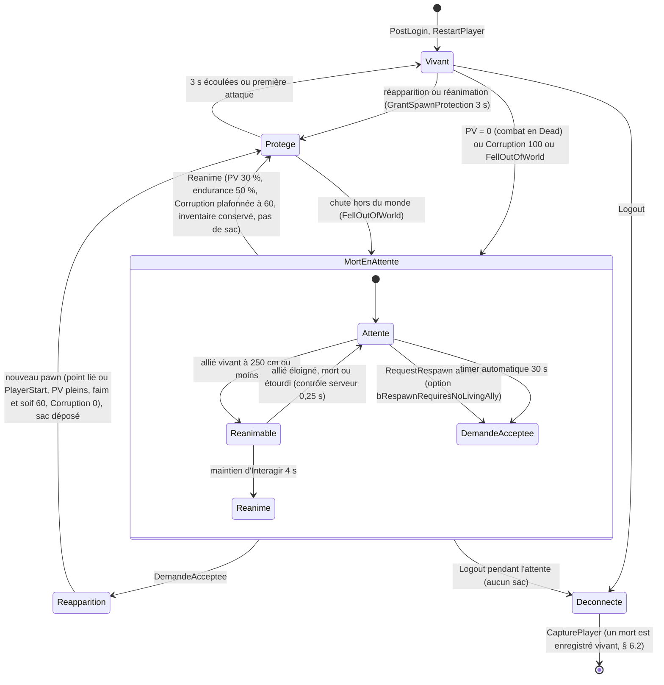

Notes de lecture :
- `Protege` n'est pas un état distinct dans le code : c'est le drapeau `bSpawnProtected` du combat (compté comme `State.Combat.Invulnerable`). `MortEnAttente` correspond à `bDeadAwaitingRespawn` (répliqué à tous, tag `State.Player.DeadAwaitingRespawn`) **et** à l'état `Dead` du combat.
- À la mort, le mouvement est coupé (`DisableMovement`) mais **pas les entrées** : la touche *Interagir* (ou `IA_Respawn`) sert à demander la réapparition. Pas de ragdoll : le montage de mort tient la pose, la capsule reste cohérente pour une réanimation.
- **Zone létale** : si la mort vient de dégâts continus (lave, faim, zone de feu…) ou d'une chute hors du monde (`FellOutOfWorld` est surchargé pour tuer par le flux normal au lieu de détruire le pawn), `WasKilledInLethalZone` est vrai et le sac est déposé au **dernier point sûr** relevé par la sauvegarde.
- `bRespawnRequiresNoLivingAlly` (faux par défaut, arbitrage v1.3) : vrai, il impose en coop d'attendre l'échéance de 30 s tant qu'un allié vivant peut réanimer.

### 2.14 Séquence « mort → sac → réapparition au lit »

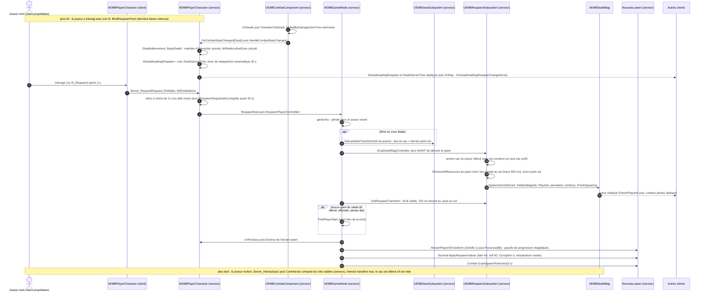

### 2.15 Séquence « réanimation par un allié »

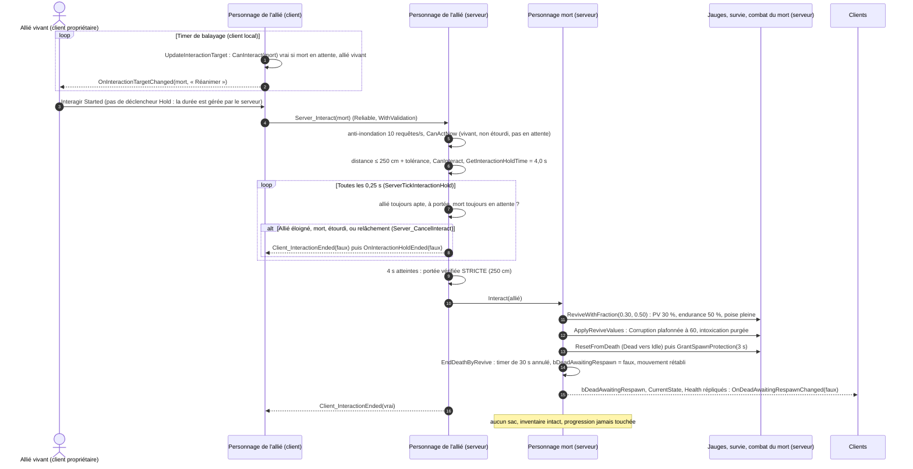

---

## 3. Communication entre systèmes

### 3.1 Délégués (liste exhaustive du code)

| Délégué (type) | Propriétaire | Diffusé où | Abonnés dans le code |
|---|---|---|---|
| `OnAttributeChanged` (`FEMBOnAttributeChanged` : type, valeur, max) | `UEMBStatsComponent` | serveur (à chaque modification) **et** clients (RepNotify `OnRep_Health/Stamina/Poise/MaxHealth`) | aucun (HUD prévu) |
| `OnDeath` (`FEMBOnDeath` : tueur) | `UEMBStatsComponent` | **serveur uniquement** | `UEMBCombatComponent::HandleOwnerDeath` → `Dead` ; `AEMBBossBase::HandleStatsDeath` |
| `OnPoiseBroken` (`FEMBOnPoiseBroken` : instigateur) | `UEMBStatsComponent` | **serveur uniquement** | `UEMBCombatComponent::HandleOwnerPoiseBroken` → `Staggered` 0,8 s ; `AEMBBossBase::HandlePoiseBroken` → étourdi (dragon et Colosse 4 s, Nyxariel 3 s) |
| `OnCombatStateChanged` (`FEMBOnCombatStateChanged` : ancien, nouveau) | `UEMBCombatComponent` | serveur (`TransitionTo`) et clients (`OnRep_CurrentState`) | `AEMBPlayerCharacter::HandleCombatStateChanged` (arrêt du sprint ; à la mort : mouvement coupé, `BeginDeath` côté serveur) |
| `OnParrySuccess` (`FEMBOnParrySuccess` : attaquant) | `UEMBCombatComponent` | partout via `Multicast_ParrySuccess` (Unreliable) | aucun (effets prévus) |
| `OnHitReceived` (`FEMBOnHitReceived` : coup, résultat) | `UEMBCombatComponent` | partout via `Multicast_BroadcastHitReceived` (Unreliable) ; **jamais** pour les dégâts continus (`bDamageOverTime`) | **v1.3** : `UEMBSurvivalComponent::HandleHitReceived` (serveur : Corruption des coups reçus) ; effets prévus |
| `OnHitConfirmed` (`FEMBOnHitConfirmed` : cible, résultat, point d'impact) — **nouveau v1.1** | `UEMBCombatComponent` de l'**attaquant** | client propriétaire de l'attaquant (et hôte) via `Client_ConfirmHit` (Unreliable), pour tout coup de lame non `Ignored` (dragon, pièce, créature) | aucun (marqueur de coup, son, hit-stop prévus) |
| `OnInventoryChanged` (`FEMBOnInventoryChanged` : ressource, quantité) | `UEMBInventoryComponent` | serveur (ressource précise) ; propriétaire après réplication (`NAME_None` = tout rafraîchir) | `AEMBPlayerCharacter::HandleInventoryChanged` → `UpdateEncumbrance` → `SetEncumbranceRatio` (serveur et propriétaire) ; UI prévue |
| `OnBuildModeChanged` (`FEMBOnBuildModeChanged` : bool) | `UEMBBuildingComponent` | client local | aucun (UI prévue) |
| `OnPlacementResult` (`FEMBOnPlacementResult` : résultat, intégrité) | `UEMBBuildingComponent` | client local (aperçu) et réponse serveur (`Client_PlacementResult`) | aucun (UI prévue) |
| `OnPhaseChanged` (`FEMBOnBossPhaseChanged` : nouvelle, ancienne) — type renommé v1.3 | `AEMBBossBase` | serveur (`FinishPhaseTransition`) et clients (`OnRep_CurrentPhase`) | `AEMBDragonArena::HandleBossPhaseChanged` ; arène du Colosse (allumage des obélisques en P2) ; arène de Nyxariel (mise en scène) |
| `OnPhaseTransitionStarted` (`FEMBOnBossPhaseTransitionStarted` : phase visée) | `AEMBBossBase` | serveur et clients (`OnRep_IsTransitioning`, phase visée supposée = courante + 1) | `AEMBSeraphBoss::HandlePhaseTransitionStarted` (pool de projectiles porté à 72 avant la phase 2) |
| `OnStunChanged` (`FEMBOnBossStunChanged` : bool) | `AEMBBossBase` | serveur et clients (`OnRep_IsStunned`) | aucun |
| `OnBossDefeated` (`FEMBOnBossDefeated` : tag d'événement, tueur) | `AEMBBossBase` | **serveur uniquement**, tag `GetDefeatedEventTag()` | aucun abonné C++ : la progression est appelée **directement** (`NotifyWorldEvent` dans `HandleStatsDeath`) ; disponible pour la mise en scène Blueprint |
| `OnEncounterEnded` (`FEMBOnBossEncounterEnded`) | `AEMBBossBase` | serveur (mort au combat, `ApplyDefeatedFromSave`) et clients (`OnRep_IsDead`) | les trois arènes (état final calme : lave et foudre arrêtées, obélisques éteints, cloches silencieuses) ; `AEMBSeraphBoss::HandleEncounterEnded` |
| `OnObeliskDestroyed` (`FEMBOnObeliskDestroyed` : obélisque) — **v1.3** | `AEMBObelisk` | serveur et clients | aucun abonné C++ (le Colosse compte les obélisques intacts à la demande) |
| `OnBellStruck` (`FEMBOnBellStruck` : cloche, frappeur) — **v1.3** | `AEMBSeraphBell` | **serveur uniquement** | `AEMBSeraphArena` (étourdit Nyxariel 2 s s'il vole, puis `MarkUsed`) |
| `OnDeadAwaitingRespawnChanged` (`FEMBOnDeadAwaitingRespawnChanged` : bool) — **v1.3** | `AEMBPlayerCharacter` | serveur et clients (`OnRep_DeadAwaitingRespawn`) | aucun (écran de mort, UI de groupe prévus) |
| `OnInteractionTargetChanged` (cible, invite) — **v1.3** | `AEMBPlayerCharacter` | client local (balayage par timer) | aucun (invite d'interface prévue) |
| `OnInteractionHoldEnded` (`bCompleted`) — **v1.3** | `AEMBPlayerCharacter` | client propriétaire (`Client_InteractionEnded`) | aucun (barre de maintien prévue) |
| `OnSurvivalChanged` (faim, soif, température, Corruption) — **v1.3** | `UEMBSurvivalComponent` | serveur (1 Hz) et propriétaire (`OnRep_Gauges`) | aucun (HUD prévu) |
| `OnEnvironmentChanged` — **v1.3** | `UEMBEnvironmentSubsystem` | machine locale, sur changement structurel (jour/nuit, météo, volume, source) ; **pas** à chaque mise à jour de l'heure | aucun |
| `OnXPChanged` (`FEMBOnXPChanged` : XP totale, niveau) — **v1.2** | `UEMBProgressionComponent` | serveur (`AddXP`) et clients (`OnRep_Level`, `OnRep_TotalXP` : tous les clients) | aucun (UI prévue) |
| `OnLevelUp` (`FEMBOnLevelUp` : niveau) — **v1.2** | `UEMBProgressionComponent` | serveur (un appel par niveau gagné) et clients (`OnRep_Level`, sauf première réception) | aucun (UI prévue) |
| `OnPointsChanged` (`FEMBOnPointsChanged` : points de glyphe, points d'Éveil) — **v1.2** | `UEMBProgressionComponent` | serveur et propriétaire (`OnRep_Points`) | aucun (UI prévue) |
| `OnGlyphStateChanged` (`FEMBOnGlyphStateChanged` : glyphe, état) — **v1.2** | `UEMBProgressionComponent` | serveur et propriétaire ; le premier calcul est mémorisé **sans** diffusion | aucun (UI prévue) |
| `OnSkillRankChanged` (`FEMBOnSkillRankChanged` : nœud, rang) — **v1.2** | `UEMBProgressionComponent` | serveur et propriétaire (`OnRep_SkillRanks`), même règle de premier calcul | aucun (UI prévue) |
| `OnWorldEventRecorded` (`FEMBOnWorldEventRecorded` : tag) — **v1.2** | `UEMBProgressionSubsystem` | **serveur uniquement**, après distribution aux participants | `UEMBSaveSubsystem::HandleWorldEventRecorded` → `RequestSave(false)` |
| `OnSaveCompleted` (`FEMBOnSaveCompleted` : succès) — **v1.2** | `UEMBSaveSubsystem` | serveur, fin d'écriture (asynchrone ou bloquante) | aucun (UI prévue). **Pas** diffusé quand une demande est ignorée (chargement non terminé, écritures bloquées, rencontre de boss) |
| `OnLoadCompleted` (`FEMBOnLoadCompleted` : sauvegarde trouvée) — **v1.2** | `UEMBSaveSubsystem` | serveur, fin du chargement (faux = monde vierge) | aucun |

Événements Blueprint (`BlueprintImplementableEvent`, mise en scène) : `AEMBBossBase::BP_OnAttackTelegraph`, `BP_OnShowGroundMarker` ; `AEMBDragonArena::OnArenaPhaseApplied`, `OnAshStormChanged` (tempête de cendres de phase 3, purement visuelle), `OnArenaFinalCalmState` ; **v1.3** : `AEMBColossusBoss::BP_OnRuneRing`, `BP_OnResonanceFinished` ; `AEMBObelisk::BP_OnLitChanged`, `BP_OnHealthChanged`, `BP_OnDestroyed` ; `AEMBSeraphBoss::BP_OnTipFlash` ; `AEMBSeraphBell::BP_OnRung`, `BP_OnUsedChanged`, `BP_OnSilenced` ; `AEMBSeraphShadow::BP_OnEcho`, `BP_OnDissipated` ; `AEMBProjectile::BP_OnLaunched`, `BP_OnReflected`, `BP_OnEnded`.

Délégués moteur utilisés : `UAIPerceptionComponent::OnTargetPerceptionUpdated` (contrôleur des boss), chevauchement et arrêt du projectile (`HandleBeginOverlap`, `HandleProjectileStop`), `FOnMontageEnded` (fin d'action de la FSM, protégée par `ActionToken`), délégués de timers (dont `SetTimerForNextTick` pour le regroupement des destructions).

### 3.2 Gameplay Tags (`EMBTags`, `EMBGameplayTags.h`)

Tags natifs déclarés par `UE_DECLARE_GAMEPLAY_TAG_EXTERN` : utilisables sans `.ini`, à résoudre au `BeginPlay` ou à l'usage, jamais dans un constructeur de CDO (le code le respecte : `UEMBCombatComponent::ResolveDefaultTags` au `BeginPlay`).

| Famille | Tags | Utilisation réelle dans le code |
|---|---|---|
| `State.*` | `State.Combat.Invulnerable`, `.Staggered`, `.HyperArmor`, `State.Dead` ; **v1.3** : `State.Survival.Whispers` (Corruption ≥ 25), `State.Player.DeadAwaitingRespawn` | Joueur : `HasStateTag`, notify `IFrames` (tag vide = Invulnerable) ; **v1.3** : le personnage implémente `IGameplayTagAssetInterface` (invulnérable, étourdi, mort, en attente de réapparition) ; `Whispers` est posé par la survie (`HasSurvivalTag`). Boss : `StateTags` reconstruits localement (`RefreshStateTags`), exposés par `IGameplayTagAssetInterface`. |
| `Attack.Player.*` | `.Light`, `.Heavy`, `.Charged` | `FEMBAttackDefinition::AttackTag` → `FEMBHitData::AttackTag` |
| `Attack.Dragon.*` | 11 attaques | Clé fonctionnelle des lignes d'attaque (cache `AttackRowByTag`, recharges, historique anti-répétition) ; `Cataclysm` forcé par `BTTask_EMBDragonBreath::bUseCataclysmTag` |
| `Attack.Guardian.*`, `Attack.Seraph.*` (**v1.3**, namespace `EMBBossTags`, `EMBBossTags.h`) | 9 + 9 attaques | Même rôle pour `DT_ColossusAttacks` et `DT_SeraphAttacks` ; lus aussi par les classes filles (enchaînement, événements programmés, rejeu des clones) |
| `Boss.Phase.*` | `1`, `2`, `3` | `AEMBBossBase::GetPhaseTag`, inclus dans `StateTags` |
| `Building.Material.*`, `Building.Category.*` | 4 + 8 tags | Déclarés ; le code utilise les **énumérations miroirs** `EEMBBuildMaterial` / `EEMBPieceCategory` |
| `Building.NoBuildZone` | 1 | Zone interdite (avec le tag d'acteur `NoBuild`) dans `UEMBBuildingComponent::IsNoBuildZone` |
| `Event.*` | `Event.Boss.Killed.Guardian/.Seraph/.Dragon`, `Event.Location.Discovered.SunkenLibrary/.AshAltar/.StarWell` | `Event.Boss.Killed.*` : émis à la mort de chaque boss (`GetDefeatedEventTag` du Colosse, de Nyxariel et du dragon, puis `NotifyWorldEvent`), enregistrés dans `WorldEvents` et sauvegardés. `Event.Location.Discovered.*` : posés sur les `AEMBDiscoveryVolume` du niveau (`NotifyPlayerEvent`), enregistrés par joueur (`ObtainedTriggers`). Les trois tags de boss donnent un point d'Éveil (`IsBossKilledTag`). Déclencheurs des glyphes secrets : `FEMBGlyphRow::SecretTrigger` |
| `Glyph.*`, `Skill.*` (tags `.ini`, non natifs) | un tag par glyphe et par nœud (colonnes `GrantedTag` de `DT_Glyphs.csv` et `DT_SkillNodes.csv` ; déclarés dans `Config/Tags/EmberfallGlyphs.ini` et `EmberfallSkills.ini`, 20 tags `Skill.*`) | Agrégés dans `UEMBProgressionComponent::GrantedTags` (`HasGrantedTag`) ; **aucun système ne les lit encore** (recettes, compétences actives non codées). La construction se verrouille par **nom de glyphe** (`RequiredGlyph`, `HasGlyph`), pas par tag |

### 3.3 Interfaces

| Interface | Implémentée par | Rôle |
|---|---|---|
| `IEMBHitReceiver` (C++ natif, `CannotImplementInterfaceInBlueprint`) | `AEMBBossBase` (donc les trois boss) | Traitement autonome d'un coup : invulnérabilité de transition, `BeginEncounter` avant tout dégât, **résistance par type** (PV seulement, pas la posture), points faibles par os (permanents ou conditionnels, remontée de la hiérarchie du squelette), critique ×3 sur boss étourdi, bonus pendant la vulnérabilité (dragon et Nyxariel ×1,5), menace, posture (ignorée pendant l'étourdissement ; hook `OnPoiseDamageTaken`). Reçoit aussi la posture de parade (coup à 0 dégât, 35 de posture). |
| `IEMBHitReceiver` | `AEMBBuildablePiece` | Dégâts structurels : physique ×1,0 ; feu ×1,5 sur le bois, ×0,5 sur les autres matériaux ; autres types ×0,5. Retourne `Killed` si la pièce tombe à 0 PV. |
| `IEMBHitReceiver` — **v1.3** | `AEMBObelisk` | 500 PV ; détruit à 0 (collision coupée). Touché par les joueurs et par la charge du Colosse. |
| `IEMBHitReceiver` — **v1.3** | `AEMBSeraphBell` | Aucun dégât ; un coup de **joueur** sonne la cloche (intervalle minimal 0,4 s) et prévient l'arène. |
| `IEMBHitReceiver` — **v1.3** | `AEMBSeraphShadow` | Tout coup d'un joueur dissipe le clone ; les autres sources sont ignorées. |
| `IEMBInteractable` (C++ natif) — **v1.3** | `AEMBPlayerCharacter` (réanimation, maintien 4 s), `AEMBDeathBag` (ramasser, propriétaire seul), `AEMBBuildablePiece` (si `bIsRespawnPoint` : « Se lier », et « Dormir » pour un lit) | `CanInteract` sur serveur **et** client (invite) ; `Interact` serveur seul ; `GetInteractionHoldTime` (0 = instantané). Le serveur revérifie la portée (250 cm + 50 cm de tolérance pendant le maintien, stricte à la réussite) et `CanInteract`. |
| `IGameplayTagAssetInterface` (moteur) | `AEMBBossBase` ; **v1.3** : `AEMBPlayerCharacter` | Boss : `Boss.Phase.N` et tags d'état. Joueur : invulnérable, étourdi, mort, en attente de réapparition. |

### 3.4 Routage des dégâts : `UEMBCombatComponent::ApplyHitToActor`

Fonction **statique**, appelée uniquement sur le serveur (elle renvoie `Ignored` si `Target->HasAuthority()` est faux).

```
ApplyHitToActor(Target, Hit)
 1. Target implémente IEMBHitReceiver ?      -> ReceiveEMBHit(Hit)          (boss, pièces, obélisques, cloches, clones)
 2. sinon Target a un UEMBCombatComponent ?  -> ReceiveHit(Hit)             (joueur : esquive, parade, garde, dégâts)
 3. sinon Target a un UEMBStatsComponent ?   -> ApplyDamage (+ ApplyPoiseDamage sauf bDamageOverTime) (créatures simples, prévues)
 4. sinon                                    -> Ignored
```

Appelants réels : `UEMBCombatComponent::SweepBlade` (lame du joueur, avec bonus de riposte ×3 sur l'attaquant paré pendant 1,5 s, puis `Client_ConfirmHit`) ; `AEMBBossBase::ApplyHitToPawns` (zones, cônes, anneaux runiques, charge, plongeons), `TickBurn` (brûlure, `bDamageOverTime`), `TickFireZones` (zones de feu, `bDamageOverTime`) ; `AEMBSeraphBoss::ResolveDashContact` (dash) ; `AEMBProjectile` (plumes et lance, au chevauchement ; lance renvoyée sur le boss en cas de parade parfaite) ; `AEMBDragonArena::TickLava` (lave, `bDamageOverTime`), `ResolveLightningImpact` (foudre de phase 3, coup normal esquivable, non parable) ; **v1.3** `UEMBSurvivalComponent` (faim, soif, froid, chaud, intoxication : une frappe regroupée par seconde, `bDamageOverTime`).

Compléments v1.3 de la résolution côté joueur : les dégâts de **feu** sont multipliés par (1 − `GetFireResistance()`) (passif `FireResistance` + huile, plafond 0,9) ; `FEMBHitData::CorruptionAmount` (plumes 5, Halo noir 20) est ajouté à la Corruption de la cible par la survie, sinon un coup de type Corruption en donne `clamp(0,2 × dégâts, 2, 20)` ; la protection de réapparition bloque aussi les dégâts continus.

Résolution côté joueur (`ReceiveHit`) : un coup **`bDamageOverTime`** (lave, brûlure, zones de feu) applique directement ses dégâts — ni esquive, ni garde, ni parade, ni counter-hit, ni multicast. Sinon `ResolveHit`, dans cet ordre : **i-frames** (`Dodged`) → **parade parfaite** de face, attaque parable (`Parried` ; ouvre la fenêtre de riposte ; `ApplyParryPosture` envoie 35 de posture à l'attaquant **via `ReceiveEMBHit`** s'il implémente `IEMBHitReceiver`, sinon directement sur ses jauges ; `Multicast_ParrySuccess`) → **garde** levée depuis 0,10 s, de face, attaque blocable (`Blocked` ; réduction par type : physique 85 %, feu/givre/foudre 50 %, corruption 30 % ; coût d'endurance `StaminaDamage` ou dégâts ×0,5 ; `GuardBroken` si la jauge tombe à 0) → **coup plein** (counter-hit ×1,25 en startup, recovery ou parade ratée ; poise ×0,5 sous hyper-armure). « De face » = direction vers l'**instigateur** dans un cône de `GuardHalfAngleDegrees` = 100° (demi-angle, hypothèse hors référentiel). Chaque résultat non ignoré part en `Multicast_BroadcastHitReceived`.

---

## 4. Behavior Trees des boss

Les assets `BT_` / `BB_` des trois boss **ne sont pas dans le dépôt** : ils sont à construire dans l'éditeur en suivant les schémas figés dans les en-têtes (`EMBDragonAIController.h`, `EMBColossusBoss.h`, `EMBSeraphBoss.h`), repris ci-dessous. **v1.3** : toute la logique de contrôle (possession, perception, Blackboard, cible, regard) est dans `AEMBBossAIController` ; `AEMBDragonAIController` n'en est qu'une classe fine qui garde le nom historique. Les trois Blackboards utilisent **les mêmes 14 clés** (§ 4.2). Le contrôleur n'existe que sur le serveur ; il ne lance pas le BT d'un boss déjà vaincu.

### 4.1 Arbre du dragon (Vaelthyrax, repris de l'en-tête `EMBDragonAIController.h`)

```
Root
└─ Selector "Racine"                       [Service : BTService_EMBUpdateCombatContext (0,2 s ± 0,05)]
   │
   ├─ 1. Sequence "Mort"                   [Décorateur Blackboard : bIsDead == true ; Observer Aborts : Both]
   │     └─ Wait (durée très longue)       (le BrainComponent est de toute façon arrêté par le boss à la mort)
   │
   ├─ 2. Sequence "Transition de phase"    [Décorateur Blackboard : bIsTransitioning == true ; Observer Aborts : Both]
   │     └─ Wait 0,25 s                    (rugissement joué par le boss ; invulnérable ; aucune attaque)
   │
   ├─ 3. Sequence "Étourdi"                [Décorateur Blackboard : bIsStunned == true ; Observer Aborts : Both]
   │     └─ Wait 0,25 s                    (4 s d'étourdissement ; riposte critique x3 côté joueur)
   │
   ├─ 4. Sequence "Cataclysm scripté"      [Décorateur Blackboard : bCataclysmDue == true ; Observer Aborts : Lower Priority
   │     │                                  + BTDecorator_EMBDragonPhase (Min 3, Max 3)]
   │     └─ BTTask_EMBDragonBreath         (bUseCataclysmTag = true : 4 s de charge en vol, 900 dégâts, ligne de vue)
   │
   ├─ 5. Sequence "Combat"                 [Décorateur Blackboard : TargetActor is Set ; Observer Aborts : Self]
   │     ├─ BTTask_EMBSelectAttack         (échoue si aucune attaque valide -> la branche 6 prend le relais)
   │     ├─ Selector "Exécution par type"  (un décorateur Blackboard par enfant, sur la clé entière SelectedAttackKind)
   │     │    ├─ [SelectedAttackKind == 1 (Breath) ou == 5 (Scripted)]  BTTask_EMBDragonBreath (bUseCataclysmTag = false)
   │     │    ├─ [SelectedAttackKind == 2 (Dive)]                       BTTask_EMBDragonDiveAttack
   │     │    └─ [SelectedAttackKind == 0 (Melee), 3 (Area) ou 4 (Grab)]
   │     │         Wait Blackboard Time (clé : SelectedAttackDuration)  (impacts programmés par le boss)
   │     └─ Wait 0,3 à 0,6 s (aléatoire)   (récupération entre deux attaques : fenêtre de punition pour le joueur)
   │
   └─ 6. Sequence "Repositionnement"       (aucun décorateur : branche de repli)
         ├─ MoveTo (TargetActor, rayon d'acceptation 700 cm)
         └─ Wait 0,3 s                     (évite de boucler à chaque frame quand tout est en recharge)
```

Valeurs de `SelectedAttackKind` = `EEMBDragonAttackKind` : Melee 0, Breath 1, Dive 2, Area 3, Grab 4, Scripted 5. Remarque : `BTTask_EMBSelectAttack` **exclut** les attaques `bScripted` ; la valeur 5 n'atteint donc jamais la branche 5 (le Cataclysm passe uniquement par la branche 4). C'est sans danger.

### 4.2 Clés du Blackboard (`AEMBBossAIController::BBKey_*`, communes aux trois boss)

| Clé | Type | Écrite par | Lue par |
|---|---|---|---|
| `TargetActor` | Object (Actor) | `SetCombatTarget` (perception, service) | décorateur branche 5, `MoveTo`, tâches |
| `TargetDistance` | Float (cm, à plat) | service | `BTTask_EMBSelectAttack` |
| `TargetAngle` | Float (degrés, signé, > 0 = à droite) | service | `BTTask_EMBSelectAttack` |
| `CurrentPhase` | Int | `SyncBlackboardState` | `BTDecorator_EMBDragonPhase` |
| `bIsFlying` | Bool | `SyncBlackboardState` | (libre) |
| `bIsStunned` | Bool | `SyncBlackboardState` (poussée immédiate par le boss) | décorateur branche 3 |
| `bIsTransitioning` | Bool | idem | décorateur branche 2 |
| `bIsDead` | Bool | idem | décorateur branche 1 |
| `bIsVulnerable` | Bool | idem | aucune branche ne l'utilise aujourd'hui |
| `bCataclysmDue` | Bool | `SyncBlackboardState` (`IsScriptedAttackDue` du boss ; réévaluée par le service : dépend du temps) | décorateur branche 4 du dragon ; toujours faux pour le Colosse et Nyxariel |
| `ThreatCount` | Int | service (joueurs à < 2 500 cm) | (libre) |
| `SelectedAttackTag` | Name | `BTTask_EMBSelectAttack` | `BTTask_EMBDragonBreath`, `BTTask_EMBDragonDiveAttack` |
| `SelectedAttackKind` | Int | `BTTask_EMBSelectAttack` | décorateurs du sélecteur d'exécution |
| `SelectedAttackDuration` | Float (s) | `BTTask_EMBSelectAttack` | `Wait Blackboard Time` |

Les **états critiques** (étourdi, transition, mort, vulnérable, phase) ne passent pas par l'intervalle du service : le boss appelle `PushStateToBlackboard` → `AEMBBossAIController::SyncBlackboardState` au moment où l'état change, ce qui déclenche immédiatement les « observer aborts ».

### 4.3 Rôle de chaque nœud C++ (trois boss)

| Nœud | Type | Rôle | Points techniques |
|---|---|---|---|
| `BTService_EMBUpdateCombatContext` | Service (0,2 s ± 0,05) | Synchronise l'état du boss, choisit la cible (et appelle `BeginEncounter`, idempotent, dès qu'une cible existe), écrit distance, angle et `ThreatCount`. | Score = proximité (1 au contact, 0 à `MaxTargetDistance` = 8 000 cm) + menace récente (demi-vie 8 s) ; bonus d'hystérésis ×1,15 sur la cible courante. Itère au plus 4 joueurs (`CollectAlivePlayerPawns`). |
| `BTTask_EMBSelectAttack` (commun, v1.3) | Tâche instantanée (`bCreateNodeInstance`) | Tirage pondéré anti-répétition parmi les lignes de la table d'attaques **du boss** (`AEMBBossBase::GetAttackRows`). | Score = poids de base × facteur distance × facteur angle × poids de phase × pénalité (×0,25 dernière, ×0,6 avant-dernière) × `GetAttackWeightModifier` (dragon : `WingBuffet` ×3 si ≥ 2 joueurs à < 800 cm) ; exclut recharges, scriptées, phases interdites et attaques refusées par `IsAttackAllowed` (Résonance sans obélisque ; Nyxariel au sol en phases 1-2 ; Ombres jumelles avec clones vivants). Échoue aussi si le boss **tombe** (`IsFalling`). Lance directement les attaques à impacts programmés (`BeginTimedAttack`) et écrit leur durée. |
| `BTTask_EMBDragonBreath` | Tâche latente (`bNotifyTick`) | Souffles : `Cone` (20°, 2,5 s, visée figée en fin de télégraphe), `Sweep` (arc 120° en 2,0 s), `Aerial` (vol rasant, zones de feu 8 s à 20/s), `Cataclysm` (4 s de charge en vol, 900 dégâts avec ligne de vue). | 8 ticks de dégâts par seconde (`StaminaDamage` 10 par tick sur garde) ; télégraphe ×0,9 en phase 3 (sauf charge du Cataclysm) ; brûlure si `bAppliesBurn` ; souffle aérien : zones de feu serveur (`AddFireZone`) et **un** `Multicast_SpawnFireZoneVFX` (Unreliable) par traînée pour leur visuel ; nettoyage idempotent sur fin normale comme sur abandon ; appelle `NotifyCataclysmFired`. |
| `BTTask_EMBDragonDiveAttack` | Tâche latente (`bNotifyTick`) | Piqué en 4 étapes : Takeoff 2,0 s → Mark 1,5 s (ombre sur la position prédite, flash 0,35 s) → Dive 4 500 cm/s → impact rayon 600 → Vulnerable 2,5 s. | Lancement calé pour que l'impact tombe à la fin exacte de la marque ; `BeginVulnerableWindow` ; nettoyage idempotent (retour au sol). |
| `BTDecorator_EMBDragonPhase` (commun malgré son nom) | Décorateur Blackboard (clé `CurrentPhase`) | Vrai si `MinPhase ≤ phase ≤ MaxPhase`. | Observe la clé : ré-évaluation immédiate au changement de phase avec « Observer Aborts ». Utilisé par le dragon (Cataclysm) et par Nyxariel (repli en vol ou au sol). |
| `BTTask_EMBColossusCharge` (v1.3) | Tâche latente (`bNotifyTick`) | Charge de bélier : télégraphe 1,4 s (×0,9 en P2), direction figée à l'ouverture de l'esquive latérale (1,30 s), puis course à 2 000 cm/s (\*) jusqu'à `MaxRange` + 500 cm (\*) ou un obstacle. | `StepGroundCharge` (balayage contre le décor seul : les joueurs ne bloquent pas) ; chaque joueur traversé est touché une fois ; obélisque ou mur percuté → `ResolveChargeImpact` (dégâts à l'obstacle, étourdi 3 s). Nettoyage idempotent. |
| `BTTask_EMBSeraphDash` (v1.3) | Tâche latente (`bNotifyTick`) | Estoc (télégraphe 0,5 s) et Feinte (1,0 s + délai aléatoire 0,3-0,9 s) ; 0,15 s avant le dash : visée figée et `Multicast_TipFlash` (signal d'esquive) ; dash 1 800 cm en 0,25 s. | En vol : trajectoire 3D à pente bornée ; au sol (P3) : `StepGroundCharge`. Contact testé sur le **segment** parcouru (`ResolveDashContact`) ; un coup paré arrête le dash ; événement relayé aux clones. |
| `BTTask_EMBSeraphPlunge` (v1.3) | Tâche latente (`bNotifyTick`, étapes de trajet) | Piqué en spirale (ombre 1,2 s sur la position **prédite**, flash 0,35 s, impact rayon 400) ; Chute de l'étoile morte (3 bonds, ombre 0,8 s, impacts espacés de 0,9 s, puis vulnérable 4 s). | Position fonction du **temps** : l'impact tombe à l'instant annoncé quelle que soit la distance. En P3, vol activé seulement pendant l'attaque, retour au sol garanti en fin ou en abandon. |
| `BTTask_EMBSeraphReposition` (v1.3) | Tâche latente (`bNotifyTick`, durée aléatoire) | Phases 1-2 : décollage si besoin, orbite à ~1 100 cm (\*) et 200 cm (\*) au-dessus de la cible ; phase 3 : simple attente. | Utilisée en récupération (0,4-0,7 s) et en repli (0,5-0,9 s) ; vol par `StepFlightToward`. |

### 4.4 Colosse d'Ossivaire (repris de l'en-tête `EMBColossusBoss.h`)

```
Root
└─ Selector "Racine"                       [Service : BTService_EMBUpdateCombatContext (0,2 s ± 0,05)]
   ├─ 1. Sequence "Mort"                   [Deco BB bIsDead == true, aborts Both]          -> Wait long
   ├─ 2. Sequence "Transition de phase"    [Deco BB bIsTransitioning == true, aborts Both] -> Wait 0,25 s
   ├─ 3. Sequence "Étourdi"                [Deco BB bIsStunned == true, aborts Both]       -> Wait 0,25 s
   │      (posture brisée 4 s, ou 3 s après une charge qui percute un obélisque / un mur)
   ├─ 4. Sequence "Combat"                 [Deco BB TargetActor is Set, aborts Self]
   │     ├─ BTTask_EMBSelectAttack         (échoue si rien de valide, ou si le Colosse tombe)
   │     ├─ Selector "Exécution par type"  (un décorateur BB par enfant, sur la clé entière SelectedAttackKind)
   │     │    ├─ [SelectedAttackKind == 6 (Charge)]  BTTask_EMBColossusCharge
   │     │    └─ [SelectedAttackKind == 0 (Melee), 3 (Area), 7 (Channel) ou 8 (Rings)]
   │     │         Wait Blackboard Time (clé SelectedAttackDuration)  (impacts programmés par le boss)
   │     │         (dupliquer le noeud avec un décorateur par valeur, ou un décorateur composite "Or")
   │     └─ Wait 0,4 à 0,8 s (aléatoire)   (récupération : fenêtre de punition pour le joueur)
   └─ 5. Sequence "Repositionnement" (repli) : MoveTo(TargetActor, rayon 500) puis Wait 0,3 s
```

- Rugissement du lion → Poing-marteau : enchaînement géré par le boss (`GetChainedAttackTag`) ; la durée écrite dans `SelectedAttackDuration` couvre les deux attaques.
- Résonance : canalisation de 3 s interrompue par 150 de posture reçue ; exclue de la sélection sans obélisque intact.
- Ondes runiques : anneaux émis par des timers du boss, qui se propagent seuls (aucune tâche BT dédiée).
- Aucun décorateur de phase : la table d'attaques filtre les phases (`AllowedPhases`).

### 4.5 Nyxariel, l'Aile Flétrie (repris de l'en-tête `EMBSeraphBoss.h`)

```
Root
└─ Selector "Racine"                       [Service : BTService_EMBUpdateCombatContext (0,2 s ± 0,05)]
   ├─ 1. Sequence "Mort"                   [Deco BB bIsDead == true, aborts Both]          -> Wait long
   ├─ 2. Sequence "Transition de phase"    [Deco BB bIsTransitioning == true, aborts Both] -> Wait 0,25 s
   │      (rugissement 3 s, invulnérable ; la base pose Nyxariel au sol pendant la transition)
   ├─ 3. Sequence "Étourdi"                [Deco BB bIsStunned == true, aborts Both]       -> Wait 0,25 s
   │      (posture brisée 3 s, ou cloche 2 s ; BeginStun() le fait tomber au sol)
   ├─ 4. Sequence "Combat"                 [Deco BB TargetActor is Set, aborts Self]
   │     ├─ BTTask_EMBSelectAttack         (échoue si rien de valide : en phases 1-2 aucune attaque n'est permise
   │     │                                  tant que Nyxariel n'est pas en vol, voir IsAttackAllowed)
   │     ├─ Selector "Exécution par type"  (un décorateur BB par enfant, sur la clé entière SelectedAttackKind)
   │     │    ├─ [SelectedAttackKind == 9 (Dash)]    BTTask_EMBSeraphDash      (Estoc fulgurant, Feinte)
   │     │    ├─ [SelectedAttackKind == 10 (Plunge)] BTTask_EMBSeraphPlunge    (Piqué en spirale, Chute de l'étoile morte)
   │     │    └─ [SelectedAttackKind == 0 (Melee) ou 3 (Area)]
   │     │         Wait Blackboard Time (clé SelectedAttackDuration)  (impacts programmés par le boss :
   │     │         Ciseaux d'ailes, Pluie de plumes, Lance jetée, Halo noir, Ombres jumelles)
   │     └─ BTTask_EMBSeraphReposition     (récupération 0,4 à 0,7 s : vol orbital en phases 1-2 ; simple attente en
   │                                        phase 3 où Nyxariel est au sol). C'est la fenêtre de punition du joueur.
   └─ 5. Selector "Repositionnement" (repli quand aucune attaque n'est valide)
         ├─ [BTDecorator_EMBDragonPhase Min 1 / Max 2, aborts Self]
         │     BTTask_EMBSeraphReposition (0,5 à 0,9 s) : décollage si besoin, puis orbite à ~1 100 cm de la cible
         └─ [BTDecorator_EMBDragonPhase Min 3 / Max 3, aborts Self]
               Sequence : MoveTo(TargetActor, rayon 700) puis Wait 0,2 s   (phase 3 : au sol, vitesse x1,2)
```

- Feinte : levée 1,0 s, délai aléatoire 0,3-0,9 s (`FRandomStream` serveur du boss), éclat de la pointe 0,15 s avant le dash : c'est le signal d'esquive.
- Ombres jumelles : les clones (`AEMBSeraphShadow`) rejouent chaque événement dommageable du boss 0,3 s plus tard, à 30 % des dégâts (`BroadcastShadowEcho`) ; l'invocation est un impact programmé, sans tâche dédiée.
- Phase 3 (25 % des PV) : au sol définitivement ; la Chute de l'étoile morte reste possible (bonds scriptés, vol limité à la durée de l'attaque).

### 4.6 Valeurs de `SelectedAttackKind` (`EEMBDragonAttackKind`)

| Valeur | Nom | Boss | Exécution |
|---|---|---|---|
| 0 | Melee | tous | `Wait Blackboard Time` (impacts programmés) |
| 1 | Breath | dragon | `BTTask_EMBDragonBreath` |
| 2 | Dive | dragon | `BTTask_EMBDragonDiveAttack` |
| 3 | Area | tous | `Wait Blackboard Time` |
| 4 | Grab | dragon | `Wait Blackboard Time` |
| 5 | Scripted | dragon | branche Cataclysm (jamais choisie par la sélection) |
| 6 | Charge | Colosse | `BTTask_EMBColossusCharge` |
| 7 | Channel | Colosse | `Wait Blackboard Time` (Résonance) |
| 8 | Rings | Colosse | `Wait Blackboard Time` (Ondes runiques) |
| 9 | Dash | Nyxariel | `BTTask_EMBSeraphDash` |
| 10 | Plunge | Nyxariel | `BTTask_EMBSeraphPlunge` |

Les valeurs 6 à 10 sont ajoutées **en fin** d'énumération (v1.3) : les colonnes `Kind` déjà importées du dragon ne changent pas.

---

## 5. Progression (codée — v1.2 ; passifs de survie branchés en v1.3)

Fichiers : `EMBProgressionTypes.h` (énumérations, `FEMBPassiveModifiers`, `FEMBSkillRank`, `FEMBProgressionSaveData`, lignes `FEMBGlyphRow` et `FEMBSkillNodeRow`), `EMBProgressionSettings.h/.cpp`, `EMBProgressionComponent.h/.cpp`, `EMBProgressionSubsystem.h/.cpp`, `EMBPlayerState.h/.cpp`, `EMBDiscoveryVolume.h/.cpp`. Référentiel : § 7 (v1.2).

### 5.1 ADR-P1 — Où vit l'état de progression ? (décision appliquée)

**Contexte.** Coop 1-4, serveur autoritaire. La progression (niveau, XP, points, glyphes, rangs, savoirs, déclencheurs) doit être décidée par le serveur, visible du propriétaire (UI de l'arbre), en partie visible des partenaires (niveau), survivre à la mort du pawn et être sauvegardée par l'hôte.

| Option | Avantages | Inconvénients |
|---|---|---|
| A. `UGameInstanceSubsystem` qui stocke l'état | Survit aux changements de carte | Une instance par machine, **jamais répliquée** : il faudrait réinventer la réplication par RPC. |
| B. Composant sur le **pawn** | Cohérent avec les autres composants | Le pawn est détruit à la mort / réapparition : état perdu ou à recopier. |
| C. **Composant sur `AEMBPlayerState`** + `UWorldSubsystem` sans état de joueur | Réplication native, existe sur toutes les machines, survit au pawn, conservé à la déconnexion (PlayerState inactif) | Exige `AEMBPlayerState` et `AEMBGameMode` (désormais codés). |

**Décision (codée) : C.** Conséquences constatées dans le code : le personnage ne dépend pas de la progression (c'est le composant qui **pousse** ses bonus vers le pawn) ; la construction lit `HasGlyph` via le PlayerState du pawn ; la sauvegarde exporte et importe une structure unique `FEMBProgressionSaveData`.

### 5.2 Rôles des classes

| Classe | Rôle | Machines |
|---|---|---|
| `UEMBProgressionSettings` (`UDeveloperSettings`, `Config=Game`) | Chemins des tables (`GlyphTable`, `SkillTable`), règles à valider (`SecretGlyphMode`, `DeathSaveBehavior`), barème XP, points, XP des boss, rayon des participants. Calculs : `GetXPForNextLevel(L) = round(XPBase × L^XPExponent)`, `GetCumulativeXPForLevel`, `GetGlyphPointsForLevel`. | toutes (objet par défaut) |
| `UEMBProgressionComponent` (sur `AEMBPlayerState`) | État par joueur, achats (RPC), XP et niveaux, déclencheurs, savoirs, état dérivé (`GrantedTags`, `Modifiers`, états de glyphes en cache), délégués d'UI, application des passifs au pawn, export/import. | serveur (autorité) + clients (lecture, UI) |
| `UEMBProgressionSubsystem` (`UWorldSubsystem`) | Tables chargées en synchrone (type de ligne contrôlé), recherche de lignes, **événements monde** (`WorldEvents`, serveur seul), distribution aux joueurs (`NotifyWorldEvent`, `NotifyPlayerEvent`), délégué `OnWorldEventRecorded`. | toutes (distribution : serveur) |
| `AEMBPlayerState` | Porte le composant, `NetUpdateFrequency` 10 Hz, copie de la progression au voyage transparent (`CopyProperties`) et à la reconnexion d'un joueur inactif (`OverrideWith`), par export/import (donc assainie). | toutes |
| `AEMBDiscoveryVolume` | Boîte `OverlapOnlyPawn` ; au premier passage d'un joueur (serveur) : savoir optionnel, puis `NotifyPlayerEvent(tag, XP)` ; sans tag, l'XP n'est versée qu'à la première obtention du savoir. Découverte **non partagée** au groupe. | serveur |

### 5.3 Règles codées

- **XP et niveaux** : `AddXP` (serveur) ajoute en saturation `int64`, passe autant de niveaux que nécessaire jusqu'à `MaxLevel` (80) ; chaque niveau donne les points de glyphe de sa tranche (4 / 6 / 8) et `AwakeningPointsPerLevel` (1). L'XP au-delà du plafond reste dans `TotalXP`.
- **Déclencheurs** (`GrantTrigger`, une seule fois par joueur) : un tag de boss donne `AwakeningPointsPerBoss` (1) ; chaque glyphe `bHidden` dont `SecretTrigger` correspond est soit **révélé** (`RevealOnly`, réglage par défaut), soit **débloqué gratuitement** (`AutoUnlock`) si ses autres prérequis (niveau, parents, savoirs) sont remplis, sinon révélé.
- **État d'un glyphe** (`ComputeGlyphState`) : `Unlocked` s'il est possédé ; `Hidden` s'il est secret, non révélé et que son déclencheur n'est pas obtenu ; sinon `Available` si niveau, parents, savoirs et déclencheur sont réunis, `Locked` sinon. Les **points** ne changent pas l'état : ils ne sont vérifiés qu'à l'achat (`CanUnlockGlyph`).
- **Achat** : voir la séquence du § 2.8. `Validate` renvoie toujours vrai ; le serveur refuse proprement par `CanUnlockGlyph` / `CanRankUpSkill` (journal `Verbose`, **aucun retour au client**).
- **Passifs** (`RebuildDerivedState`) : somme `ValuePerRank × rang` par `EEMBPassiveStat` ; poussés vers le pawn par `ApplyModifiersToPawn` à chaque changement (côté serveur) et à chaque possession (`AEMBPlayerCharacter::PossessedBy`).

| Statistique | Application dans le code |
|---|---|
| `PhysicalDamage` | `UEMBCombatComponent` : dégâts ×(1 + somme) |
| `AttackStaminaCost` | coût des attaques ×max(0, 1 + somme) (`ScaledAttackCost`) |
| `RiposteMultiplier` | riposte ×(3 + somme) |
| `DodgeIFrames` | fin des i-frames de roulade + somme × 1 frame |
| `GuardStaminaCost` | coût d'endurance en garde ×max(0, 1 + somme) |
| `ParryWindowFrames` | fenêtre de parade parfaite + somme × 1 frame |
| `BuildCost` | `UEMBBuildingComponent::SetBuildCostMultiplier(max(0, 1 + somme))`, borné à [0,1 ; 1], coût arrondi au supérieur, minimum 1 (`GetEffectiveCost`, identique aperçu / serveur) |
| `CarryWeight` | `UEMBInventoryComponent::SetCarryWeightBonus` (charge maximale = 300 + bonus) |
| `HungerThirstRate`, `ComfortRange`, `CorruptionGain` | **v1.3** : poussés par `ApplyModifiersToPawn` vers `UEMBSurvivalComponent::SetPassiveModifiers` (baisse de faim et soif, élargissement de la plage de confort, gain de Corruption) |
| `FireResistance` | **v1.3** : appliqué par le **combat** (`GetFireResistance` = passif + bonus de l'huile, plafond 0,9 ; dégâts de feu × (1 − résistance)) ; la survie ne le relaie pas, elle ne gère que le bonus temporaire de l'huile |
| `HarvestYield` | **stocké, non appliqué** (récolte non codée ; transmis à la survie mais lu par aucun système) |
| `None` (compétences actives) | accordent leur `GrantedTag` ; **aucune exécution codée** |

- **Verrou de construction** : `UEMBBuildingComponent::IsPieceUnlocked` lit `RequiredGlyph` de la ligne `DT_BuildPieces` puis `HasGlyph` sur le PlayerState du pawn ; colonne vide = toujours disponible. Sans PlayerState `AEMBPlayerState` (GameMode non configuré), avertissement et **autorisation** (le jeu reste testable).
- **Participants d'un boss** (`NotifyWorldEvent`, appelé par `AEMBBossBase` pour les trois boss) : chaque PlayerState du GameState dont le pawn existe (vivant ou mort en attente de réapparition) à moins de `ParticipantRadius` (10 000 cm) de la source ; source nulle = tous les joueurs. L'XP n'est versée qu'à la première obtention du déclencheur par ce joueur ; un événement monde déjà enregistré n'est jamais redistribué.

### 5.4 Barèmes (référentiel § 7.2, valeurs de `DefaultGame.ini`)

| Paramètre | Valeur |
|---|---|
| XP du niveau L au niveau L+1 | `round(150 × L^1,5)` (`XPBase` 150, `XPExponent` 1,5) |
| Niveau maximal | 80 |
| Points de glyphe par niveau gagné | 4 (niveaux 2-20), 6 (21-50), 8 (51-80) : 496 au niveau 80 |
| Points d'Éveil | 1 par niveau gagné + 1 par boss majeur (une fois chacun) : 82 au maximum |
| XP des boss (par participant) | Gardien 6 000, Séraphe 15 000, Dragon 60 000 |
| Rayon des participants | 10 000 cm |
| `SecretGlyphMode` | `RevealOnly` (**à valider**) |

Ordre de grandeur, calculé à partir de la formule (à vérifier par l'équilibrage) : l'XP cumulée pour atteindre le niveau 80 est de l'ordre de 3,4 millions, alors que les seules sources codées sont les trois boss (6 000 + 15 000 + 60 000 = 81 000, une fois chacun) et les volumes de découverte (XP réglée par volume). Voir section 9, P4.

---

## 6. Sauvegarde (codée — format 2 depuis la v1.3)

Fichiers : `EMBSaveTypes.h`, `EMBSaveGame.h/.cpp`, `EMBSaveSubsystem.h/.cpp`, `EMBGameMode.h/.cpp` ; ajouts dans `EMBStructureSubsystem`, `EMBBuildablePiece`, `EMBInventoryComponent`, `EMBStatsComponent`, `EMBBossBase` ; **v1.3** : `FEMBSurvivalSaveData` (`EMBSurvivalTypes.h`), `UEMBRespawnSubsystem` (liaisons et sacs). Référentiel : § 8 (format 2) et § 9.

### 6.1 Principe

- **Qui sauvegarde** : uniquement le serveur (hôte ou dédié), par `UEMBSaveSubsystem` (`UGameInstanceSubsystem`). Les clients n'écrivent rien ; leur personnage est **lié au monde de l'hôte** (pas de personnage portable entre mondes en v1).
- **Fichiers** : 3 mondes (`?Slot=0..2` dans l'URL de la carte, 0 par défaut) × 2 fichiers `EMB_World_<n>_A` et `EMB_World_<n>_B`, écrits **en alternance**. Une écriture interrompue ne peut abîmer que le fichier en cours.
- **Écriture** : instantané complet construit sur le thread de jeu (`BuildSnapshot` : joueurs connectés capturés, pièces, événements monde, champs de contrôle), puis `UGameplayStatics::AsyncSaveGameToSlot`. Une seule écriture en vol ; les demandes reçues pendant ce temps fusionnent en une seule, relancée à la fin (`bSavePending`). À l'arrêt (`EndPlay` du GameMode, `Quit` ou fin de PIE) : `SaveNowBlocking` (`SaveGameToSlot` synchrone), ignorée si une écriture asynchrone est déjà en vol.
- **Déclencheurs** : minuterie de 300 s (`AutosaveIntervalSeconds`, minimum 10 s), événement monde enregistré (boss vaincu), déconnexion d'un joueur (`Logout` → `CapturePlayer`), arrêt du serveur.
- **Report pendant un boss** : sans `bForce`, `RequestSave` est reportée tant qu'**un** `AEMBBossBase::IsEncounterActive()` est vrai (rencontre engagée, boss vivant, au moins un joueur **vivant** à moins de l'`ArenaRadius` du boss : dragon 6 000, Colosse 3 000, Nyxariel 4 000 cm). La minuterie du point sûr (10 s) relance la sauvegarde reportée dès que la rencontre n'est plus active. Après un wipe, la rencontre n'est plus « active » : la sauvegarde repart. **v1.3** : le report est **plafonné à 300 s** (`DeferredSinceTime`) ; au-delà, l'écriture est forcée (l'état du combat n'étant pas sauvegardé, rien d'incohérent n'est écrit).
- **Garde-fous** : aucune écriture avant la fin du chargement ; aucune écriture si un fichier de version inconnue existe ou si des constructions sauvegardées ne peuvent pas être validées (`IsWriteBlocked`) ; un joueur dont l'identité n'a pas été réclamée ou est en double n'est jamais capturé.
- **Dernier point sûr** (toutes les 10 s, hors rencontre de boss) : pawn vivant, au sol, en état de combat `Idle`.

### 6.2 Contenu (`UEMBSaveGame`, propriétés `SaveGame`)

| Bloc | Champs | Source |
|---|---|---|
| En-tête | `SaveFormatVersion` (**2**), `SaveTimestamp` (UTC, départage A/B), `SlotIndex` | `BuildSnapshot` |
| Monde (`FEMBWorldSaveData`) | `WorldEvents` : événements monde acquis (`Event.Boss.Killed.*`) ; **v2** : `DeathBags` (`FEMBDeathBagSaveData` : `OwnerStableId`, `Transform`, `Contents`) | `UEMBProgressionSubsystem::GetWorldEvents` ; `UEMBRespawnSubsystem::GetPersistentBags` (sacs des joueurs persistés seulement) |
| Joueurs (`FEMBPlayerSaveData`, clé `StableId`) | `Progression` (`FEMBProgressionSaveData`), `bHasPawnState`, `Resources`, `Health`, `Stamina`, `bHasPawnTransform`, `PawnTransform`, `bHasLastSafeTransform`, `LastSafeTransform` ; **v2** : `Survival` (`FEMBSurvivalSaveData` : faim, soif, Corruption, température ressentie, huile et intoxication restantes), `bHasSurvivalState`, `BoundRespawnPieceSaveId` | `ExportSaveData`, `ExportResources`, jauges, survie et transform du pawn ; liaison convertie en `SaveId` de pièce **du même fichier** (les `SaveId` sont renumérotés à chaque écriture) ; **toutes** les entrées connues sont conservées, y compris celles des joueurs absents |
| Constructions (`FEMBPieceSaveData`) | `SaveId` (1..N), `RowName`, `PieceClassPath` (informatif), `Transform`, `Health`, `Material`, `Category`, `bAnchoredToGround`, `PlacerStableId`, `SupportLinkIds` | pièces posées par des joueurs et non effondrées (`WasPlacedByPlayer`) ; les pièces placées dans le niveau reviennent avec le niveau |
| Contrôle de fin (**derniers champs déclarés**) | `ExpectedPlayerCount`, `ExpectedPieceCount`, `bComplete` | `FinalizeForWrite` |

**Joueur mort au moment de la capture** (en attente de réapparition ; `DeathSaveBehavior`, **à valider**) : enregistré **vivant** — PV et endurance aux maxima **de base** (pas les maxima réduits par la survie), survie aux valeurs de réapparition (faim 60, soif 60, Corruption 0, température neutre, aucun effet temporaire) ; avec `RespawnAtSafePoint` (défaut), position = point lié valide, sinon dernier point sûr, sinon aucune (PlayerStart) ; avec `KeepPosition`, position telle quelle. **Aucun sac n'est créé par la sauvegarde** et l'inventaire est enregistré tel quel : le sac n'existe qu'à une réapparition réelle (voir 9.5, V5).

**Non sauvegardé, recalculé** : intégrité des pièces (recalcul global au chargement), `GrantedTags` et passifs (dérivés), état de combat, attente de réapparition, état d'un combat de boss en cours (seule la défaite du boss est persistée : phase, PV et échelle repartent à neuf au rechargement), identifiant de base, `PlacerPlayerId` de session (remis à `INDEX_NONE`), liaisons à des points de réapparition **placés dans le niveau** (seules les pièces posées par un joueur ont un `SaveId`), sacs et liaisons des joueurs non persistés (`Session_<PlayerId>`), heure et météo de l'environnement.

### 6.3 Chargement et validation

Séquence complète au § 2.10. Règles appliquées à chaque fichier lu :
1. **Bon monde** (`SlotIndex` = monde actif), sinon ignoré.
2. **Version** (`MigrateToCurrent`, **v1.3** : résultat `EEMBMigrationResult`) : `Ok` (format 2, ou format 1 migré : champs v2 à leur défaut, `bHasSurvivalState` faux donc survie de départ) ; `TooRecent` (supérieure au binaire) → fichier ignoré **et écritures bloquées** (on ne détruit jamais ce que l'on ne sait pas lire) ; `Invalid` (inférieure à 1 ou migration impossible) → fichier ignoré **sans** bloquer les écritures (changement v1.3 : auparavant ce cas bloquait aussi).
3. **Complétude** (`IsComplete` : `bComplete` vrai et décomptes égaux au contenu relu) → sinon ignoré, l'autre fichier prend le relais.
4. Le plus récent valide l'emporte (`IsNewerThan` : horodatage, puis version) ; la prochaine écriture vise l'autre fichier.

**Bornes à l'import** : 256 joueurs, 15 000 pièces, transform sans NaN, échelle 1 (± 0,01), coordonnées ≤ 2 097 152 cm ; classe, matériau et catégorie d'une pièce **relus dans `DT_BuildPieces`** (jamais dans le fichier) ; ressources inconnues ignorées, doublons fusionnés, quantités plafonnées ; progression assainie (niveau **déduit de l'XP**, points plafonnés à ce que le niveau et les boss permettent, glyphes et nœuds inconnus ignorés si les tables sont chargées).

**Constructions** : `BeginBulkLoad` (adjacence seule) → création différée de chaque pièce (`InitializePiece` puis `RestoreFromSave(PV, PlacerStableId)`) → `EndBulkLoad` : un recalcul global en O((V+E) log V) depuis toutes les ancres ; les pièces à intégrité ≤ 0 sont **détruites sans effet visible** ; les `SupportLinkIds` servent uniquement de contrôle (écart journalisé, jamais bloquant). Coût : une seule passe synchrone au démarrage du serveur (estimation du code : quelques centaines de ms pour 5 000 pièces, **non mesurée**).

**Joueurs** : `RestorePlayer` (à `PostLogin`) réclame l'identité ; si le chargement n'est pas terminé, la demande attend `FinishLoading`. La progression est importée tout de suite (PlayerState) ; le pawn (inventaire, PV, endurance, position par `TeleportTo` avec repli) est restauré dès qu'il existe, avec nouvelles tentatives toutes les 0,25 s pendant 20 s (`PawnRestoreTimeoutSeconds`).

**Boss déjà vaincus** : `RestoreWorldEvents` puis `ApplyDefeatedFromSave` sur chaque `AEMBBossBase` dont le tag de défaite est enregistré (le `BeginPlay` de chaque boss fait le même contrôle, utile si les événements sont déjà restaurés) : boss caché, sans collision ni IA, `bIsDead` répliqué, ni XP ni `OnBossDefeated`, arène en état final calme (lave et foudre arrêtées, obélisques éteints, cloches silencieuses). Le boss n'est **pas détruit** (références des arènes et des Blueprints conservées).

**Réapparition et sacs (v2)** : les liaisons sont rétablies pendant la création des pièces (`RestoreBinding` d'après `BoundRespawnPieceSaveId`) ; les sacs sont recréés après les pièces (`RestoreBag`, contenu assaini par `UEMBInventoryComponent::SanitizeResourceList`). Un sac recréé n'a pas de `PlayerId` tant que son propriétaire n'est pas connecté (`NotifyPlayerPresent` le lui attribue).

**Survie (v2)** : importée par `TryRestorePawn` seulement si `bHasSurvivalState` (un fichier v1 migré garde les valeurs de départ) ; import borné (valeurs non finies remplacées, jauges dans [0, 100], Corruption ≤ 99 pour ne pas tuer au chargement).

### 6.4 Format et versionnage

- `UEMBSaveGame::CurrentFormatVersion = 2` (1 = format v1.2 ; 2 = survie par joueur, liaison de réapparition, sacs ; migration 1 → 2 par ajout de champs à leur défaut). Évolution : incrémenter la constante, ajouter un cas `MigrateStep(N)` (N → N+1), **ne jamais renommer ni réutiliser une propriété** (la sérialisation étiquetée d'Unreal tolère l'ajout de champs, qui prennent leur valeur par défaut).
- **Piège de sérialisation** (référentiel § 8, v1.3) : une valeur égale au défaut de la propriété n'est pas écrite. Les champs sauvegardés ont donc des défauts **neutres** et non des constantes d'équilibrage (ex. `FEMBProgressionSaveData::Level` vaut 0 par défaut ; l'import ramène le niveau à ≥ 1 et le recalcule depuis l'XP). Conséquence : une `FEMBSurvivalSaveData` neuve vaut « faim 0, soif 0 », d'où le drapeau `bHasSurvivalState`.
- Les références aux données sont des **noms de ligne** (`FName`) ; une ligne supprimée est ignorée au chargement. Les énumérations (`EEMBBuildMaterial`, `EEMBPieceCategory`) sont écrites dans le fichier mais **relues dans la table** au chargement ; ne jamais réordonner leurs entrées par prudence.
- La détection d'un fichier tronqué repose sur l'hypothèse que les propriétés sont écrites dans l'ordre de déclaration et qu'une lecture tronquée laisse `bComplete` à faux ; le comportement réel du moteur face à un fichier coupé (objet partiel ou `nullptr`) est **à vérifier par un test** (fichier volontairement tronqué). Dans les deux cas le fichier est écarté.
- Le choix A/B repose sur l'horloge UTC de la machine hôte : un recul d'horloge peut faire préférer l'ancien fichier (risque faible, non traité).

### 6.5 Identifiant stable d'un joueur (`UEMBSaveSubsystem::GetStablePlayerId`)

| Cas | Clé | Limite |
|---|---|---|
| Service en ligne réel (Steam, EOS…) : `GetUniqueId()` valide et de type autre que `NULL` | `GetUniqueId().ToString()` | stable entre sessions et machines |
| Hôte local (listen ou solo) | `LocalHost` (fixe) | le personnage de l'hôte est lié **au monde**, pas au compte : un autre joueur qui héberge ce monde reprend le personnage `LocalHost` |
| Sinon (client avec l'Online Subsystem `NULL` : PIE, LAN) | `Guest_<nom assaini>` (lettres et chiffres) | **non garanti unique** ni stable : changer de nom = personnage neuf ; deux invités de même nom → le second démarre un personnage **neuf non persisté** (détection par `ActiveIds`) |

L'identifiant est calculé une fois par connexion (`ControllerIds`) puis réutilisé. Les journaux n'écrivent qu'un hachage 32 bits (`ShortId`), jamais l'identifiant de plateforme ni le nom. Le poseur d'une pièce est mémorisé par cet identifiant (`PlacerStableId`, serveur seul, non répliqué) **dès la pose** (`UEMBBuildingComponent` appelle `SetPlacerStableId`) ; à la capture, un poseur vide est complété depuis le `PlacerPlayerId` de session si le joueur est encore connecté. Le poseur est donc aussi fiable que l'identifiant : pour un invité, c'est son nom.

---

## 7. Réplication

### 7.1 Tableau des données

| Donnée | Répliquée ? | Condition | Qui fait autorité | Notes |
|---|---|---|---|---|
| Stats : `Health` | Oui (RepNotify) | aucune (tous) | Serveur | `OnRep_Health` → `OnAttributeChanged` |
| Stats : `MaxHealth` | Oui (RepNotify) | aucune | Serveur | change pour la mise à l'échelle coop du boss |
| Stats : `Stamina` | Oui (RepNotify) | `COND_OwnerOnly` | Serveur | HUD du propriétaire uniquement |
| Stats : `Poise` | Non (valeur exacte serveur) ; copie `RepPoise` répliquée (RepNotify) | aucune | Serveur | `RepPoise` n'est rafraîchie que si la poise varie d'au moins 1 point (ou touche 0 / le maximum) : la régénération continue ne génère pas un envoi par tick ; posture visible (barre du boss) |
| Stats : `MaxStamina`, `MaxPoise` | Oui | `COND_InitialOnly` | Serveur | envoyées une fois |
| Stats : délais, multiplicateur de régénération | Non | — | Serveur | Tick de régénération serveur seulement |
| Combat : `CurrentState` | Oui (RepNotify) | aucune | Serveur (FSM) | `OnRep_CurrentState` → `OnCombatStateChanged` |
| Combat : `ComboIndex` | Oui | aucune | Serveur | sert à la prédiction du coup suivant |
| Combat : fenêtres, compteurs i-frames / hyper-armure, buffer, temps | Non | — | Serveur | sur le client, les notifies alimentent des copies locales pour la prédiction |
| Combat : montages | Multicast | attaques, roulade, parade : `Multicast_PlayMontage` **Unreliable** ; garde, charge, étourdissement, rupture de garde, mort : `Multicast_PlayMontageReliable` **Reliable** ; arrêt ciblé `Multicast_StopMontage(montage, fondu)` **Reliable** | Serveur | propriétaire : ignore si montage prédit en cours ; l'arrêt ne vise que la garde ou la charge, jamais une action lancée juste après |
| Combat : résultat de coup, parade réussie | Multicast Unreliable | — | Serveur | `OnHitReceived`, `OnParrySuccess` ; rien pour `bDamageOverTime` |
| Combat : confirmation de coup à l'attaquant | Client RPC Unreliable | propriétaire de l'attaquant | Serveur | `Client_ConfirmHit` → `OnHitConfirmed` |
| Combat : charge portée (`EncumbranceRatio`) | Non | — | calculée sur chaque machine depuis l'inventaire répliqué | le propriétaire prédit la bonne roulade avec la même valeur |
| Inventaire : `Resources` | Oui (RepNotify) | `COND_OwnerOnly` | Serveur | `TArray` de paires (pas de `TMap`) ; poids déduit localement (`GetCurrentWeight`) |
| Construction : mode, pièce choisie, aperçu, fantôme | Non | — | Client local | purement local ; le serveur ne connaît pas le mode construction |
| Pièce : `PieceRowName`, `Material`, `Category`, `bAnchoredToGround`, `PlacerPlayerId` | Oui | `COND_InitialOnly` | Serveur | dans le bunch initial (spawn différé) |
| Pièce : `CurrentHealth`, `Integrity`, `bCollapsed` | Oui (RepNotify) | aucune, mais acteur **dormant** (`DORM_DormantAll`) | Serveur | chaque écriture serveur suivie de `FlushNetDormancy` + `ForceNetUpdate` (intégrité : seulement si la valeur change) |
| Pièce : identifiant de base | Non | — | calculé à la demande (`UEMBStructureSubsystem::GetBaseId`, O(taille de la base)) | non stocké, non répliqué |
| Pièce : mouvement | Non | `SetReplicateMovement(false)` | — | `NetCullDistance` 15 000 cm, `NetUpdateFrequency` 2 |
| Pièce : effets d'effondrement | Multicast Unreliable | — | Serveur | débris lourds jamais sur serveur dédié |
| Graphe de structure | Non | — | Serveur (intégrité) | chaque machine construit son graphe local pour la prédiction d'aperçu |
| Boss (`AEMBBossBase`, trois boss) : `CurrentPhase`, `bIsTransitioning`, `bIsStunned`, `bIsDead` | Oui (RepNotify) | aucune | Serveur | `bAlwaysRelevant`, `NetUpdateFrequency` 30 |
| Boss : `bIsFlying`, `bIsVulnerable` | Oui | aucune | Serveur | — |
| Boss : PV, posture | via son `UEMBStatsComponent` | voir lignes Stats | Serveur | — |
| Boss : `StateTags` | Non | — | reconstruits localement depuis les propriétés répliquées | — |
| Boss : menace, recharges, historique, brûlures, zones de feu, anneaux runiques, canalisation, échelle coop, minuterie de wipe | Non | — | Serveur | zones de feu : visuel par `Multicast_SpawnFireZoneVFX` ; anneaux : `Multicast_RuneRing` |
| Boss : montages, souffle (début/fin), arrêt des montages, **VFX des zones de feu** | Multicast **Reliable** (5 RPC : `Multicast_PlayMontage`, `Multicast_StopMontages`, `Multicast_StartBreathVFX`, `Multicast_StopBreathVFX`, `Multicast_SpawnFireZoneVFX`) | — | Serveur | état visible durable ou zone dangereuse : une perte laisserait un souffle affiché ou une zone invisible. **v1.3** : `Multicast_SpawnFireZoneVFX` est passé en Reliable (envoyé à la pose de chaque zone, fréquence faible) |
| Boss : VFX ponctuels, télégraphes, marqueurs au sol (y compris foudre, ombres des plongeons) | Multicast **Unreliable** (3 RPC : `Multicast_SpawnVFXAtLocation`, `Multicast_Telegraph`, `Multicast_ShowGroundMarker`) | — | Serveur | ignorés sur serveur dédié ; perte tolérée (voir limites) |
| Colosse : anneau runique, fin de Résonance — **v1.3** | Multicast **Reliable** (`Multicast_RuneRing`, `Multicast_ResonanceFinished`) | — | Serveur | mécanique à lire (3 envois par Ondes runiques, 1 par Résonance) ; le Blueprint anime l'anneau localement |
| Nyxariel : éclat de la pointe — **v1.3** | Multicast **Reliable** (`Multicast_TipFlash`) | — | Serveur | **signal d'esquive** de la Feinte : ne doit pas se perdre |
| Obélisque : `Health`, `bLit` — **v1.3** | Oui (RepNotify) | aucune | Serveur | `NetUpdateFrequency` 5 ; RepNotify → événements Blueprint |
| Cloche : `bUsed`, `bSilenced` — **v1.3** ; sonnerie | Oui (RepNotify) ; `Multicast_Ring` **Unreliable** | aucune | Serveur | `NetUpdateFrequency` 5 |
| Clone de Nyxariel (`AEMBSeraphShadow`) : `bDissipated` — **v1.3** | Oui (RepNotify) ; rejeu et dash cosmétiques par `Multicast_PlayEcho` / `Multicast_StartDash` **Unreliable** | aucune | Serveur (dégâts, dissipation) | mouvement **non** répliqué : le dash est un aller-retour cosmétique qui revient toujours à la position d'origine |
| Projectile (`AEMBProjectile`) : `NetState` (`FEMBProjectileNetState` : actif, renvoyé, séquence, style, origine, vitesse, heure serveur) — **v1.3** | Oui (RepNotify) | aucune (`NetUpdateFrequency` 10) | Serveur (dégâts jamais résolus sur les clients) | mouvement **non** répliqué : chaque client déroule la ligne droite depuis l'origine et la vitesse, avec rattrapage de latence par l'heure serveur ; `Sequence` force le RepNotify d'un projectile recyclé |
| Contrôleur IA, Blackboard, BT | Non (serveur seul) | — | Serveur | — |
| Arènes (dragon, Colosse, Nyxariel) : décor par phase, lave, tempête de cendres, allumage, état final calme | Non (acteurs non répliqués) | — | Déduit de `CurrentPhase` / `bIsDead` sur chaque machine ; dégâts de lave et foudre, décision d'étourdir par cloche : **serveur** | rattrapage des phases manquées à la liaison |
| Personnage : `bDeadAwaitingRespawn` (RepNotify), `DeathServerTime` — **v1.3** | Oui | aucune (tous : invite de réanimation, UI de groupe) | Serveur | temps restant estimé côté client par `GetServerWorldTimeSeconds` |
| Personnage : cible d'interaction, maintien côté client | Non | — | Client local (estimation d'interface) | le serveur chronomètre le maintien et décide seul de la fin |
| Combat : `bSpawnProtected` — **v1.3** | Oui | aucune | Serveur | protection de 3 s visible des autres (effets) |
| Stats : `HealthMaxMultiplier`, `StaminaMaxMultiplier` — **v1.3** | Oui (RepNotify `OnRep_MaxMultipliers`) | vie : aucune (barres de vie des autres) ; endurance : `COND_OwnerOnly` | Serveur | maxima effectifs = base × multiplicateur de survie ; le multiplicateur de régénération reste serveur |
| Survie : `Hunger`, `Thirst`, `FeltTemperature`, `Corruption`, `bIntoxicated`, `bFireOilActive` — **v1.3** | Oui (RepNotify `OnRep_Gauges`) | `COND_OwnerOnly` | Serveur (timer 1 Hz) | données de HUD |
| Survie : `PublicCorruptionTier` (0, 1 ≥ 50, 2 ≥ 75) — **v1.3** | Oui | `COND_SkipOwner` | Serveur | palier plutôt que valeur exacte : au plus deux changements par traversée de seuil |
| Survie : passifs, isolation, durées d'huile et d'intoxication, effets appliqués | Non | — | Serveur | — |
| Environnement (`UEMBEnvironmentSubsystem`) : heure, météo, volumes, sources | **Non** (local à chaque machine) | — | Serveur pour la survie | les volumes posés dans le niveau existent partout ; les sources posées par des pièces ne sont enregistrées que sur le **serveur** |
| Pièce : `bIsRespawnPoint` — **v1.3** | Oui | `COND_InitialOnly` | Serveur | invite d'interaction côté client ; `HeatRadius`, `HeatBonus`, `PurifyRadius`, `PurifyRate` **non** répliqués |
| Sac de mort (`AEMBDeathBag`) : `OwnerPlayerId` — **v1.3** | Oui | aucune | Serveur | **seule** information de propriété répliquée (la clé stable et le contenu restent serveur) ; `NetUpdateFrequency` 1, `NetCullDistance` 10 000 cm ; non dormant (choix documenté) |
| Liaisons de réapparition, registre des sacs, bénéfice de sommeil | Non | — | Serveur (`UEMBRespawnSubsystem`) | — |
| Personnage : sprint | Dans les **mouvements** (`FLAG_Custom_0` des saved moves de `UEMBCharacterMovementComponent`) | propriétaire → serveur | Serveur pour l'endurance (`ForbidSprint`, `Client_StopSprint`) ; vitesse rejouée à l'identique des deux côtés | plus de RPC `Server_SetSprinting` |
| Personnage : déplacement, saut | `UCharacterMovementComponent` (moteur) | — | Serveur avec prédiction client native | coût du saut facturé serveur (`OnJumped`) |
| Progression : `Level`, `TotalXP` | Oui (RepNotify `OnRep_Level`, `OnRep_TotalXP`) | aucune (tous les clients : UI de groupe) | Serveur | porté par le **PlayerState** (`NetUpdateFrequency` 10 Hz, `ForceNetUpdate` à chaque changement) |
| Progression : `UnspentGlyphPoints`, `UnspentAwakeningPoints`, `UnlockedGlyphs`, `RevealedGlyphs`, `SkillRanks`, `Knowledge`, `ObtainedTriggers` | Oui (RepNotify) | `COND_OwnerOnly` | Serveur | `TArray` et `FGameplayTagContainer` (pas de `TMap`) ; les partenaires ne voient ni glyphes ni compétences |
| Progression : `GrantedTags`, `Modifiers`, états de glyphes en cache | Non | — | recalculés sur chaque machine depuis l'état répliqué | `RebuildDerivedState`, `RefreshGlyphStates` |
| Passifs de combat (`UEMBCombatComponent::PassiveModifiers`) | Non | — | Serveur | appliqués aux calculs serveur (dégâts, coûts, i-frames, parade) ; la prédiction client n'en a pas besoin |
| Construction : `BuildCostMultiplier` | Oui | `COND_OwnerOnly` | Serveur | l'aperçu du client calcule le même coût que le serveur (`GetEffectiveCost`) |
| Inventaire : `CarryWeightBonus` | Oui (RepNotify) | `COND_OwnerOnly` | Serveur | la charge maximale (et donc la roulade prédite) est identique des deux côtés |
| Pièce : `PlacerStableId` | Non | — | Serveur | identifiant stable du poseur, pour la sauvegarde |
| Boss vaincu d'après la sauvegarde | via `bIsDead` (RepNotify) + visibilité et collision de l'acteur (répliquées par le moteur) | aucune | Serveur | `OnRep_IsDead` diffuse `OnEncounterEnded` : arène calme aussi chez un client qui rejoint |
| Événements monde (`UEMBProgressionSubsystem::WorldEvents`) | **Non** | — | Serveur seul | `IsWorldEventRecorded` renvoie faux sur un client ; un client déduit un boss vaincu de l'état répliqué de l'acteur |
| Sauvegarde (`UEMBSaveSubsystem`) | Non | — | Serveur seul | aucune donnée de sauvegarde ne transite par le réseau |

### 7.2 RPC existants

| RPC | Classe | Type | Validation | Rôle |
|---|---|---|---|---|
| `Server_HandleInput(EEMBCombatInput)` | `UEMBCombatComponent` | Server, Reliable | `WithValidation` : valeur d'énumération dans la plage | entrée de combat |
| `Client_RejectPrediction()` | `UEMBCombatComponent` | Client, Reliable | — | coupe le montage prédit refusé |
| `Multicast_PlayMontage(UAnimMontage*, float, FName)` | `UEMBCombatComponent` | NetMulticast, Unreliable | — | animation d'action (attaques, roulade, parade) |
| `Multicast_PlayMontageReliable(UAnimMontage*, float, FName)` — **nouveau v1.1** | `UEMBCombatComponent` | NetMulticast, Reliable | — | montages dont la perte se voit : garde, charge, étourdissement, rupture de garde, mort |
| `Multicast_StopMontage(UAnimMontage*, float)` | `UEMBCombatComponent` | NetMulticast, Reliable | — | arrêt **ciblé** de la garde ou de la charge |
| `Client_ConfirmHit(AActor*, EEMBHitResult, FVector)` — **nouveau v1.1** | `UEMBCombatComponent` | Client, Unreliable | — | retour de coup à l'attaquant (`OnHitConfirmed`) |
| `Multicast_BroadcastHitReceived(...)` | `UEMBCombatComponent` | NetMulticast, Unreliable | — | retour de coup reçu (jamais pour `bDamageOverTime`) |
| `Multicast_ParrySuccess(AActor*)` | `UEMBCombatComponent` | NetMulticast, Unreliable | — | parade réussie |
| `Client_StopSprint()` | `AEMBPlayerCharacter` | Client, Reliable | — | refus ou épuisement (le souhait de sprint, lui, voyage dans les mouvements ; `Server_SetSprinting` a été **supprimé**) |
| `Server_PlacePiece(FName, FTransform)` | `UEMBBuildingComponent` | Server, Reliable | `WithValidation` : NaN, nom vide, hors monde | demande de pose |
| `Client_PlacementResult(EEMBPlacementResult, float)` | `UEMBBuildingComponent` | Client, Reliable | — | réponse du serveur (dont `LimitReached`) |
| `Multicast_PlayCollapseEffects(bool)` | `AEMBBuildablePiece` | NetMulticast, Unreliable | — | effets d'effondrement |
| `Multicast_PlayMontage`, `Multicast_StopMontages`, `Multicast_StartBreathVFX`, `Multicast_StopBreathVFX`, `Multicast_SpawnFireZoneVFX` (**Reliable depuis la v1.3**) | `AEMBBossBase` | NetMulticast, Reliable | — | montages, souffle, visuel des zones de feu |
| `Multicast_SpawnVFXAtLocation`, `Multicast_Telegraph`, `Multicast_ShowGroundMarker` | `AEMBBossBase` | NetMulticast, **Unreliable** | — | mise en scène ponctuelle, ombres des plongeons, marqueurs de foudre de l'arène |
| `Multicast_RuneRing(FVector, float, float, float)`, `Multicast_ResonanceFinished(bool, float)` — **v1.3** | `AEMBColossusBoss` | NetMulticast, Reliable | — | anneau runique à animer ; faisceaux de la Résonance |
| `Multicast_TipFlash(FGameplayTag, float)` — **v1.3** | `AEMBSeraphBoss` | NetMulticast, Reliable | — | éclat de la pointe (signal d'esquive de la Feinte et de l'Estoc) |
| `Multicast_PlayEcho(FGameplayTag, FVector)`, `Multicast_StartDash(FVector, FVector, float)` — **v1.3** | `AEMBSeraphShadow` | NetMulticast, Unreliable | — | rejeu et dash cosmétiques des clones |
| `Multicast_Ring(bool)` — **v1.3** | `AEMBSeraphBell` | NetMulticast, Unreliable | — | sonnerie (efficace ou non) |
| `Server_RequestRespawn()` — **v1.3** | `AEMBPlayerCharacter` | Server, Reliable | `WithValidation` | demande de réapparition ; refusée en silence avant 3 s (ou avant 30 s avec allié vivant si `bRespawnRequiresNoLivingAlly`) |
| `Server_Interact(AActor*)` — **v1.3** | `AEMBPlayerCharacter` | Server, Reliable | `WithValidation` ; **anti-inondation 10 requêtes/s** (ignorées sans punir) | interaction instantanée ou début de maintien ; le serveur revérifie aptitude, portée et `CanInteract` |
| `Server_CancelInteract()` — **v1.3** | `AEMBPlayerCharacter` | Server, Reliable | — | relâchement d'*Interagir* : fin du maintien |
| `Client_InteractionEnded(bool)` — **v1.3** | `AEMBPlayerCharacter` | Client, Reliable | — | fin d'un maintien (réussi ou interrompu) → `OnInteractionHoldEnded` |
| `Server_Consume(FName)` — **v1.3** | `UEMBSurvivalComponent` | Server, Reliable | contrôles serveur : ligne existante, ressource possédée, effet utile, 1,0 s entre deux consommations, plafond 5 demandes/s ; côté client, envois espacés | consommation d'un consommable (`RequestConsume`) |
| `Server_UnlockGlyph(FName)` — **nouveau v1.2** | `UEMBProgressionComponent` (sur le PlayerState, appartenant à la connexion du joueur) | Server, Reliable | `WithValidation` : **toujours vrai** (identifiant inconnu = refus propre, pas une déconnexion) | achat d'un glyphe ; le serveur refait `CanUnlockGlyph` ; **aucune réponse en cas de refus** |
| `Server_RankUpSkill(FName)` — **nouveau v1.2** | `UEMBProgressionComponent` | Server, Reliable | idem | un rang de compétence de plus ; le serveur refait `CanRankUpSkill` ; aucune réponse en cas de refus |

Les RPC de progression ne sont pas limités en fréquence (contrairement à `Server_PlacePiece`, 0,1 s, et à `Server_HandleInput`, 30/s) : chaque appel parcourt au plus la table des glyphes au recalcul ; à surveiller si un client malveillant inonde le serveur (point P7, section 9).

### 7.3 Ce qui est prédit côté client

- **Montages de combat** (`PredictLocally`) : attaque légère (y compris le coup suivant dans la fenêtre de combo), lourde, début de charge, roulade, parade — uniquement si l'état répliqué est `Idle`, `Block` ou `Recovery` avec fenêtre de combo ouverte, et si l'endurance répliquée est > 0. Pas de prédiction pour la garde ni le relâchement de charge.
- **Sprint** : vitesse prédite par `UEMBCharacterMovementComponent::GetMaxSpeed` et rejouée par le serveur à partir des saved moves (plus de correction de position au démarrage ni à l'arrêt).
- **Roulade selon la charge portée** : le propriétaire calcule le même `EncumbranceRatio` que le serveur depuis l'inventaire répliqué (montage léger / moyen / lourd, roulade refusée au-delà de 100 %).
- **Aperçu de construction** : placement, accrochage, couleur et intégrité prédite (graphe local + intégrité répliquée des voisins), coût effectif (multiplicateur répliqué) et verrou de glyphe (`IsPieceUnlocked` sur l'état de progression répliqué).
- **Arbre de glyphes** : l'UI lit `GetGlyphState` / `CanUnlockGlyph` localement ; l'achat lui-même n'est **pas** prédit (l'état change au retour de la réplication).
- **Déplacement et saut** : prédiction native du `CharacterMovementComponent`.
- **v1.3 — Interaction** : la cible et l'invite sont calculées localement (`CanInteract` côté client) ; la barre de maintien est une **estimation** locale (`GetInteractionHoldProgress`) : seul le serveur décide de la réussite. Le temps restant avant réapparition est estimé par l'horloge serveur du GameState.
- **v1.3 — Projectiles** : trajectoire simulée sur chaque client à partir de l'état répliqué (origine, vitesse, heure serveur de lancement) ; ce n'est pas une prédiction du joueur mais une simulation déterministe, les dégâts restant serveur.
- **Jamais prédits** : dégâts, jauges (y compris survie), inventaire, état de combat, effets d'un coup, pose effective d'une pièce, consommation, mort, réanimation, réapparition, tout ce qui concerne les boss.

### 7.4 Limites connues (documentées dans le code ou constatées à la lecture)

1. **Pas de rollback.** Un montage prédit refusé est coupé (`Client_RejectPrediction`) ; en cas de désaccord, l'état répliqué fait foi et seul l'habillage visuel est transitoirement faux.
2. **Fenêtre de parade mesurée en temps serveur** : un joueur à 100 ms de ping perçoit les 10 frames raccourcies. `ParryLatencyTolerance` existe mais vaut 0 (valeur du référentiel). Lié à Q6 de `03_Scalabilite.md`.
3. **Pas de compensation de latence pour la détection des coups** : le balayage de la lame utilise les positions serveur ; ce que voit le client attaquant peut différer.
4. ~~Sprint sans « saved moves »~~ — **corrigé v1.1** : `UEMBCharacterMovementComponent` transporte le souhait de sprint dans les drapeaux compressés ; l'endurance reste facturée par un timer serveur (0,2 s).
5. **Montages d'action courts en Unreliable** (attaques, roulade, parade) : un paquet perdu = une animation manquante chez un autre client (l'état de gameplay reste juste). Les montages durables (garde, charge, étourdissement, mort) sont désormais Reliable.
6. **Animations évaluées sur serveur dédié** (`AlwaysTickPoseAndRefreshBones` sur le joueur et le dragon) : nécessaire aux notifies de fenêtre de coup et aux sockets, coût à mesurer. Les i-frames de roulade et la fenêtre de parade n'en dépendent plus (timers).
7. **Multicasts des boss** : 5 Reliable dans la base (montages, souffle, visuel des zones de feu — passé en Reliable en v1.3, ce qui supprime le risque de zones invisibles par perte de paquet) et 3 cosmétiques ponctuels Unreliable ; s'y ajoutent 3 Reliable propres (anneaux et Résonance du Colosse, éclat de la pointe de Nyxariel). Un télégraphe ou un marqueur au sol perdu reste possible (Unreliable), y compris l'**ombre** d'un plongeon de Nyxariel.
8. **Push Model non utilisé** : `03_Scalabilite.md` (§ 13.1) le retient, mais aucune propriété n'est marquée sale explicitement dans le code et `net.IsPushModelEnabled` n'est pas réglé dans `Config/DefaultEngine.ini`. **Ouvert.**
9. **Un acteur répliqué par pièce** (dormant) : **retenu pour la v1 par décision utilisateur** ; l'acteur « Base » à Fast Array (`03_Scalabilite.md` D5, Q4) reste une évolution. Le format de sauvegarde des pièces (`FEMBPieceSaveData`, une entrée par pièce, sans regroupement par base) est indépendant de ce choix : une migration vers le Fast Array ne demanderait qu'un changement du chargement (`SpawnSavedPieces`), pas du fichier. La dépendance `NetCore` reste déclarée.
10. **Retour de coup asymétrique** : l'attaquant reçoit `OnHitConfirmed` pour tous ses coups ; les **autres** joueurs ne voient un coup porté au dragon ou à une pièce qu'à travers la variation de PV répliquée (pas de multicast de résultat côté dragon ni pièce).
11. **PlayerState à 10 Hz** : le PlayerState est relevé de 1 Hz (défaut) à 10 Hz pour que les achats et niveaux se voient vite ; coût faible en coop 1-4, à garder en tête si des données volumineuses y sont ajoutées.
12. **Projectiles poolés non dormants** (v1.3) : jusqu'à 96 acteurs répliqués (24 préchauffés, 72 dès la transition vers la phase 2) restent dans la liste de réplication même inactifs ; un projectile inactif ne coûte qu'une comparaison de propriétés à chaque passe, mais la **mise en sommeil réseau** n'est pas faite (amélioration notée dans l'en-tête, à mesurer).
13. **Clones et projectiles sans rattrapage d'état** : un clone ne réplique que sa dissipation ; un client qui rejoint pendant un dash ne voit que la position d'origine. Un projectile recyclé dont deux lancements tombent entre deux réplications ne déclenche qu'un RepNotify (`Sequence` sur 8 bits) — perte cosmétique d'un tir chez ce client, aucun effet sur les dégâts.
14. **Interaction et maintien** : la durée de 4 s est chronométrée par le serveur avec un contrôle toutes les 0,25 s ; la barre côté client peut donc finir jusqu'à un aller-retour réseau avant ou après la réanimation effective.
15. **Environnement non répliqué** : l'heure et la météo poussées sur le serveur ne parviennent pas aux clients ; tout affichage client (température ambiante, jour/nuit) devra passer par un état répliqué à créer (GameState prévu).

---

## 8. Arborescence et dépendances

### 8.1 Fichiers du module (`Source/Emberfall/`)

```
EmberfallGDD/
├── Emberfall.uproject                      UE 5.4, module Runtime « Emberfall », plugins EnhancedInput et Niagara
├── README.md                               installation, réglages d'assets (collisions, Physics Assets)
├── Config/
│   ├── DefaultEngine.ini                   Enhanced Input ; canaux EMBMeleeHit (GameTraceChannel1, Ignore par défaut),
│   │                                       EMBBuilding (GameTraceChannel2, Block par défaut) et, v1.3,
│   │                                       EMBProjectile (GameTraceChannel3, canal objet, Block par défaut)
│   │                                       GlobalDefaultGameMode = EMBGameMode
│   ├── DefaultGame.ini                     nom du projet ; [EMBProgressionSettings] tables, règles, barèmes ;
│   │                                       [EMBSaveSubsystem] BuildPiecesTable, intervalles ; v1.3 :
│   │                                       [EMBRespawnSubsystem] DeathBagClass (vide = sac natif sans mesh),
│   │                                       [EMBSurvivalComponent] ConsumablesTable ; cuisson de /Game/Data
│   └── Tags/EmberfallGlyphs.ini            tags Glyph.* (colonne GrantedTag de DT_Glyphs)
│       Tags/EmberfallSkills.ini            tags Skill.* (colonne GrantedTag de DT_SkillNodes)
├── Data/
│   ├── DT_BuildPieces.csv                  32 lignes (FEMBBuildPieceRow, colonne RequiredGlyph v1.2 ; colonnes
│   │                                       bIsRespawnPoint, HeatRadius, HeatBonus, PurifyRadius, PurifyRate v1.3 ;
│   │                                       nouvelle ligne PurifyingBrazier)
│   ├── DT_DragonAttacks.csv                11 lignes (FEMBDragonAttackRow, colonne StaminaDamage v1.1)
│   ├── DT_ColossusAttacks.csv              NOUVEAU v1.3 : 9 lignes (même format, tags Attack.Guardian.*)
│   ├── DT_SeraphAttacks.csv                NOUVEAU v1.3 : 9 lignes (même format, tags Attack.Seraph.*)
│   ├── DT_Consumables.csv                  NOUVEAU v1.3 : 9 lignes (FEMBConsumableRow)
│   ├── DT_Glyphs.csv                       36 lignes (FEMBGlyphRow)
│   └── DT_SkillNodes.csv                   20 lignes (FEMBSkillNodeRow, colonnes PassiveStat, ValuePerRank,
│                                           RequiredKnowledge v1.2)
├── Source/
│   ├── Emberfall.Target.cs                 cible Game (BuildSettingsVersion.V5, ordre d'includes 5.4)
│   ├── EmberfallEditor.Target.cs           cible Editor
│   ├── EmberfallServer.Target.cs           cible Server (serveur dédié)
│   └── Emberfall/                          module (détail ci-dessous)
└── docs/                                   00 référentiel, 01 GDD, 02 architecture, 03 scalabilité

Source/Emberfall/
├── Emberfall.Build.cs
├── Public/
│   ├── Emberfall.h                         module + catégorie de log LogEmberfall
│   ├── EMBGameplayTags.h                   EMBTags (tags natifs)
│   ├── EMBCombatTypes.h                    énums de combat, FEMBHitData, FEMBHitWindowParams, FEMBAttackDefinition, EMBCombatDefaults
│   ├── EMBHitReceiver.h                    interface IEMBHitReceiver
│   ├── EMBStatsComponent.h                 jauges (joueur et boss) ; v1.3 : multiplicateurs de survie, ReviveWithFraction
│   ├── EMBCombatComponent.h                FSM de combat, détection et résolution des coups ; v1.3 : sortie de Dead, protection, résistance au feu
│   ├── EMBAnimNotifyState_HitWindow.h      fenêtre de coup
│   ├── EMBAnimNotifyState_ComboWindow.h    fenêtre de combo
│   ├── EMBAnimNotifyState_IFrames.h        invulnérabilité / hyper-armure
│   ├── EMBPlayerCharacter.h                personnage jouable ; v1.3 : mort, réanimation, interaction (IEMBInteractable)
│   ├── EMBCharacterMovementComponent.h     NOUVEAU v1.1 : sprint prédit (FEMBSavedMove, données de prédiction)
│   ├── EMBProgressionTypes.h               énums (passifs, modes, états), FEMBPassiveModifiers, FEMBSkillRank,
│   │                                       FEMBProgressionSaveData, lignes glyphes / compétences
│   ├── EMBProgressionSettings.h            NOUVEAU v1.2 : réglages (UDeveloperSettings, DefaultGame.ini)
│   ├── EMBProgressionComponent.h           NOUVEAU v1.2 : état de progression d'un joueur (sur le PlayerState)
│   ├── EMBProgressionSubsystem.h           NOUVEAU v1.2 : tables, événements monde, distribution
│   ├── EMBPlayerState.h                    NOUVEAU v1.2 : PlayerState (porte la progression)
│   ├── EMBGameMode.h                       NOUVEAU v1.2 : GameMode (cycle de vie de la sauvegarde ; v1.3 : RespawnPlayer)
│   ├── EMBDiscoveryVolume.h                NOUVEAU v1.2 : volume de lieu découvert
│   ├── EMBSaveTypes.h                      NOUVEAU v1.2 : FEMBPieceSaveData, FEMBPlayerSaveData, FEMBWorldSaveData ; v1.3 : FEMBDeathBagSaveData, champs v2
│   ├── EMBSaveGame.h                       NOUVEAU v1.2 : UEMBSaveGame (version, contrôle de fin, migration)
│   ├── EMBSaveSubsystem.h                  NOUVEAU v1.2 : sauvegarde (UGameInstanceSubsystem, serveur)
│   ├── EMBInventoryComponent.h             inventaire de ressources, poids porté, bonus de charge, export/import ; v1.3 : RemoveAllResources, SanitizeResourceList
│   ├── EMBBuildingTypes.h                  énums (dont LimitReached), EMBBuildingDefaults, FEMBBuildPieceRow, FEMBPlacementEvaluation
│   ├── EMBBuildingComponent.h              mode construction, aperçu, RPC de pose, limites
│   ├── EMBBuildablePiece.h                 pièce posée (répliquée, dormante, IEMBHitReceiver ; v1.3 : IEMBInteractable, fonctions de la ligne)
│   ├── EMBStructureSubsystem.h             graphe d'intégrité, sous-graphe dépendant, effondrement par niveaux
│   ├── EMBDragonTypes.h                    FEMBDragonAttackRow (+ Kind 6 à 10 v1.3), EMBDragonDefaults
│   ├── EMBBossBase.h                       NOUVEAU v1.3 : base des boss, FEMBBossAttackRow (alias), EMBBossDefaults
│   ├── EMBBossTags.h                       NOUVEAU v1.3 : tags Attack.Guardian.* et Attack.Seraph.*
│   ├── EMBBossAIController.h               NOUVEAU v1.3 : contrôleur IA générique (clés BB communes)
│   ├── EMBDragonBoss.h                     boss Vaelthyrax (classe fille, réduit à ses spécificités)
│   ├── EMBDragonAIController.h             classe fine + schéma du BT du dragon
│   ├── EMBDragonArena.h                    arène évolutive (lave, foudre et tempête de phase 3)
│   ├── EMBColossusBoss.h                   NOUVEAU v1.3 : Colosse d'Ossivaire + schéma du BT, EMBColossusDefaults
│   ├── EMBColossusArena.h                  NOUVEAU v1.3 : AEMBColossusArena et AEMBObelisk
│   ├── EMBSeraphBoss.h                     NOUVEAU v1.3 : Nyxariel + schéma du BT, EMBSeraphDefaults, FEMBSeraphEcho
│   ├── EMBSeraphArena.h                    NOUVEAU v1.3 : AEMBSeraphArena et AEMBSeraphBell
│   ├── EMBSeraphShadow.h                   NOUVEAU v1.3 : ombre jumelle (clone)
│   ├── EMBProjectile.h                     NOUVEAU v1.3 : projectile répliqué poolé, EMBProjectileDefaults
│   ├── EMBInteractable.h                   NOUVEAU v1.3 : interface IEMBInteractable
│   ├── EMBDeathBag.h                       NOUVEAU v1.3 : sac de mort
│   ├── EMBRespawnSubsystem.h               NOUVEAU v1.3 : liaisons de réapparition et sacs (serveur)
│   ├── EMBSurvivalTypes.h                  NOUVEAU v1.3 : EMBSurvivalDefaults, FEMBSurvivalSaveData, FEMBConsumableRow
│   ├── EMBSurvivalComponent.h              NOUVEAU v1.3 : faim, soif, température, Corruption, consommables
│   ├── EMBEnvironmentSubsystem.h           NOUVEAU v1.3 : environnement (local, non répliqué)
│   ├── EMBEnvironmentVolume.h              NOUVEAU v1.3 : volume de biome
│   ├── BTTask_EMBSelectAttack.h            commun aux trois boss
│   ├── BTTask_EMBDragonBreath.h
│   ├── BTTask_EMBDragonDiveAttack.h
│   ├── BTTask_EMBColossusCharge.h          NOUVEAU v1.3
│   ├── BTTask_EMBSeraphDash.h              NOUVEAU v1.3
│   ├── BTTask_EMBSeraphPlunge.h            NOUVEAU v1.3
│   ├── BTTask_EMBSeraphReposition.h        NOUVEAU v1.3
│   ├── BTService_EMBUpdateCombatContext.h  commun
│   └── BTDecorator_EMBDragonPhase.h        commun malgré son nom
└── Private/                                47 .cpp : un par en-tête (dont Emberfall.cpp, EMBGameplayTags.cpp,
                                            EMBBossTags.cpp) ; EMBCombatTypes, EMBHitReceiver, EMBInteractable,
                                            EMBBuildingTypes, EMBDragonTypes, EMBProgressionTypes, EMBSaveTypes,
                                            EMBSurvivalTypes : en-têtes seuls
```

Des copies de sauvegarde `*.bak-20261023*` de la v1.2 coexistent toujours (36 dans `Public/`, 28 dans `Private/`, d'autres dans `Data/` et `Config/`) ; elles ne sont pas compilées (extension) mais sont à exclure du dépôt (`.gitignore`) ou à archiver après validation. Depuis la v1.3 le dépôt git sert de sauvegarde (référentiel § 9.1) : aucune nouvelle copie `.bak`. Un fichier `Data/DT_SkillNodes.csv.tmp` est aussi présent : à vérifier (reliquat probable), **non supprimé**.

Fichiers **prévus, non codés** : `EMBGameState.h/.cpp` (état de monde répliqué, dont heure et météo), `EMBPlayerController.h/.cpp` (HUD, menus), système météo / jour-nuit, widgets UMG (`Public/UI/` si l'on sort de l'organisation « à plat » imposée par le référentiel § 1 — à arbitrer).

### 8.2 Dépendances de modules (`Emberfall.Build.cs`, état réel)

`PCHUsage = UseExplicitOrSharedPCHs`.

| Module | Public / Privé | Utilisé par (includes constatés) |
|---|---|---|
| `Core`, `CoreUObject`, `Engine` | Public | tout le module |
| `InputCore`, `EnhancedInput` | Public | `AEMBPlayerCharacter` (plugin `EnhancedInput` activé dans le `.uproject`) |
| `GameplayTags` | Public | `EMBTags`, `FEMBHitData`, dragon, progression, sauvegarde |
| `DeveloperSettings` | Public | `UEMBProgressionSettings` (**ajouté v1.2**) |
| `AIModule` | Public | contrôleur, Blackboard, nœuds BT, perception |
| `NavigationSystem` | Public | aucun include direct ; utile au `MoveTo` du BT et au navmesh |
| `Niagara` | Public | effets du dragon et des pièces |
| `UMG` | Public | **aucun usage** (UI prévue) |
| `NetCore` | Public | **aucun usage direct** (`FFastArraySerializer` pour l'évolution D5) |
| `GameplayTasks` | Privé | requis par les nœuds BT (tâches) |
| `Slate`, `SlateCore` | Privé | **aucun usage** |

`Chaos`, `GeometryCollectionEngine` et `PhysicsCore` ont été **retirés** (aucun include ; les débris passent par un acteur Blueprint). Recommandation inchangée : conserver UMG et NetCore (prévus), retirer `Slate`/`SlateCore` tant qu'ils ne sont pas inclus — la compilation tranchera (le code n'a jamais été compilé).

### 8.3 Dépendances internes (qui inclut qui)

```
EMBCombatTypes ◄── EMBHitReceiver ◄── EMBCombatComponent ◄── EMBPlayerCharacter ──► EMBCharacterMovementComponent
       ▲                ▲                 ▲      ▲                  └──► EMBInventoryComponent (poids)
       │                │                 │      └── EMBAnimNotifyState_* (FindFromMesh)
EMBDragonTypes ◄── EMBDragonBoss ─────────┘ (ApplyHitToActor)
                        ▲
   EMBDragonAIController, BTTask_*, BTService_*, BTDecorator_*, EMBDragonArena
EMBBuildingTypes ◄── EMBBuildablePiece (implémente IEMBHitReceiver) ◄── EMBStructureSubsystem
                 ◄── EMBBuildingComponent ──► EMBInventoryComponent
                                          ──► EMBCombatComponent (lecture de l'état Dead, serveur)
EMBStatsComponent ◄── combat, personnage, dragon, arène
EMBProgressionTypes ◄── EMBCombatComponent (FEMBPassiveModifiers)
                    ◄── EMBProgressionComponent ◄── EMBPlayerState ◄── EMBGameMode
                    ◄── EMBProgressionSubsystem ◄── EMBDragonBoss.cpp, EMBDiscoveryVolume.cpp
EMBProgressionComponent ◄── EMBBuildingComponent.cpp (HasGlyph), EMBPlayerCharacter.cpp (PossessedBy)
EMBSaveTypes (inclut EMBBuildingTypes, EMBInventoryComponent, EMBProgressionTypes) ◄── EMBSaveGame ◄── EMBSaveSubsystem
EMBSaveSubsystem.cpp ──► structure, pièces, inventaire, jauges, combat, boss, progression, survie, réapparition
EMBBuildingComponent.cpp ──► EMBSaveSubsystem (GetStablePlayerId à la pose)

v1.3 :
EMBDragonTypes ◄── EMBBossBase (FEMBBossAttackRow = FEMBDragonAttackRow, EMBDragonDefaults) ◄── EMBDragonBoss,
                   EMBColossusBoss ◄── EMBColossusArena ; EMBSeraphBoss ◄── EMBSeraphArena, EMBSeraphShadow
EMBBossBase ◄── EMBBossAIController ◄── EMBDragonAIController ; BTTask_*, BTService_*, BTDecorator_* (base seule
                ou classe fille pour les tâches propres)
EMBCombatTypes ◄── EMBProjectile ◄── EMBSeraphBoss.cpp (pool) ; EMBHitReceiver ◄── EMBObelisk, EMBSeraphBell, EMBSeraphShadow
EMBInteractable ◄── EMBPlayerCharacter, EMBDeathBag, EMBBuildablePiece
EMBInventoryComponent ◄── EMBDeathBag, EMBRespawnSubsystem (FEMBResourceStack)
EMBSurvivalTypes ◄── EMBSurvivalComponent (+ EMBCombatTypes, EMBProgressionTypes), EMBEnvironmentSubsystem,
                     EMBEnvironmentVolume, EMBSaveTypes (FEMBSurvivalSaveData)
EMBGameMode.cpp ──► EMBRespawnSubsystem, EMBSaveSubsystem (point sûr), EMBSurvivalComponent, EMBCombatComponent
EMBBuildablePiece.cpp ──► EMBRespawnSubsystem (liaison, sommeil), EMBEnvironmentSubsystem (chaleur, purification),
                          EMBSurvivalComponent (Corruption du lit)
EMBProgressionComponent.cpp ──► EMBSurvivalComponent (SetPassiveModifiers)
```

Pas de dépendance circulaire **entre en-têtes**. Liens nouveaux de la v1.2 : le **combat inclut les types de progression** (`FEMBPassiveModifiers`) ; la **construction lit la progression** (`IsPieceUnlocked`) et appelle la sauvegarde (`GetStablePlayerId`) dans son `.cpp` ; le **dragon appelle la progression** (`NotifyWorldEvent`, `IsWorldEventRecorded` ; depuis la v1.3 par `AEMBBossBase`, pour les trois boss) ; la **sauvegarde dépend de tous les domaines** (c'est son rôle, elle n'est incluse par aucun en-tête de jeu). Liens antérieurs à connaître : la **construction dépend du combat** (`EMBBuildablePiece` inclut `EMBHitReceiver.h` donc `EMBCombatTypes.h` ; `UEMBBuildingComponent` lit l'état `Dead` du `UEMBCombatComponent` par `FindComponentByClass`), et le **personnage relie inventaire et combat** (`UpdateEncumbrance`). Le combat, lui, ne connaît toujours ni la construction ni les boss (il ne voit que l'interface `IEMBHitReceiver`).

Liens nouveaux de la v1.3 : la **survie** dépend du combat (abonnement à `OnHitReceived`, dégâts par `ApplyHitToActor`, résistance au feu) et des jauges, jamais l'inverse (elle **pousse** ses effets) ; la **construction** dépend de la réapparition, de l'environnement et de la survie (pièces fonctionnelles) ; le **GameMode** orchestre la réapparition (sauvegarde, réapparition, survie, combat). Aucun en-tête de jeu n'inclut `EMBSaveSubsystem.h`. `EMBBossBase.h` inclut `EMBDragonTypes.h` (le format de ligne du dragon sert de format commun) : renommer ce fichier toucherait les trois boss.

### 8.4 Canaux de collision (`Config/DefaultEngine.ini`)

| Canal | Slot moteur | Type / réponse par défaut | Rôle | Réglages faits dans le code | À régler dans l'éditeur |
|---|---|---|---|---|---|
| `EMBMeleeHit` | `ECC_GameTraceChannel1` | trace, **Ignore** | balayage de la lame du joueur (`HitTraceChannel`, `SweepMultiByChannel`) : ne voit que ce qui l'accepte explicitement | clones de Nyxariel : **Overlap** ; pièces de construction : **Ignore** explicite (les lames traversent les pièces) | Physics Asset des boss en Overlap (points faibles par os), capsules en Ignore, décor selon le besoin ; **obélisques et cloches** : voir V8 (section 9.5) |
| `EMBBuilding` | `ECC_GameTraceChannel2` | objet, **Block** | placement et chevauchement des pièces (`PlacementOverlapChannel`) ; trace vers le haut du lit (`IsSheltered`) | pièces : Block | — |
| `EMBProjectile` (**v1.3**) | `ECC_GameTraceChannel3` | objet, **Block** | type d'objet des projectiles de boss (`EMBProjectileDefaults::ObjectChannel`) : les autres objets « acceptent » le projectile et c'est lui qui décide (réponse effective = la plus faible des deux) | projectile : Block sur `WorldStatic` (piliers, cloches, obélisques arrêtent les plumes), Overlap sur `Pawn` (résolution par `ApplyHitToActor`), Ignore sur `WorldDynamic` et sur son propre canal | — |

Autres canaux moteur utilisés : `Visibility` (traces d'interaction : la sphère du sac le bloque ; ligne de vue du Cataclysm par défaut, `LineOfSightChannel`), `Pawn` (chevauchement du sac). La charge du Colosse et le dash de Nyxariel au sol balaient contre `WorldStatic` et `WorldDynamic` seulement (les joueurs ne bloquent pas la course).

---

## 9. Écarts code ↔ référentiel et points de revue

Statut établi le 23/10/2026 (v1.2), **mis à jour le 27/10/2026 (v1.3)** par relecture du code (non compilé, non exécuté) : **Corrigé** = le code fait désormais ce que demande le référentiel (v1.3) ou la piste proposée ; **Partiel** = corrigé avec une réserve ; **Ouvert** = rien n'a changé ou le manque persiste. **Rien n'a été compilé ni testé** : aucun statut ci-dessous ne vaut validation fonctionnelle.

### 9.1 Écarts entre le code et `00_Constantes_et_Contrats.md`

| # | Référentiel | Constat v1 | État v1.1 (code actuel) | Statut |
|---|---|---|---|---|
| E1 | § 4.3 : fenêtre de riposte de 1,5 s, premier coup ×3 | `IsRiposteWindowOpen()` jamais appelé | `SweepBlade` multiplie par `CriticalRiposteMultiplier` le premier coup porté à l'attaquant paré (`RiposteTarget`) pendant 1,5 s ; la fenêtre se referme sur `Hit` ou `Killed`. Réserve : voir N1 (cumul avec le critique du boss étourdi). | **Corrigé** |
| E2 | § 4.3 : `CriticalRiposteMultiplier` ×3, `BossPostureBreakDuration` 4 s | constantes inutilisées, doublons dans `EMBDragonDefaults` | `CriticalRiposteMultiplier` est utilisé (riposte). `BossPostureBreakDuration` reste **inutilisé** ; le dragon garde ses doublons `EMBDragonDefaults::CriticalHitMultiplier` et `PostureBreakStunDuration` (mêmes valeurs). | **Ouvert** (faible : risque de divergence) |
| E3 | § 4.2 (v1.1) : garde physique 85 %, feu/givre/foudre 50 %, corruption 30 % | même réduction pour tous les types | `GetBlockReduction(DamageType)` applique les trois taux (`BlockReductionPhysical / Elemental / Corruption`). | **Corrigé** |
| E4 | § 4.2 / § 4.3 (v1.1) : roulade selon la charge, poids unitaires, maximum 300 | `SetEncumbranceRatio` jamais appelé, pas de poids | `UEMBInventoryComponent::GetCurrentWeight` / `GetUnitWeight` / `MaxCarryWeight` = 300 ; le personnage recalcule le ratio à chaque `OnInventoryChanged` (serveur et propriétaire) → `SetEncumbranceRatio` ; i-frames 13/11/9, coût 22 au-delà de 70 %, roulade refusée au-delà de 100 %. | **Corrigé** |
| E5 | § 2 : `EMBBuildablePiece` acteur répliqué par pièce | `03_Scalabilite.md` D5 propose un acteur « Base » à Fast Array | Acteur par pièce ; le graphe est découplé des acteurs (3 points de branchement documentés dans `EMBStructureSubsystem.h`). **Décision utilisateur v1.2 : acteur par pièce pour la v1**, Fast Array en évolution. | **Tranché** (conforme au référentiel) |
| E6 | § 6 : arène P3 — tempête de cendres et foudre (impact 150, télégraphe 1,5 s, rayon 250, toutes les 3 s, décalage 0-400 cm) | non codé | `AEMBDragonArena::StartLightning / StrikeLightning / ResolveLightningImpact` (timers serveur, constantes `EMBDragonDefaults::Lightning*`), marqueur et flash via `Multicast_ShowGroundMarker` ; tempête = événement Blueprint `OnAshStormChanged` (visuel seul). Réserves : N2, N3. | **Corrigé** |
| E7 | § 1 : dossiers « à plat » | respecté | Toujours respecté (les 9 fichiers v1.2 sont ajoutés à plat). À revoir si l'UI est ajoutée. | — |
| E8 | § 3.4 / § 3.6 / § 7.4 : contrats | respectés | Toujours respectés ; ajouts compatibles (`OnHitConfirmed`, `SetEncumbranceRatio`, `GetCurrentWeight`, `PlacerPlayerId` en paramètre par défaut d'`InitializePiece`, `LimitReached` ajouté **en fin** d'énumération). v1.2 : les signatures du § 7.4 sont présentes telles quelles (`SetPassiveModifiers`, `SetBuildCostMultiplier`, `SetCarryWeightBonus`, `ExportResources` / `ImportResources`, `RestoreFromSave`, API du composant et du subsystem de progression) ; colonnes de `FEMBSkillNodeRow` ajoutées **en fin** de ligne. | Conforme |
| E9 | § 3.2 (v1.1) : `bDamageOverTime` | — | Champ présent dans `FEMBHitData` ; posé par la lave, la brûlure et les zones de feu ; **pas** par la foudre (coup normal, conforme). | **Conforme** |
| E10 | § 4.3 (v1.1) : canaux `EMBMeleeHit` / `EMBBuilding` | — | Déclarés dans `Config/DefaultEngine.ini` ; valeurs par défaut de `HitTraceChannel` (GameTraceChannel1) et `PlacementOverlapChannel` (GameTraceChannel2). Les réponses des assets (Physics Assets en Overlap, capsules en Ignore, décor en Block) restent à régler dans l'éditeur (README). | **Conforme** côté code |
| E11 | § 5 (v1.1) : pas de grille par catégorie, limites 3 000/base et 15 000/monde, `GroundTraceDepth` 180 | — | `GetGridStep` (300/150/25), contrôle serveur ±5 cm ou socket ; `CountPiecesInTouchedBases` (parcours borné) et `LimitReached` ; `GroundTraceDepth` = 180. Les limites 10 000 (listen) / 6 000 (Series S) de `03_Scalabilite.md` § 14.2 ne sont **pas** distinguées (une seule valeur, réglable en Blueprint). | **Conforme** (réserve plateforme) |
| E12 | § 6 (v1.1) : vulnérable ×1,5, `StaminaDamage` 10 par tick de souffle, mise à l'échelle figée au début de la rencontre | — | `VulnerableDamageMultiplier` = 1,5 ; colonne `StaminaDamage` dans `DT_DragonAttacks` reprise par `MakeHitData` ; `BeginEncounter` idempotent appelé à la perception, au choix de cible du service et **avant tout dégât** dans `ReceiveEMBHit`. | **Conforme** |
| E13 | § 8 (v1.2) : au chargement, « les pièces à intégrité ≤ 0 s'effondrent normalement » | — | `EndBulkLoad` les **détruit sans effet ni vague visible** (choix documenté dans `EMBStructureSubsystem.h` : personne ne regarde la scène au démarrage). Le code est plus sûr que le texte. | **Écart documentaire** : aligner le référentiel sur le code |
| E14 | § 7.1 (v1.2) : subsystem de progression « actif sur le serveur » | — | Créé sur serveur **et** clients (lecture des tables par l'UI et `IsPieceUnlocked`) ; distribution et `WorldEvents` serveur seul. | Conforme en substance (préciser le texte) |
| E15 | § 7.3 (v1.2) : passifs poussés « à chaque changement et à chaque possession » | — | `RefreshAll` → `PushModifiersToCurrentPawn` (serveur) et `AEMBPlayerCharacter::PossessedBy` → `ApplyModifiersToPawn`. | **Conforme** |
| E16 | § 8 (v1.2) : constructions sauvegardées avec « classe (soft path) » | — | `PieceClassPath` est écrit mais **ignoré au chargement** : classe, matériau et catégorie sont relus dans `DT_BuildPieces` (un fichier modifié ne peut pas charger une classe arbitraire). | Conforme (renforcé) |
| E17 | § 7.2 (v1.2) : XP Gardien 6 000, Séraphe 15 000 | — | **v1.3** : le Colosse et Nyxariel émettent `Event.Boss.Killed.Guardian` / `.Seraph` ; `AEMBBossBase::GetDefeatXP` lit `GuardianXP` / `SeraphXP` / `DragonXP` selon le tag. | **Corrigé** (non testé) |
| E18 | § 11.1 (v1.3) : base commune, dragon « sans changer son comportement ni ses valeurs » | — | Le dragon dérive de `AEMBBossBase` ; ses constantes restent dans `EMBDragonDefaults`. Écart de **comportement** constaté à la lecture : `Multicast_SpawnFireZoneVFX` est passé d'Unreliable à Reliable (amélioration, voir I11) ; la rencontre du dragon peut désormais être **abandonnée** après 30 s de wipe (règle § 11.1, nouvelle pour lui). | Conforme (écarts voulus) |
| E19 | § 9.2 (v1.3) : « mort par dégâts continus ou chute hors du monde : sac au dernier point sûr » | — | `WasKilledInLethalZone` (dégâts continus ou `FellOutOfWorld`) → `GetLastSafeTransform`. Une mort par **lave sur un sol existant** n'est un cas « zone létale » que si le coup fatal est un dégât continu (c'est le cas de la lave codée) ; la limite décrite dans `UEMBRespawnSubsystem::DropDeathBag` est donc couverte par le GameMode. | **Conforme** |
| E20 | § 11.2 / § 11.3 (v1.3) : valeurs chiffrées des boss | — | Reprises dans `EMBColossusDefaults` / `EMBSeraphDefaults` et dans les CSV ; les valeurs **absentes** du référentiel (vitesse et dépassement de la charge, cadence des anneaux, altitude et orbite de Nyxariel, tailles et durées de vie des projectiles, taille du pool, prédiction des plongeons, vulnérabilité ×1,5 de Nyxariel…) sont marquées **(\*)** dans les en-têtes. | Conforme ; **(\*) à valider** (V9) |

### 9.2 Incohérences entre composants repérées à la lecture

| # | Constat v1 | État v1.2 (code actuel) | Statut |
|---|---|---|---|
| I1 | Rien ne pouvait endommager une pièce | `AEMBBuildablePiece` implémente `IEMBHitReceiver` (multiplicateurs par type et matériau) et relie `TakeDamage` à `ApplyStructuralDamage`. Le dragon ne vise toujours que les pawns, ce qui est **conforme** au référentiel v1.1 (arènes en `Building.NoBuildZone`). Réserve : la lame du joueur ne touchera une pièce que si son mesh **bloque** `EMBMeleeHit` ; or la pièce utilise le profil `BlockAll` et le canal est en `Ignore` par défaut — à vérifier dans l'éditeur (voir N4). | **Partiel** |
| I2 | Lame sur `ECC_Pawn` : capsule touchée, points faibles jamais déclenchés | Balayage sur `EMBMeleeHit` (GameTraceChannel1) ; pour chaque acteur, l'impact qui porte un os est préféré. Fonctionnera dès que les assets seront réglés (Physics Asset du dragon en Overlap, capsule en Ignore). | **Corrigé** côté code (réglage d'assets à faire) |
| I3 | Dégâts continus esquivables, counter-hit et multicast en rafale | Drapeau `bDamageOverTime` : dégâts directs dans `ReceiveHit` (ni esquive, garde, parade, counter-hit ni multicast) ; pas de poise dans le chemin « simples jauges ». | **Corrigé** |
| I4 | Posture de parade appliquée directement aux jauges du boss | `ApplyParryPosture` envoie un coup de posture pur (0 dégât, 35 de posture) via `ReceiveEMBHit` quand l'attaquant implémente `IEMBHitReceiver` : invulnérabilité de transition et règle « pas de posture pendant l'étourdissement » respectées. | **Corrigé** |
| I5 | `SetWeaponMesh` jamais appelé | Toujours aucun appelant : la détection repose sur les sockets `weapon_base` / `weapon_tip` du squelette du personnage. v1.3 : même situation pour `UEMBSurvivalComponent::SetInsulation` (isolation thermique de l'équipement, 0 en v1). | **Ouvert** (équipement non codé) |
| I6 | Aucun retour de coup sur le dragon | `Client_ConfirmHit` → `OnHitConfirmed` sur le client de l'attaquant (pour le dragon, les pièces et les créatures). Les autres joueurs n'ont toujours que la variation de PV (limite 7.4-10). | **Partiel** |
| I7 | Mise à l'échelle à la première détection | Devenu la règle du référentiel v1.1 (« figée au début de la rencontre ») ; `BeginEncounter` est en plus appelé avant tout dégât. | **Corrigé** (par arbitrage) |
| I8 | Pièces sans base ni propriétaire | **v1.2 : identifiant persistant du poseur** `PlacerStableId` (serveur seul), renseigné dès la pose par `GetStablePlayerId`, sauvegardé et restauré (`RestoreFromSave`) ; `PlacerPlayerId` de session reste répliqué (`COND_InitialOnly`) et vaut `INDEX_NONE` après un chargement. Réserves restantes : l'identifiant n'est stable qu'avec un vrai service en ligne (invités identifiés par leur **nom**, hôte = `LocalHost`, § 6.5) ; l'identifiant de base (`GetBaseId`) reste non persistant et change quand la base change ; aucune limite « bases par joueur » ; `Owner` toujours nul ; aucun système ne **lit** encore le poseur (droits, tir ami). | **Partiel** (sauvegarde : corrigé) |
| I9 | `OnBossDefeated` sans abonné | **v1.2** : la mort du dragon appelle directement `UEMBProgressionSubsystem::NotifyWorldEvent` (XP 60 000 et déclencheur aux participants, enregistrement de l'événement, autosave). `OnBossDefeated` reste diffusé, sans abonné C++ (mise en scène Blueprint possible). **v1.3** : porté par `AEMBBossBase::HandleStatsDeath` pour les trois boss. | **Corrigé** |
| I10 | Réglage de la posture du dragon par réflexion | Affectation directe dans `ConfigureStatsDefaults`. | **Corrigé** |
| I11 | Zones de feu invisibles chez les clients | **v1.3** : `Multicast_SpawnFireZoneVFX` est **Reliable** et envoyé à la pose de chaque zone (plus de perte de paquet ni d'attente de la fin de traînée, d'après le commentaire de l'en-tête). Réserves restantes : client arrivé en cours de combat : rien ; `SpawnSystemAtLocation` sans pool (contraire à `03_Scalabilite.md` D8). | **Partiel** (amélioré) |
| I12 | Le serveur ignore le mode construction | Inchangé : seul le client filtre les entrées de combat. Le serveur refuse en revanche toute pose à un joueur mort. | **Ouvert** (acceptable) |
| I13 | — Réapparition | **v1.3** : attente de réapparition répliquée, réapparition (3 s / 30 s) par `AEMBGameMode::RespawnPlayer` au point lié ou au `PlayerStart`, sac de mort, réanimation par un allié, valeurs de réapparition et de réanimation, protection de 3 s (§ 2.13 à 2.15). Réserve : quitter la partie en étant mort évite le sac (V5). | **Corrigé** (réserve V5, non testé) |
| I14 | — Progression | **v1.2** : composant, subsystem, réglages, PlayerState, volumes de découverte, CSV `DT_SkillNodes`, verrou `RequiredGlyph` (`IsPieceUnlocked` consulte `HasGlyph`), six passifs de combat, le coût de construction et la charge appliqués. Réserves : P1 à P4, P7 (section 9.4). | **Corrigé** (avec réserves) |
| I15 | — Push Model (limite 7.4-8) | Non utilisé (ni marquage explicite, ni réglage `.ini`). | **Ouvert** |

### 9.3 Nouveaux points relevés à la relecture v1.1

| # | Constat | Conséquence | Piste | Gravité |
|---|---|---|---|---|
| N1 | Les critiques se **cumulent** : riposte ×3 (côté joueur, `SweepBlade`) puis ×3 si le dragon est étourdi (`ReceiveEMBHit`), puis point faible (jusqu'à ×1,3) et vulnérabilité ×1,5. Une parade qui brise la posture du dragon suivie d'un coup dans les 1,5 s donne ×9 (jusqu'à ×17,6). | Burst très supérieur à l'intention du référentiel (§ 4.3 décrit **un** coup critique ×3, « riposte sur boss étourdi **ou** premier coup sur l'attaquant paré »). | Ne pas appliquer la riposte si la cible est un `IEMBHitReceiver` qui gère son propre critique, ou plafonner à ×3 ; trancher au référentiel si la riposte s'applique aux boss. | Moyenne |
| N2 | La foudre (`ResolveLightningImpact`) a pour instigateur l'**arène** : le test « de face » de la garde vise le pivot de l'arène, pas le point d'impact. | Garde efficace ou non selon l'orientation par rapport au centre de l'arène, pas à l'éclair. | Instigateur nul (le test retombe sur `HitDirection`) ou `bUnblockable` selon l'intention du GDD. | Faible |
| N3 | `LightningImpactTimers` reçoit un handle tous les 3 s et n'est vidé qu'à `EndPlay`. Le marqueur de foudre est Unreliable : un paquet perdu = éclair sans télégraphe (150 dégâts). | Croissance mémoire lente pendant la phase 3 ; rares coups « injustes ». | Retirer les handles expirés ; marqueur à rendre fiable ou dupliqué si les tests réseau montrent des pertes. | Faible |
| N4 | Collision des pièces : profil `BlockAll` + canal `EMBMeleeHit` en `Ignore` par défaut. Si le réglage est corrigé, rien n'empêche un joueur d'abîmer sa propre base ou celle d'un coéquipier (pas de filtre dans `SweepBlade`). | Soit les coups ne touchent jamais les pièces, soit tir ami sur les constructions. | Régler la réponse du canal sur la classe de pièce et trancher au GDD (dégâts aux bases alliées ?). | Moyenne |
| N5 | La roulade pendant la charge (`ChargedAttack → Dodge`) n'est pas prédite côté client. | Roulade perçue avec un retard d'un aller-retour réseau dans ce seul cas. | Étendre `PredictLocally` à l'état `ChargedAttack` en charge. | Faible |
| N6 | `UEMBBuildingComponent` dépend désormais du combat (lecture de l'état `Dead`) et `AEMBBuildablePiece` de l'interface de combat. | Couplage entre les domaines de Dev A et Dev B (§ 8.3) ; acceptable, mais toute évolution de `EMBCombatTypes.h` touche la construction. | Documenter dans le référentiel (attribution des fichiers) ou passer par une interface « vivant / mort ». | Faible |

### 9.4 Points ouverts relevés à la relecture v1.2 (progression et sauvegarde)

| # | Constat | Conséquence | Piste | Gravité |
|---|---|---|---|---|
| P1 | **v1.3** : `HungerThirstRate`, `ComfortRange`, `CorruptionGain` appliqués par la survie, `FireResistance` par le combat. Reste **`HarvestYield`**, stocké et transmis mais lu par aucun système (récolte non codée). | Le nœud Récolteur s'achète sans effet. | Brancher à la récolte quand elle existera ; d'ici là, griser le nœud ou le retirer de `DT_SkillNodes`. | Faible (était Moyenne) |
| P2 | Compétences **actives non exécutées** (`bIsActive`, `PassiveStat = None`) : elles accordent seulement leur `GrantedTag`, que **aucun système ne lit** (`GrantedTags` / `HasGrantedTag` sans consommateur). | Points d'Éveil dépensés sans effet. | Système d'activation (entrée, coût, recharge, effet) à concevoir ; même remarque pour l'UI. | Moyenne |
| P3 | ~~Gardien et Séraphe absents~~ **v1.3** : le Colosse et Nyxariel sont codés et émettent leur événement de défaite ; `GuardianXP`, `SeraphXP`, les 2 points d'Éveil, les glyphes secrets `S_GuardianCore`, `S_SeraphFeathers` et `G_DraconicForge` (donc la forge draconique) deviennent atteignables **une fois les boss posés dans un niveau** avec leurs Blueprints, BT et DataTables. | — | Recette en jeu (rien n'est compilé) : défaite de chaque boss → XP, point d'Éveil, glyphes. | **Corrigé** côté code (non testé) |
| P4 | **Pas de source d'XP courante** : seules sources codées = les trois boss (6 000 + 15 000 + 60 000, une fois chacun, v1.3) et volumes de découverte (XP réglée par volume). L'XP cumulée pour le niveau 80 est de l'ordre de 3,4 millions (calcul sur la formule du référentiel). Créatures, récolte, artisanat : non codés. | Montée en niveau quasi impossible ; les glyphes à `RequiredLevel` élevé sont inaccessibles. | Définir les sources d'XP au GDD ; prévoir une commande de triche (serveur, éditeur seulement) pour tester l'arbre. | Haute (pour tester) |
| P5 | **v1.3** : réinitialisation codée (`ResetEncounter` après 30 s sans joueur vivant dans l'arène : PV pleins, attaque, étourdissement, vol, menace et zones de feu effacés, échelle coop libérée) ; **la phase est conservée** (choix du référentiel § 11.1). Reste l'écart avec le rechargement : le combat n'étant pas sauvegardé, recharger le monde remet le boss **en phase 1** alors qu'un wipe le laisse dans sa phase. | Voir V6. | — | **Partiel** |
| P6 | ~~Mort et réapparition non codées~~ **v1.3** : codées (I13). L'effet de bord change de forme : un joueur mort qui **quitte** est enregistré vivant (PV pleins, au point lié ou au dernier point sûr) **sans sac**, inventaire conservé (V5). | « Quitter plutôt que réapparaître » évite la perte de l'inventaire. | Voir V5. | Moyenne (était Haute) |
| P7 | RPC `Server_UnlockGlyph` / `Server_RankUpSkill` : **aucun retour en cas de refus** (journal `Verbose` seulement) et **aucune limitation de fréquence**. | L'UI ne peut pas afficher le motif d'un refus serveur (désynchronisation rare mais possible) ; un client peut inonder le serveur de demandes (coût : un recalcul par demande acceptée, faible par demande refusée). | `Client_` RPC de résultat (motif) ou délégué ; anti-spam comme `Server_PlacePiece`. | Faible |
| P8 | `DeathSaveBehavior` (**à valider**) : `RespawnAtSafePoint` par défaut ; v1.3 : position = point lié valide, sinon dernier point sûr. | Voir P6 / V5. | Trancher au GDD avec V5. | Moyenne |
| P9 | `SecretGlyphMode` (**à valider**) : `RevealOnly` par défaut ; `AutoUnlock` ne débloque que si niveau, parents et savoirs sont remplis (sinon révèle). | Économie des points de glyphe différente selon le mode. | Trancher au GDD (ancienne QA2). | Moyenne |
| P10 | **Sauvegarde illisible — comportement à valider.** (a) Version supérieure au binaire (`TooRecent` ; v1.3 : une version < 1 est désormais simplement ignorée, sans blocage) : le fichier est écarté et **toutes les écritures sont bloquées pour la session**, mais la partie démarre (monde vierge ou autre fichier) **sans aucun message au joueur** (journal seulement ; `OnSaveCompleted` n'est pas diffusé, `IsWriteBlocked` n'est lu par rien) : le joueur joue sans que rien ne soit sauvegardé. (b) Fichier que le moteur ne sait pas désérialiser : reçu comme `nullptr`, donc traité comme **absent**, **sans blocage** ; si les deux fichiers sont dans ce cas, le monde démarre vierge et la première autosave **écrase** le fichier A. (c) La détection d'un fichier tronqué par les champs de fin est à **tester** (§ 6.4). (d) `BuildPiecesTable` absente alors que le fichier contient des pièces : écritures bloquées, même silence. | Perte de progression silencieuse (a, d) ou écrasement d'un fichier peut-être récupérable (b). | Décider : refuser de démarrer le monde, ou démarrer avec un avertissement bloquant à l'écran ; dans le cas (b), renommer le fichier illisible (copie `.corrupt`) avant toute écriture. | **Haute** |
| P11 | Identifiant stable (§ 6.5) : invités identifiés par leur **nom** (non unique, change si le joueur se renomme) ; l'hôte local est toujours `LocalHost`, donc lié au **monde** et non au compte ; avec l'Online Subsystem NULL (PIE, LAN) aucun client n'a d'identifiant fiable. | Personnage perdu ou repris par un autre en LAN / tests ; acceptable avec Steam ou EOS. | Exiger un service en ligne pour la coop publique ; documenter la limite pour les tests. | Moyenne |
| P12 | Coûts **non mesurés** sur le thread de jeu : `BuildSnapshot` capture jusqu'à 15 000 pièces en une frame à chaque autosave ; `SpawnSavedPieces` crée toutes les pièces en une passe au démarrage ; tables de progression chargées en synchrone. | Hitch possible toutes les 5 minutes sur une grosse base. | Profiler (Unreal Insights) avec 5 000 et 15 000 pièces ; étaler par lots si nécessaire (pistes notées dans le code). | Moyenne |
| P13 | ~~Report sans durée maximale~~ **v1.3** : report plafonné à 300 s (`DeferredSinceTime`), puis écriture forcée. | — | — | **Corrigé** (non testé) |
| P14 | **Rien n'a été compilé ni exécuté** (toujours vrai en v1.3, sur environ 26 700 lignes). Points de compilation à surveiller en priorité : `SetNetUpdateFrequency` (PlayerState, boss, projectiles, obélisques, cloches, clones ; accesseur à confirmer sous UE 5.4), alias `using FEMBResourceStack` et `using FEMBBossAttackRow` dans des en-têtes analysés par UHT, `PURE_VIRTUAL` dans une `UCLASS(Abstract)`, tags natifs du namespace `EMBBossTags`, `DOREPLIFETIME` d'une `USTRUCT` (`FEMBProjectileNetState`) avec RepNotify à paramètre. | Les statuts « Corrigé » de ce document sont des constats de lecture, pas des tests. | Compiler (Editor + Server), puis une recette PIE à 2 joueurs (§ 9.5, V12). | **Haute** |

### 9.5 Points ouverts relevés à la relecture v1.3 (mort, survie, boss, sauvegarde v2)

Liste volontairement honnête : ce qui suit n'est **pas** fait, ou fait avec une limite connue.

| # | Constat | Conséquence | Piste | Gravité |
|---|---|---|---|---|
| V1 | **Météo et cycle jour/nuit non codés.** Seuls leurs points d'entrée existent : `UEMBEnvironmentSubsystem::SetTimeOfDay` (défaut 12 h, donc **jamais la nuit**) et `SetWeatherTemperatureOffset` (défaut 0). Personne ne les appelle. L'environnement n'est pas répliqué. | Le malus de nuit (−8 °C, Corruption ×2) et la météo n'ont aucun effet en jeu ; aucun affichage client possible de l'heure. | Coder un système d'heure et de météo **serveur** qui appelle ces setters, et répliquer l'heure (GameState prévu). | Moyenne |
| V2 | **Compétences actives non exécutées** (P2 inchangé). | Points d'Éveil dépensés sans effet. | Système d'activation à concevoir. | Moyenne |
| V3 | **Récolte non codée** : `HarvestYield` sans consommateur (P1), aucune source d'XP courante (P4 inchangé). | Nœud Récolteur sans effet ; montée en niveau très lente. | Récolte et sources d'XP au GDD. | Moyenne |
| V4 | **Équipement non codé** : ni arme équipable (`SetWeaponMesh`, I5) ni isolation thermique (`SetInsulation` jamais appelé, isolation = 0). | La plage de confort ne dépend que du biome, de la nuit (inactive), des feux et du passif `ComfortRange`. | À traiter avec l'équipement. | Faible |
| V5 | **Quitter en étant mort évite le sac.** `Logout` n'appelle que `CapturePlayer`, qui enregistre le joueur mort **vivant** (PV pleins, survie de réapparition, au point lié ou au dernier point sûr) avec son inventaire, sans créer de sac (choix documenté dans `EMBSaveSubsystem.cpp`). | Un joueur peut contourner la pénalité de mort en quittant pendant l'attente (et en solo, en quittant le jeu). | Décider au GDD : déposer le sac au `Logout` d'un joueur mort (appel de `DropDeathBag` avant la capture) ou assumer la tolérance. | Moyenne |
| V6 | **Phase de boss conservée après un wipe**, mais **perdue au rechargement** (le combat n'est pas sauvegardé). Après un abandon, le boss revient à PV pleins dans la phase atteinte : en phase 3 du dragon, Cataclysm 20 s après la reprise ; les seuils déjà franchis ne se redéclenchent pas. | Combat plus dur après un wipe tardif, plus facile après un rechargement ; incohérence entre les deux chemins. | Trancher au GDD : conserver la phase (et la sauvegarder) ou revenir en phase 1 dans les deux cas (avec un état d'arène réversible). | Moyenne |
| V7 | **Projectiles poolés jamais mis en sommeil réseau** (limite 7.4-12) ; le pool atteint 72 acteurs dès la transition vers la phase 2 et peut monter à 96. | Coût de réplication constant pendant tout le combat contre Nyxariel (faible par acteur, non mesuré). | `SetNetDormancy(DORM_DormantAll)` à `ReturnToPool`, `FlushNetDormancy` au `Launch` ; mesurer avec Network Insights. | Faible |
| V8 | **Obélisques et cloches peut-être intouchables à l'épée** : ils utilisent le profil `BlockAll` ; or, selon la description de ce profil moteur, un canal personnalisé y garde **sa propre réponse par défaut**, et `EMBMeleeHit` est en `Ignore` par défaut. Le balayage de la lame (canal `EMBMeleeHit`) ne les verrait alors pas. Les commentaires du code affirment le contraire. | Si confirmé : Résonance impossible à contrer en détruisant les obélisques, cloches inutilisables, donc mécaniques d'arène inopérantes. | Vérifier dans l'éditeur ; au besoin `SetCollisionResponseToChannel(ECC_GameTraceChannel1, ECR_Overlap)` sur leur mesh (comme les clones). Même question que N4 pour les pièces (qui, elles, ignorent explicitement le canal). | **Haute** (à vérifier en premier) |
| V9 | **Valeurs (\*) à valider** : toutes les constantes marquées (\*) dans `EMBColossusDefaults`, `EMBSeraphDefaults` et `EMBSurvivalDefaults` sont des choix d'implémentation hors référentiel (charge 2 000 cm/s et dépassement 500 cm, anneaux à 20 Hz, orbite 1 100 cm à 200 cm de hauteur, dash et ses pentes, tailles et durées de vie des projectiles, pool 24/72/96, prédiction des plongeons, vulnérabilité ×1,5 de Nyxariel, vitesse au sol 800 cm/s…). S'y ajoutent les règles « à valider » du référentiel (`DeathSaveBehavior`, `SecretGlyphMode`). | Équilibrage non éprouvé. | Playtest, puis report des valeurs retenues dans le référentiel. | Moyenne |
| V10 | **Sac déposé loin pour toute mort par dégâts continus** : brûlure et zones de feu du dragon, lave, faim, soif, intoxication rendent `WasKilledInLethalZone` vrai ; le sac part au dernier point sûr, qui n'est **pas** relevé pendant une rencontre de boss (souvent hors de l'arène). | Comportement correct pour la lave et le vide, surprenant pour une mort par brûlure ou par faim en terrain accessible. | Restreindre la « zone létale » à la lave et à la chute, ou tester l'accessibilité du lieu de la mort. | Faible |
| V11 | **Mort pendant la protection** : la chute hors du monde tue par `UEMBStatsComponent::ApplyDamage` direct, qui ne passe pas par la protection de 3 s ; les autres dégâts, y compris continus, sont bloqués. | Cohérent (le vide doit tuer) ; à garder en tête si d'autres morts « système » sont ajoutées. | — | Info |
| V12 | **Rien n'est compilé ni exécuté** (P14). Aucun asset n'existe : Blueprints des trois boss et de leurs arènes, `BT_` / `BB_`, DataTables importées, actions `IA_Interact` / `IA_Respawn`, Blueprint du sac (`DeathBagClass`), volumes de biome posés dans un niveau. | Tous les statuts « Corrigé » sont des constats de lecture. | Compiler (Editor + Server) ; recette PIE à 2 joueurs : mort → sac → réapparition au lit, réanimation, quitter mort, faim/soif/Corruption, consommables, feu de camp et brasero, chaque boss (phases, wipe, défaite, XP), autosave et rechargement d'un fichier v1. | **Haute** |

---

## 10. Questions ouvertes

| # | Question | Qui tranche |
|---|---|---|
| QA1 | ~~Acteur par pièce ou acteur « Base » à Fast Array ?~~ **Tranché (utilisateur, v1.2) : acteur par pièce pour la v1**, Fast Array en évolution. | — |
| QA2 | Glyphe secret : l'événement **révèle** (puis achat) ou **débloque** directement ? Codé : réglage `SecretGlyphMode`, `RevealOnly` par défaut (**à valider**, P9). | GDD |
| QA3 | ~~Barème de progression~~ Fixé au référentiel v1.2 § 7.2 (niveau 80, points d'Éveil dès le niveau 2, 3 boss, découverte non partagée). Reste : **sources d'XP** hors boss (P4). | GDD |
| QA4 | ~~Personnage portable ou lié au monde ?~~ Codé : **lié au monde de l'hôte** (sauvegarde serveur seule). À confirmer par la production si un personnage portable est souhaité plus tard. | Production + GDD |
| QA5 | Reste à planifier : N1 (cumul des critiques), N4 et V8 (collision des pièces, obélisques et cloches avec la lame), P10 (sauvegarde illisible), V1 (météo et jour/nuit), V7 (dormance des projectiles), V12 (compilation et recette). I11, I13, P3 et P6 sont traités en v1.3. | Dev A, Dev B, Dev C, Dev D, Dev E |
| QA6 | La riposte ×3 s'applique-t-elle aux boss, et se cumule-t-elle avec le critique ×3 du boss étourdi (N1) ? | GDD, puis référentiel |
| QA7 | Un joueur peut-il endommager ses propres constructions ou celles d'un coéquipier (N4) ? | GDD |
| QA8 | ~~Réapparition : où, avec quelle pénalité, qui la porte ?~~ **Tranché au référentiel v1.3 § 9 et codé** (point lié ou `PlayerStart`, sac de mort, `AEMBGameMode`). Restent : V5 (quitter en étant mort) et `DeathSaveBehavior` (P8). | GDD |
| QA9 | Sauvegarde illisible (P10) : refuser de démarrer le monde, ou démarrer avec un avertissement bloquant ? Mettre de côté un fichier non désérialisable avant de l'écraser ? | Production, puis Dev B |
| QA10 | ~~Gardien et Séraphe à coder ?~~ **Codés en v1.3** (Colosse d'Ossivaire, Nyxariel). | — |
| QA11 | `HarvestYield` et compétences actives (P1, P2) : les laisser achetables sans effet, les griser, ou les retirer de `DT_SkillNodes` tant que leurs systèmes n'existent pas ? | GDD |
| QA12 | Coop publique : un service en ligne (Steam ou EOS) est-il prévu ? Sans lui, l'identifiant des clients repose sur leur nom (P11). | Production |
| QA13 | Un joueur qui quitte pendant son attente de réapparition doit-il perdre son sac (dépôt au `Logout`) ou garder son inventaire (comportement actuel) ? (V5) | GDD |
| QA14 | Après un wipe, le boss garde-t-il sa phase (actuel, non sauvegardé) ou repart-il en phase 1 ? Faut-il sauvegarder la phase atteinte pour que rechargement et wipe se comportent pareil ? (V6) | GDD, puis Dev C |
| QA15 | Une mort par brûlure, faim ou intoxication doit-elle envoyer le sac au dernier point sûr comme la lave et le vide ? (V10) | GDD |
| QA16 | Qui code le système d'heure et de météo, et faut-il répliquer l'heure dès la tranche verticale (V1) ? | Chef d'équipe |
